# Flink 기초 개념 요약 (1/3) - 왜 생겼고, 무엇이며, 어떤 구조인가

> 용어 풀이는 이해를 돕는 일반 설명이다. 강의가 직접 정의한 것이 아닐 수 있다. 강의 근거가 아닌 서술은 (보충)으로 따로 표시했다.

## 1. Flink 등장 배경

### 1-1. 이전에는 어떻게 처리했나

- **CEP(Complex Event Processing) — 들어오는 이벤트에서 복잡한 패턴을 실시간으로 찾아내는 방식.** 초기 실시간 처리는 CEP 등으로 했다.
- **Storm(트위터), S4(Yahoo) — 데이터 흐름(스트림)을 여러 서버에 나눠 동시에 처리하는 분산 스트림 병렬 처리 시스템.**
- **MapReduce(Google)와 Hadoop — 대용량 데이터를 모아서 한꺼번에 처리하는 배치 처리를 크게 넓힌 기술.** 지연이 짧아야 하는 작업은 별도의 스트림 처리 기술로 따로 발전했다.
- **배치 데이터 파이프라인.** 많은 기업이 오랫동안 ETL 또는 ELT 방식을 썼다.
  - ETL(Extract, Transform, Load) — 꺼내서(Extract) 가공하고(Transform) 저장소에 넣는(Load) 순서.
  - ELT(Extract, Load, Transform) — 꺼내서 먼저 넣고, 나중에 가공하는 순서.

배치의 장점은 다음과 같다.

- 구현과 운영이 쉽다.
- 안정적이고 일관된 데이터 처리가 된다.
- 대규모 데이터 처리에 맞는다.

### 1-2. 기존 배치 방식의 한계

- **높은 지연 시간(latency) — 요청부터 결과가 나올 때까지 걸리는 시간이 길다.** 데이터를 모아서 한 번에 처리하기 때문이다.
- **유연성 부족.** 배치 워크플로우(workflow, 작업 순서 흐름) 조정이 어렵다.
- **오류 처리 복잡.** 처리 중 오류가 나면 배치 전체에 영향을 준다.
- **리소스 관리 문제.** 데이터가 늘면 배치 크기와 처리 시간도 같이 늘어난다.
- **데이터 품질 관리 부담.** 검증, 정제, 변환 과정이 필요해서 워크플로우가 복잡해진다.
- (6쪽) 배치 파이프라인의 한계점으로 실시간 대응 불가능, 지연된 데이터 품질 확인, 변경 관리의 복잡성이 꼽힌다.

### 1-3. Flink가 없었다면?

- 강의에서는 직접 다루지 않음. "Flink가 없었다면"이라는 시나리오는 강의에 없다.
- 강의가 보여 주는 것은 세 가지뿐이다.
  - 기존 배치 처리 시스템의 한계 5가지(7쪽).
  - 그 한계에 대응하는 Flink의 해법(8쪽). 아래 1-4절 표.
  - Flink 이전에도 Storm, S4, CEP 같은 실시간 처리 기술은 있었다(5쪽).

### 1-4. Flink가 내놓은 해법 (강의의 한계-해법 대응)

| 배치의 한계      | Flink의 해법                                                       |
| ---------------- | ------------------------------------------------------------------ |
| 높은 지연 시간   | 실시간 스트림 처리, 이벤트 시간 기반 처리                          |
| 유연성 부족      | 배치와 스트림 데이터를 동일 API로 통합 처리                        |
| 오류 처리 복잡   | 체크포인트 기반 장애 허용, 상태 기반 연산                          |
| 리소스 관리 문제 | 파이프라인 병렬 처리                                               |
| 데이터 품질 관리 | 윈도우 기반 검증, 스트리밍 ETL (예: Kafka → Flink → DataWarehouse) |

- 체크포인트(checkpoint) — 처리 도중 상태를 주기적으로 저장해 두는 것. 장애가 나면 거기서 다시 시작한다.
- 장애 허용(fault tolerance) — 일부가 고장 나도 전체가 멈추지 않고 이어가는 성질.
- 상태 기반 연산(stateful) — 이전 데이터의 결과를 기억하면서 계산하는 것.
- 이벤트 시간(event time) — 데이터가 들어온 시각이 아니라, 사건이 실제 발생한 시각.

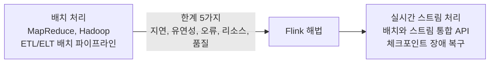

**결론:** 배치 처리의 5가지 한계(지연 시간(latency) 등)를 스트림 처리 엔진(stream processing engine)으로 풀려고 나온 것이 Flink다.

---

## 2. 배치 처리 vs 스트림 처리

- **배치 처리(Batch Processing) — 데이터가 모두 준비된 뒤 한 번에 전체를 처리하는 방식.**
  - 예시: 24시간 판매 데이터를 모은 뒤, 자정에 집계 작업을 한 번 실행해서 요약 리포트를 만든다.
- **스트림 처리(Stream Processing) — 이벤트가 발생하는 즉시 하나씩 실시간으로 처리하는 방식.**
  - 예시: 판매가 일어나는 순간 바로 처리하고, 대시보드가 실시간으로 갱신된다.
- 이벤트(event) — 시스템에서 일어난 한 건의 사건. 주문, 클릭, 센서값 등.

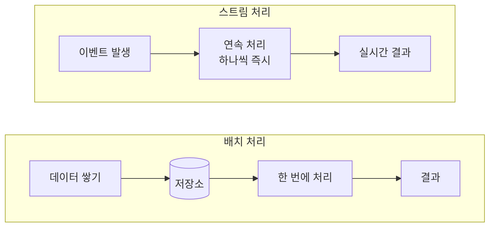

**결론:** 배치는 대규모 일괄 처리에, 스트림은 저지연(low-latency) 처리에 맞는다.

---

## 3. Flink의 특징

- **분산 스트림 처리 엔진.**
  - 분산(distributed) — 여러 대의 서버(클러스터, cluster)가 일을 나눠서 하는 것.
  - 클러스터 환경에서 분산 방식으로 데이터를 처리한다.
  - 데이터 흐름을 스트림(stream) 형태로 다루고, 각 데이터를 이벤트 단위로 계속 처리한다.
  - 병렬성(parallelism, 동시에 여러 갈래로 처리)과 확장성(scalability, 서버를 늘려 처리량을 키우는 성질)이 뛰어나서 대규모 데이터에 맞다.
- **무한한 스트림 데이터를 실시간으로 처리.**
  - 정해진 양만 처리하는 배치와 달리, 끝없이 흐르는 데이터를 실시간(real-time)으로 처리한다.
  - Kafka 등과 연동해서 데이터가 발생하는 즉시 처리하며 지연 시간이 매우 낮다.
  - Kafka — 이벤트를 받아 쌓아 두고 다른 시스템에 전달해 주는 메시지 플랫폼.

### Flink의 입력과 출력 (강의 그림)

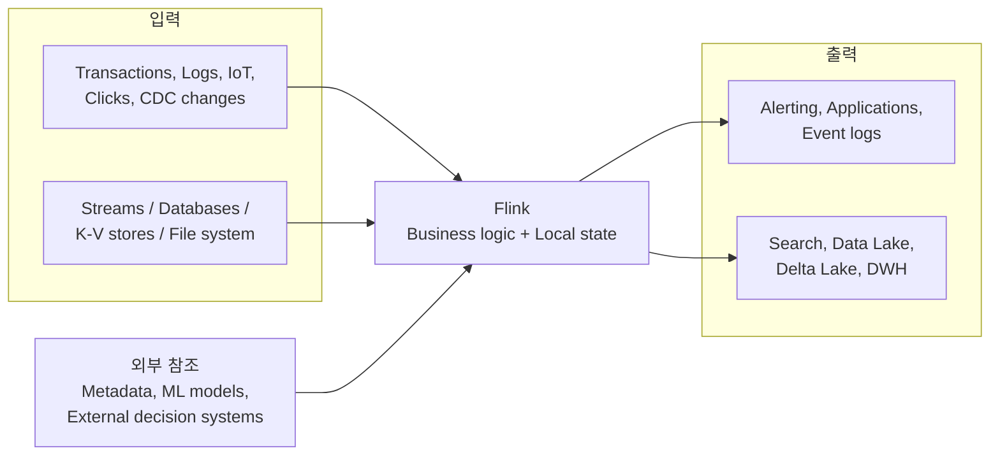

- Flink 안에는 비즈니스 로직(Business logic, 업무 규칙을 담은 처리 코드)과 로컬 상태(Local state, 처리 중 기억해 두는 값)가 있다.
- 데이터 보강(data enrichment)이나 외부 추론 엔드포인트(external inference endpoint) 같은 외부 시스템도 참조한다.

**결론:** Flink는 stateful 스트림 처리가 가능한 분산 스트림 프로세서(distributed stream processor)다.

---

## 4. 무한 스트림 vs 유한 스트림

- **무한 스트림(Unbounded Streams) — 시작점은 있지만 끝이 정해지지 않은 스트림.**
  - 데이터를 계속 실시간으로 처리해야 한다.
  - 데이터를 모두 모은 뒤에 처리하는 것은 불가능하다.
- **유한 스트림(Bounded Streams)** — (보충) 시작과 끝이 있는 구간의 스트림. 강의 본문은 정의 없이 "순서의 의미는 연산과 시간 설정에 따라 달라진다", "배치 처리라고도 부른다"만 적는다. 구간이라는 표현은 도표의 bounded 구간에서 읽은 것이다.
  - 유한 스트림에서 순서의 의미는 연산과 시간 설정에 따라 달라진다.
  - 이 유한 스트림 처리 방식을 배치 처리(Batch Processing)라고도 부른다.

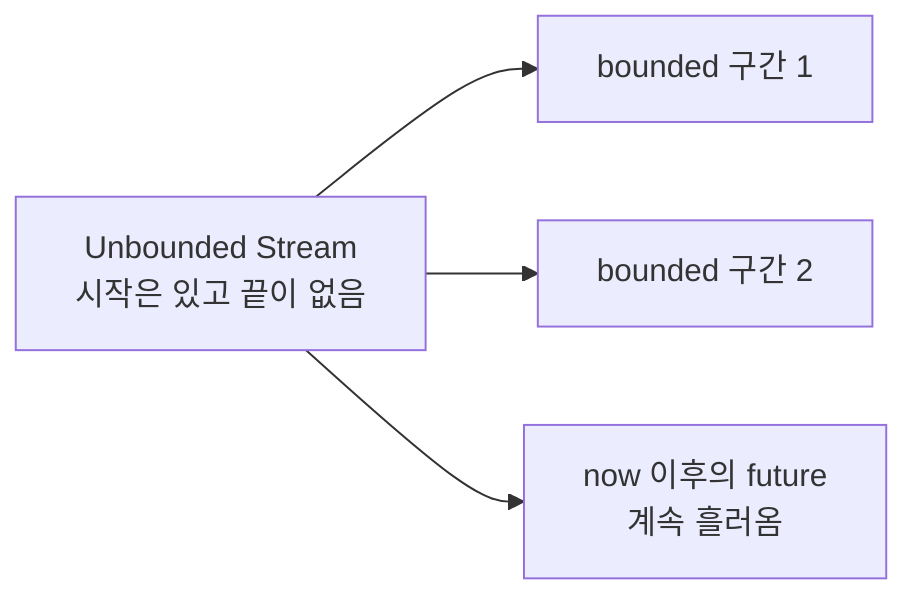

- 강의 그림은 하나의 긴 무한 스트림 안에서 일부 구간을 잘라 내면 그것이 유한 스트림이 되는 모습이다.

**결론:** 강의 표현으로 유한 스트림(bounded stream) 처리는 배치 처리라고도 부른다.

---

## 5. Flink를 활용한 스트리밍 데이터 파이프라인 구조

1. 데이터 소스에서 발생한 실시간 이벤트를 Kafka 같은 플랫폼을 통해 Flink로 전달한다.
2. Flink에서 필터링, 중복 제거, 유효성 검사, 데이터 결합, 집계를 한다.
3. 정제된 데이터를 최종 전달한다.
   - 분석 시스템(OLAP — 쌓인 데이터를 분석, 집계하는 용도의 DB)
   - 머신러닝 모델
   - 모니터링 시스템
   - OLTP(운영 DB, 실제 서비스 거래를 처리하는 DB)로 전송

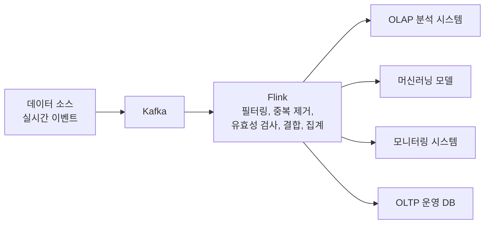

**결론:** Kafka → Flink → 분석(OLAP)·ML 모델·모니터링·운영 DB로 이어지는 스트리밍 ETL 파이프라인이다. 8쪽의 스트리밍 ETL 예시와 같은 형태다.

---

## 6. Flink 아키텍처: JobManager와 TaskManager

### 6-1. JobManager (마스터 노드)

- 작업 실행을 총괄하는 컨트롤 타워다.
- 마스터(master) 노드 — 일을 지시하고 관리하는 쪽.
- 구성 요소는 세 가지다.
  - **Resource Manager** — K8s, YARN 같은 환경에서 리소스(CPU, 메모리 등)를 협상해 할당받는다.
  - **Dispatcher** — Flink 애플리케이션을 제출하는 REST 인터페이스(HTTP로 요청을 받는 창구)를 제공한다.
  - **Job Master** — 하나의 JobGraph 실행을 관리한다.
- 강의 그림에는 JobManager 안에 Dataflow Graph, Scheduler, Checkpoint Coordinator가 보인다.
  - Scheduler — 태스크를 어디서 언제 돌릴지 배정하는 부분.
  - Checkpoint Coordinator — 체크포인트를 지휘하는 부분.

### 6-2. TaskManager (워커 노드)

- 실제 연산(Operator, 데이터에 map, filter 같은 일을 하는 단위)을 실행하는 워커(worker) 노드다.
- JVM 프로세스(자바 가상 머신 위에서 도는 하나의 프로그램)다.
- 각 TaskManager는 여러 개의 **Task Slot**을 가진다.
  - Slot은 논리적인 리소스 단위다. 한 칸의 작업 자리라고 보면 된다.
  - 하나의 Slot은 연산 파이프라인을 실행할 수 있다.
- 강의 그림에는 TaskManager마다 Memory & I/O Manager, Network Manager, Actor System이 있다.
- 두 TaskManager는 Data Streams로 서로 데이터를 주고받는다.
- TaskManager는 JobManager에 Task Status, Heartbeats, Statistics를 보낸다.
  - 하트비트(heartbeat) — "나 살아 있다"를 주기적으로 알리는 신호.
- JobManager는 TaskManager에 Deploy/Stop/Cancel Tasks와 Trigger Checkpoints를 지시한다.

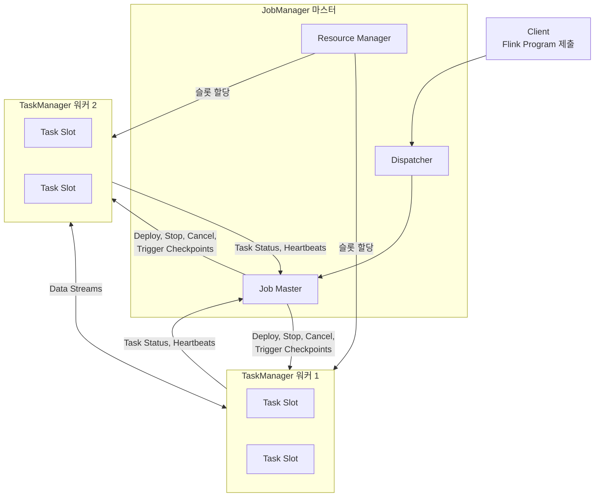

**결론:** 마스터-워커(master-worker) 구조다. JobManager는 지시와 조율을, TaskManager는 실제 연산을 맡는다.

- (보충) 업계 용어로는 JobManager가 control plane(제어부, 지시·스케줄링·조율을 맡는 쪽), TaskManager가 data plane(데이터부, 실제 데이터를 처리하는 쪽)이다. 이 용어는 강의에 없고 위 역할 구분을 옮긴 것이다.

---

## 7. Flink 실행 흐름

1. **Program (프로그램 작성)** — 클라이언트가 실행하려고 제출하는, 사용자가 개발한 애플리케이션 프로그램.
2. **Parse and Optimize (파싱 및 최적화)** — 코드를 파싱(parsing, 코드를 읽어 구조를 분석)해서 문법 오류를 확인한다. 타입 추출(Type Extractor)과 최적화도 한다.
3. **DataFlow Graph (데이터 플로우 그래프 변환)** — 애플리케이션 작업을 데이터 플로우 그래프로 바꿔서 실행 단계에서 쓸 수 있게 준비한다.
4. **Job Manager 처리** — JobManager가 태스크를 스케줄링하고, TaskManager에게 실행을 맡기고, 중간 처리 결과를 모니터링한다.
5. **Task Manager 처리** — TaskManager가 JobManager가 할당한 작업을 실제로 실행한다.

### 시퀀스 흐름 (강의 그림)

- 개발자가 CLI 등으로 Flink 애플리케이션을 제출한다. 한 Task Slot에서 여러 연산자(Source, map 등)를 실행할 수 있다.
- JobManager가 JobGraph를 Task Execution Graph로 변환하고 병렬화한다.
- Resource Manager가 Task Slot을 할당한다.
- TaskManager가 Task Slot에서 병렬로 데이터 스트림 처리를 수행한다.

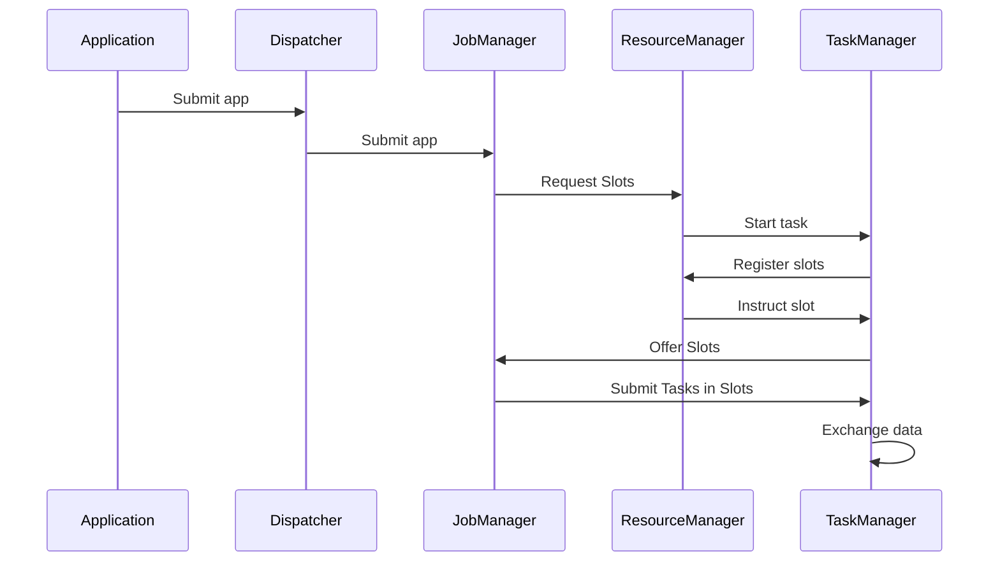

**결론:** 코드가 DAG(dataflow graph)로 변환된 뒤, 슬롯(slot) 단위로 스케줄링되어 분산 실행된다.

- DAG(Directed Acyclic Graph) — 방향이 있고 순환하지 않는 연결도. 작업 순서를 그린 지도.

---

## 8. 슬롯 공유(Slot Sharing)와 병렬도

### 8-1. 슬롯 공유

- 각 슬롯에 메모리가 할당된다. Task는 TaskManager 안의 Task Slot에서 병렬로 실행된다.
- 하나의 Task Slot에서 여러 연산자(source, map 등)를 실행할 수 있다.
  - 즉 여러 Subtask(하나의 연산이 병렬로 쪼개진 조각)가 한 Slot에서 실행될 수 있다.
- **Slot은 반드시 하나의 Subtask만 실행하는 것이 아니다.** Operator 체인(연결된 연산자 묶음) 단위로 공유할 수 있다.
- 강의 그림에서 TaskManager는 프로세스(Processes)이고, 슬롯 안의 작업은 스레드(Threads)다.

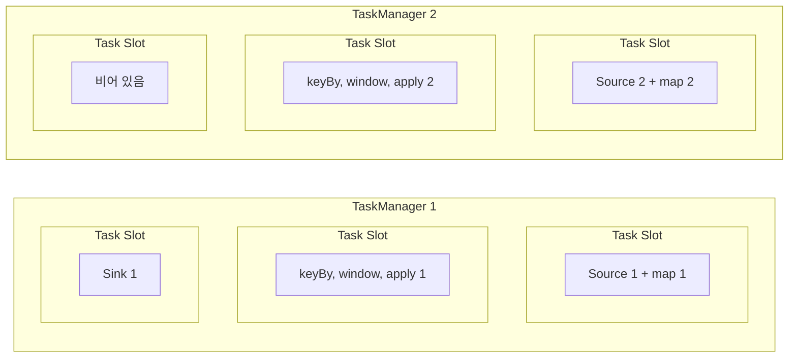

### 8-2. TaskManager 개수

- Flink Job이 TaskManager 개수를 직접 지정하지 않는다.
  1. Job에서 병렬도(Parallelism)를 정한다. (예: 100)
  2. Flink가 필요한 Slot 개수를 계산한다.
  3. Resource Manager가 TaskManager를 몇 개 띄울지 결정한다.
  4. Subtask를 Slot에 매핑한다.
- 병렬도(Parallelism) — 하나의 연산을 몇 갈래로 쪼개 동시에 돌리느냐.
- 강의 그림(Source/map Subtask가 [1]~[6]인 구성)에서는 TaskManager 2개, Slot 3개씩에 Subtask가 나뉘어 들어간다.

**결론:** 병렬도(parallelism)와 TaskManager 수는 별개 개념이고, 슬롯이 리소스 할당 단위(unit of resource allocation)다.

---

## 9. Flink 사용 이유

- **진짜 저지연 스트리밍(True Streaming, Not Micro-batching).**
  - 마이크로 배치(micro-batching) — 아주 짧은 배치를 반복해서 실시간처럼 보이게 하는 방식.
  - Flink는 마이크로 배치가 아니라 실시간 단위 처리를 지원한다.
  - 이벤트가 들어오는 즉시 처리하므로 지연(latency)이 매우 낮다.
- **체크포인트 기반 상태 복구.**
  - Flink 내부 상태는 exactly-once로 복구할 수 있다.
  - exactly-once — 장애 후에도 각 데이터가 정확히 한 번만 반영되는 보장.
  - 외부 출력은 source와 sink의 보장 및 설정에 따라 달라진다.
- **다양한 시스템과 쉬운 통합.** Kafka, S3, JDBC, Elasticsearch 등이 있다. 강의 그림에는 RabbitMQ, Pulsar, Cassandra, NiFi, DynamoDB, Kinesis, Hadoop도 보인다.
- **다양한 API와 언어.**
  - **SQL / Table API** — Bounded와 Unbounded Streams 모두에 쓰는 선언적 고수준 API. 무엇을 원하는지만 적는 방식이다.
  - **DataStream API** — 유한, 무한 스트림에서 레코드 처리와 상태, 시간 로직을 직접 구성하는 API.
  - **Bounded Streams** — DataStream API 또는 Table API/SQL로 처리한다. DataSet API는 Flink 2에서 제거됐다.
  - **CEP(Complex Event Processing)** — 복잡한 이벤트 패턴 탐지.
  - **Java, Python** 언어를 지원한다.

### 사례: Netflix

- 데이터를 빠르게 처리하고 분석하려고 Flink로 스트림 데이터를 실시간 처리한다.
- 처리 중 장애에 대비해 체크포인팅(checkpointing)과 백프레셔(backpressure) 같은 관리 기능을 쓴다.
  - (보충) 백프레셔 — 뒤 단계가 못 따라가면 앞 단계의 속도를 늦춰서 터지는 것을 막는 장치. 강의는 이름만 언급한다.
- 강의 그림 하단에 Kafka와 Flink 로고가 함께 표시된다. 그림의 흐름은 통합 로깅(Consolidated Logging)이다. 수집, 변환, 이벤트 추출, 보강을 거쳐 Kafka, Elasticsearch, Tableau, Hive로 나간다.

**결론:** Flink를 쓰는 이유는 true streaming(실시간 이벤트 단위 처리), checkpoint 기반 fault tolerance, 배치와 스트림을 아우르는 unified API다.

---

## 10. Flink 코드 구조

Flink 스트리밍 작업(Job)의 기본 실행 구조는 다섯 단계다.

1. **실행 환경 생성(StreamExecutionEnvironment)** — Flink 작업을 구성하고 실행하는 중심 객체. 데이터 소스, 변환, 싱크 등을 만드는 메서드를 제공한다.
2. **데이터 소스(Source) 정의** — 외부 데이터를 PyFlink 안으로 불러오는 역할. (파일, 소켓, 컬렉션 등)
3. **데이터 변환(Transformation) 적용** — 입력 데이터를 원하는 형태로 가공. (매핑, 필터링, 집계 등)
4. **데이터 싱크(Sink) 설정** — 처리된 데이터를 외부 시스템으로 내보내기. (콘솔, 파일, 데이터베이스 등)
5. **작업 실행 `env.execute()`** — 지금까지 구성한 소스, 변환, 싱크를 기반으로 실행.

```python
from pyflink.datastream import StreamExecutionEnvironment

env = StreamExecutionEnvironment.get_execution_environment()
data_stream = env.from_collection([1, 2, 3, 4, 5])
transformed_stream = data_stream.map(lambda x: x * 2)
transformed_stream.print()
env.execute("Simple Flink Job")
```

- PyFlink — Python으로 Flink 작업을 쓰는 API.
- `from_collection()`은 로컬 컬렉션을 쓴다. Kafka 같은 외부 source connector 설정이 필요 없고, 정해진 개수의 데이터를 쓴다.
- 커넥터(connector) — Flink와 외부 시스템을 이어 주는 부품.
- 소스(Source) — 데이터가 들어오는 입구. 싱크(Sink) — 결과가 나가는 출구.

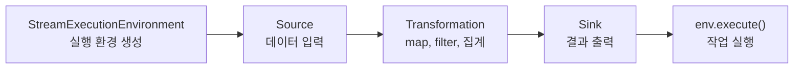

**결론:** Flink 스트리밍 잡의 기본 구조는 source → transformation → sink 형태의 dataflow 프로그램이다. 구성한 작업은 execute()로 실행한다.

---

## 11. 예제로 보는 실행 모델

### 11-1. 병렬 실행과 출력 순서

- 위 예제의 기대 결과는 2, 4, 6, 8, 10이다.
- 설정한 병렬도에 따라 연산이 여러 Subtask로 나뉘어 실행될 수 있다.
- 하나의 TaskManager에서도 여러 Subtask를 병렬로 실행할 수 있다. TaskManager 수와 병렬도는 별개 개념이다.
- 병렬도와 데이터 분배 방식에 따라 콘솔 출력 순서가 달라질 수 있다. 순서대로 출력되어도 정상이다.
- 출력 형식은 `<병렬 태스크 ID>> <출력값>`이다. 예: `4> 6`, `5> 8`, `2> 2`.

### 11-2. DAG 예시: key_by + sum

- (apple,1), (banana,1), (apple,1)을 입력으로 `key_by` 후 `sum`을 한다. 병렬도는 `set_parallelism(1)`로 정한다.
- `get_execution_plan()`으로 DAG 실행 계획을 JSON으로 볼 수 있다.
- 강의의 DAG 해석:
  - DAG는 Source → KeyBy → Sum, 연산 3개다.
  - Node 1: `from_collection()` 데이터 source.
  - Node 2: `key_by(lambda x: x[0])`, 키 기준 분할. 입력은 Node 1이고 ship_strategy는 FORWARD(로컬 전달)다.
  - Node 3: `sum(1)` 집계 연산. 입력은 Node 2이고 ship_strategy는 HASH(키 기준 분산)다.
- 키별 누적 출력 예: (apple, 2), (banana, 1). 중간 출력 (apple, 1)도 포함된다.
  - 키(key) — 같은 값끼리 묶는 기준. HASH는 강의에서 "키 기준 분산"이라고 설명한다.
  - 강의는 중간 출력 (apple, 1)도 포함된다고만 적는다.

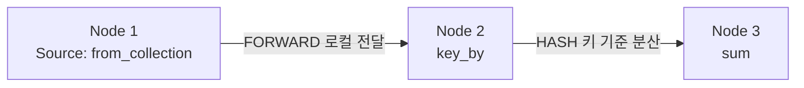

### 11-3. execute vs execute_and_collect

- `execute()` — 구성한 Flink Job을 실행하고, 결과는 연결된 Sink를 통해 출력하거나 저장한다.
- `execute_and_collect()` — Job을 실행하고, 처리 결과를 Python 클라이언트로 가져와 직접 확인한다.
- 강의는 Job 제출을 외부에서 하므로, 실행한 쉘에서 결과를 보려고 `execute_and_collect`를 주로 쓴다.

### 11-4. 로컬 실행과 클러스터 실행

- 로컬 테스트는 MiniCluster(Flink 내장 소형 실행기)가 자동 실행되어, 별도 JobManager와 TaskManager가 필요 없다.
- 클러스터 없이도 기본적인 코드 작업은 실행된다.
- 작성한 파일은 일반 Python 명령어로도 실행할 수 있다. 이때는 기본적으로 로컬 실행 환경을 쓴다.
- 안정적으로 운영하려면 클러스터에 제출하는 것이 좋다.

| 항목                    | `python example.py`                | `flink run -py example.py`     |
| ----------------------- | ---------------------------------- | ------------------------------ |
| 실행 방식               | Python 인터프리터로 직접 실행      | Flink CLI를 통해 실행          |
| 클러스터 연결           | 기본적으로 로컬 MiniCluster 사용 가능 | 기본적으로 설정된 Flink 클러스터에 제출 |
| JobManager / TaskManager | 로컬 MiniCluster 사용 시 내부적으로 실행 | 기존 Flink 클러스터의 구성 요소 사용 |
| 실행 결과 확인          | 터미널 및 실행 환경의 로그         | Flink Web UI 및 클러스터 로그  |
| 주요 사용 목적          | 로컬 개발 및 간단한 테스트         | 클러스터 기반 실습 및 작업 제출 |

강의 표의 "실행 환경", "사전 준비" 행은 세팅 내용이라 뺐다.

**결론:** 로컬은 개발과 테스트용 MiniCluster, 운영은 클러스터 제출(job submission)이다.

---

다음 편: 2편 DataStream API


---

# Flink DataStream API 요약 (2/3)

용어 풀이는 이해를 돕는 일반 설명이다. 강의가 직접 정의한 것이 아닐 수 있다. 강의 근거가 아닌 서술은 (보충)으로 따로 표시했다.

## 1편 복습

- Flink는 끝없이 들어오는 데이터를 실시간으로 처리하는 엔진이다. (1편 내용)
- 작업(Job)은 JobManager가 관리하고, TaskManager가 실제로 일을 한다. (1편 내용, 이 PDF 범위 밖)
- 이 편은 그 위에서 "코드로 스트림을 어떻게 만들고 바꾸는가"를 다룬다.

---

## 1. DataStream API 개요

### 1-1. 배치 vs 스트리밍

- 배치 분석(batch analytics) — 쌓아 둔 데이터를 정해진 시간에 한꺼번에 읽어 결과(리포트)를 만드는 방식.
- 스트리밍 분석(streaming analytics) — 들어오는 이벤트를 쉬지 않고 처리하고, 중간 기억(State)을 두고 결과를 계속 갱신하는 방식.

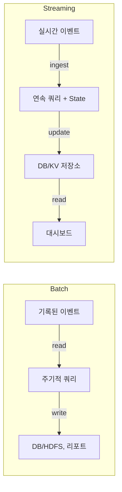

### 1-2. DataStream이란

- DataStream — 유한하거나 무한한 데이터의 흐름을 표현하는 추상화된 객체. 여기에 변환(transformation)을 걸 수 있는 기본 단위.
- 변환을 적용하면 새로운 스트림이 생긴다.
- 입력 예: 주문, 클릭, 센서 값, 채팅 메시지.
- 처리 예: 필터링(필요한 것만) → 변환(형태 바꾸기) → 집계(묶기, 개수 세기).
- 출력 예: 실시간 대시보드, 알림, 데이터 저장.

### 1-3. DataStream API의 위치

- Table API보다 낮은 추상화 수준이다. 레코드 처리, 상태, 시간 로직을 직접 짠다.
- 활용 예: 이벤트 가공, 키별 누적 집계, 사용자 정의 상태 처리.
- 프로그램 뼈대는 Source → Transformation → Sink다.


- `execute()` 또는 `execute_and_collect()`를 호출해야 Job이 제출되고 처리가 시작된다.

### 1-4. DAG: 논리 모델

- DAG(Directed Acyclic Graph) — 방향은 있지만 되돌아오는 순환은 없는 그래프.
- 노드는 연산자(operator), 간선은 데이터 흐름이다.
- Source에서 Sink까지 연산자 연결 구조를 나타낸다.
- DAG는 "논리적인 처리 흐름"일 뿐이다. 실제 실행 모양은 병렬도와 배치 방식에 따라 달라진다.

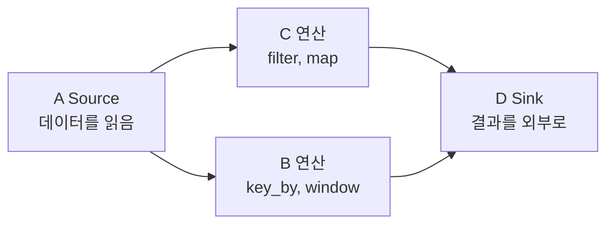

### 1-5. 물리 실행 구조

- 병렬도(Parallelism) — 연산 하나를 몇 개의 subtask로 쪼개 돌릴지 정하는 숫자.
- 서브태스크(Subtask) — 연산자의 병렬 실행 인스턴스 하나.
- 태스크 슬롯(Task Slot) — subtask를 돌리려고 TaskManager가 내주는 자원 단위.
- 태스크매니저(TaskManager) — 실제로 subtask를 실행하는 프로세스.

| 연산자 | 병렬도 | 생성된 Subtask |
|---|---|---|
| A (Source) | 2 | A1, A2 |
| B (연산) | 1 | B1 |
| C (연산) | 2 | C1, C2 |
| D (Sink) | 1 | D1 |

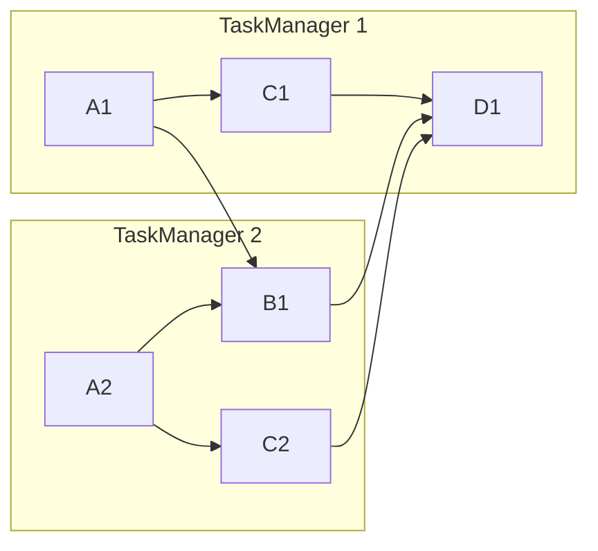

결론: DataStream 프로그램은 논리 모델(Logical model, 업계 용어로 logical plan)로 그려지고, 병렬도에 따라 물리 모델(Physical model, physical plan)로 펼쳐진다.

---

## 2. 데이터 소스(Source)

- 커넥터(Connector) — Flink와 외부 시스템을 이어 주는 부품.
- 소스별 연동에는 알맞은 Connector가 필요하다. Flink 버전과 호환되는지 확인해야 한다.

| 종류 | 읽는 곳 | 쓰임 |
|---|---|---|
| 파일 시스템 | 로컬 파일, HDFS, Amazon S3 (CSV, JSON, Parquet) | 배치, 파일 기반 스트리밍 처리 |
| 이벤트 스트리밍·메시징 | Apache Kafka, Amazon Kinesis | 실시간 로그 분석, 사용자 행동 분석, 이벤트 기반 처리 |
| 데이터베이스·CDC | MySQL, PostgreSQL 등 관계형 DB | 읽기, 또는 변경 사항을 스트림으로 수신. 실시간 동기화·분석 |
| 사용자 정의 소스 | 제공 Connector로 안 되는 외부 시스템 | Flink Source API로 수집 방식을 직접 구현 |

- CDC(Change Data Capture) — DB에서 일어난 변경(추가·수정·삭제)을 이벤트로 받아 오는 것.

### 소스 구성 방식

- `StreamExecutionEnvironment`에서 입력과 실행 환경을 정의한다.
- 파일은 `FileSource`, Kafka는 `KafkaSource` 또는 SQL 커넥터로 연결한다.

```python
env = StreamExecutionEnvironment.get_execution_environment()
env.set_parallelism(1)

source = FileSource.for_record_stream_format(
    StreamFormat.text_line_format(), str(input_path)
).build()

stream = env.from_source(source, WatermarkStrategy.no_watermarks(), "text-file")

with stream.execute_and_collect("FileSource Example") as results:
    for value in results:
        print(value, flush=True)
```

- `text_line_format()` — 텍스트를 한 줄씩 레코드로 읽는다.
- `from_source(...)` — 만든 소스를 스트림에 연결한다.
- `WatermarkStrategy.no_watermarks()` — 이 예제는 시간 기준 없이 읽는 설정이다 (보충).
- `env.from_collection(...)` — 이후 연산자 예제에서 쓰는, 리스트로 스트림을 만드는 방법이다.

결론: 소스는 외부 시스템 종류만큼 커넥터(connector)가 갈리고, DataStream 코드의 입구는 `StreamExecutionEnvironment`다.

---

## 3. 데이터 싱크(Sink)

- 싱크(Sink) — 처리한 스트림을 밖으로 내보내거나 저장하는 마지막 단계.
- 데이터 흐름은 `데이터 소스 → 연산(변환) → Sink`다.
- 소스는 입력을 정의하고, 연산은 가공하고, 싱크는 출력·저장한다.

| 종류 | 보내는 곳 | 쓰임 |
|---|---|---|
| 파일 시스템 | 로컬 파일, HDFS, S3 (CSV, JSON, Parquet) | 후속 분석, 보관 |
| 이벤트 스트리밍·메시징 | Apache Kafka | 다른 애플리케이션·파이프라인이 결과를 실시간 활용 |
| 데이터베이스 | MySQL, PostgreSQL, Elasticsearch | 실시간 집계 결과 조회, 검색, 대시보드, 서비스 데이터 갱신 |
| 사용자 정의 | 기본 Connector가 없는 외부 시스템 | Flink Sink API로 출력 방식을 직접 구현 |

### 대표 Sink

| Sink | 설명 |
|---|---|
| `print()` | 학습용 출력. 클러스터에서는 TaskManager 로그에서 확인 |
| `FileSink` | 인코더·포맷 설정에 따라 파일로 저장 |
| `KafkaSink` | 데이터를 Kafka에 저장 |
| `JDBC Sink` | JDBC로 DB(MySQL, PostgreSQL 등)에 저장 |
| `ElasticsearchSink` | 데이터를 Elasticsearch에 저장 |

- Sink 연동에도 알맞은 Connector가 필요하고, Flink 버전 호환을 확인해야 한다.

결론: 싱크(sink)는 출력 대상별 커넥터를 고르는 문제이고, 결과가 외부로 나가는 지점이 곧 파이프라인의 종단이다.

---

## 4. 데이터 변환 및 연산

### 4-1. 변환의 큰 그림

- 데이터 변환 — 입력 레코드를 다음 처리에 맞게 가공하는 단계.
- 크게 `map`(1:1 변환), `flat_map`(펼치기), `filter`(조건 선별)로 나눈다.
- 집계, 조인, 윈도우 같은 후속 처리를 위한 전처리 역할도 한다.
- 변환 함수는 병렬 처리에 최적화돼 있다. subtask로 일을 나눈다.
- 장애 복구는 체크포인트 같은 별도 설정이 필요하다 (3편 범위).

### 4-2. 지연 평가(Lazy Evaluation)

- 지연 평가(lazy evaluation) — 코드를 쓰는 순간 실행하지 않고, 실행 계획만 쌓아 두었다가 나중에 한 번에 돌리는 방식.
- 연산 계획 수립: `map`, `filter`, `flat_map`은 레코드를 즉시 처리하지 않는다. 실행할 그래프를 만든다.
- 최적화 기회: 전체 흐름을 본 뒤 병렬 실행과 데이터 전달 방식을 정한다. 가능한 연산은 체이닝해 태스크 간 데이터 전달 비용을 줄인다.
- 체이닝(chaining) — 붙어 있는 연산자를 한 태스크로 묶어 전달 비용을 줄이는 것.
- 실행 트리거: Sink를 연결하는 것만으로는 실행되지 않는다. `execute()` 또는 `execute_and_collect()`가 Job을 제출해야 한다.

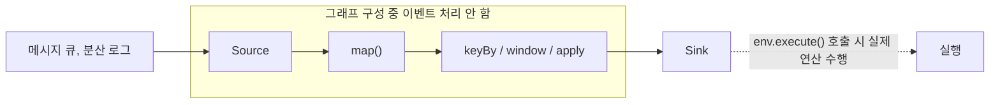

결론: Flink는 지연 평가(lazy evaluation)로 실행 계획을 먼저 세우고, `execute()`가 실행 트리거다.

### 4-3. 타입 정보

- 일부 연산자 예제(map, flat_map, process, connect 등)는 결과 타입(output_type)을 코드에 적는다. filter, reduce, union 예제에는 없다. 강의에서 보인 것은 다음과 같다.
- `type_info=Types.INT()` — 입력 컬렉션의 요소 타입.
- `output_type=Types.INT()` — 연산 결과 스트림의 타입.
- `Types.STRING()`, `Types.FLOAT()`, `Types.BOOLEAN()` — 기본 타입.
- `Types.TUPLE([Types.STRING(), Types.INT()])` — 튜플(여러 값을 묶음) 타입. `(사용자, 값)` 같은 레코드에 쓴다.
- 별도 슬라이드는 없고, 이 외 타입 체계는 강의에서 다루지 않는다.

### 4-4. 기본 변환 함수

| 함수 | 역할 | 입력 → 출력 (요약이 합성한 열) | 용도 |
|---|---|---|---|
| `map` | 각 입력 요소를 1:1로 변환 | 1개 → 1개 | 포맷 변경, 필드 추출, 단순 계산 |
| `flat_map` | 입력 요소 하나에서 0개 이상 출력 생성 | 1개 → 0~N개 | 복합 데이터 분해, 조건에 따라 다수 결과 생성 |
| `filter` | 입력 요소를 조건에 따라 선별 | N개 → 조건 만족분 | 노이즈 제거, 유효 데이터 필터링 |

#### map

```python
ds = env.from_collection(collection=[1, 2, 3, 4], type_info=Types.INT())
mapped_stream = ds.map(lambda x: x * 2, output_type=Types.INT())
```

- 결과: `[2, 4, 6, 8]`

#### flat_map

```python
ds = env.from_collection(collection=["hello", "hi"], type_info=Types.STRING())

def split_string(s):
    for ch in s:
        yield ch

flat_mapped_stream = ds.flat_map(split_string, output_type=Types.STRING())
```

- `yield`로 값을 여러 개 내보낸다.
- 결과: `['h', 'e', 'l', 'l', 'o', 'h', 'i']`

#### filter

```python
ds = env.from_collection(collection=[1, 2, 3, 4, 5, 6], type_info=Types.INT())
filtered_stream = ds.filter(lambda x: x % 2 == 0)
```

- 결과: `[2, 4, 6]`

결론: 강의는 `map`, `flat_map`, `filter`를 상태 없는(stateless) 변환의 예로 든다. 출력 개수만 다르다(1:1, 0개 이상, 조건 만족분).

### 4-5. 그룹화 및 집계 함수

| 함수 | 역할 | 용도 |
|---|---|---|
| `key_by` | 같은 키를 같은 연산 subtask로 전달 | 그룹별 집계, 상태 저장, 윈도우 연산의 사전 준비 |
| `reduce` | 키별 누적값을 갱신하여 출력 | 합계, 최대/최소 같은 간단한 집계 |
| `process` | 각 이벤트에 대한 로직을 커스텀 처리 | 키별 상태·타이머는 `KeyedProcessFunction` 사용 |

#### key_by

- 파티셔닝(partitioning) — 데이터를 키 기준으로 나눠 각 subtask에 배분하는 것.
- 같은 키는 같은 subtask로 전달된다.

```python
data = [("A", 1), ("B", 2), ("A", 3), ("B", 4)]
ds = env.from_collection(data, type_info=Types.TUPLE([Types.STRING(), Types.INT()]))
keyed_stream = ds.key_by(lambda x: x[0])
```

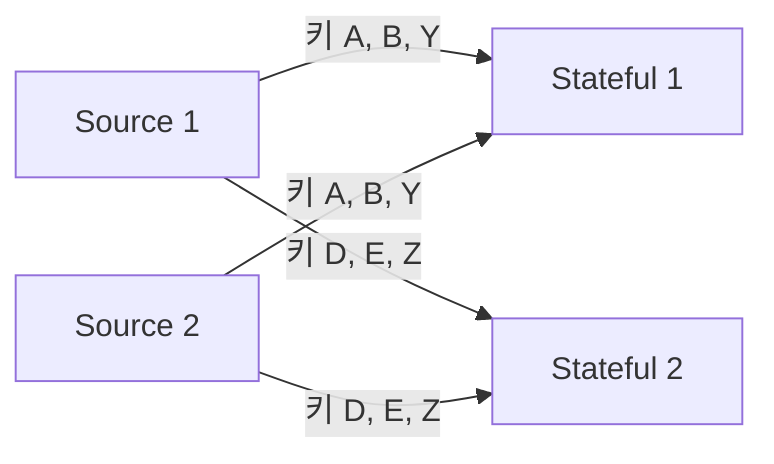

- 그림처럼 어느 Source에서 왔든 같은 키는 같은 Stateful subtask로 재분배(redistribution)된다.

#### reduce

- 키별로 직전 누적값(a)과 새 값(b)을 합쳐 새 누적값을 낸다.

```python
summed_stream = keyed_stream.reduce(lambda a, b: (a[0], a[1] + b[1]))
```

- 입력 `("A",1) ("B",2) ("A",3) ("B",4)` → 출력 `(A,1) (B,2) (A,4) (B,6)`
- 입력이 들어올 때마다 갱신된 누적값이 하나씩 나온다.

#### process

- 이벤트마다 원하는 로직을 직접 짠다. `ProcessFunction`을 상속하고 `process_element`를 구현한다.

```python
class MyProcessFunction(ProcessFunction):
    def process_element(self, value, ctx):
        if value % 2 == 0:
            yield value * 2
        else:
            yield value

processed_stream = ds.process(MyProcessFunction(), output_type=Types.INT())
```

- 입력 `[1, 2, 3, 4, 5, 6]` → 출력 `[1, 4, 3, 8, 5, 12]`
- 키별 상태·타이머가 필요하면 `KeyedProcessFunction`을 쓴다. 5절에서 이어진다.

결론: `key_by`는 키 기반 파티셔닝(keyed partitioning)이고, 이 위에서 `reduce`는 키별 누적값 갱신(업계 용어로 증분 집계, incremental aggregation), `process`는 이벤트별 커스텀 로직(업계 용어로 저수준 처리, low-level processing)을 맡는다.

### 4-6. 멀티 스트림 및 결합 함수

| 함수 | 역할 | 용도/설명 |
|---|---|---|
| `union` | 같은 타입의 여러 스트림을 병합 | 모든 입력을 전달. 전체 순서·중복 제거는 보장하지 않음 |
| `connect` | 서로 다른 타입의 두 스트림을 연결 | 입력별 함수를 적용. 자동으로 JOIN하는 것은 아님 |

#### union

```python
stream1 = env.from_collection([1, 2, 3], type_info=Types.INT())
stream2 = env.from_collection([4, 5, 6], type_info=Types.INT())
union_stream = stream1.union(stream2)
```

- 결과: 1~6 (순서는 보장되지 않는다).

#### connect

- 두 스트림의 타입이 달라도 묶을 수 있다. 입력별로 다른 함수(`map1`, `map2`)를 둔다.

```python
stream_str = env.from_collection(["A", "B"], type_info=Types.STRING())
stream_int = env.from_collection([1, 2], type_info=Types.INT())
connected_stream = stream_str.connect(stream_int)

class MyCoMapFunction(CoMapFunction):
    def map1(self, value):
        return f"String: {value}"

    def map2(self, value):
        return f"Int: {value}"

co_mapped_stream = connected_stream.map(MyCoMapFunction(), output_type=Types.STRING())
```

- 결과 예: `'String: A', 'Int: 1', 'String: B', 'Int: 2'`

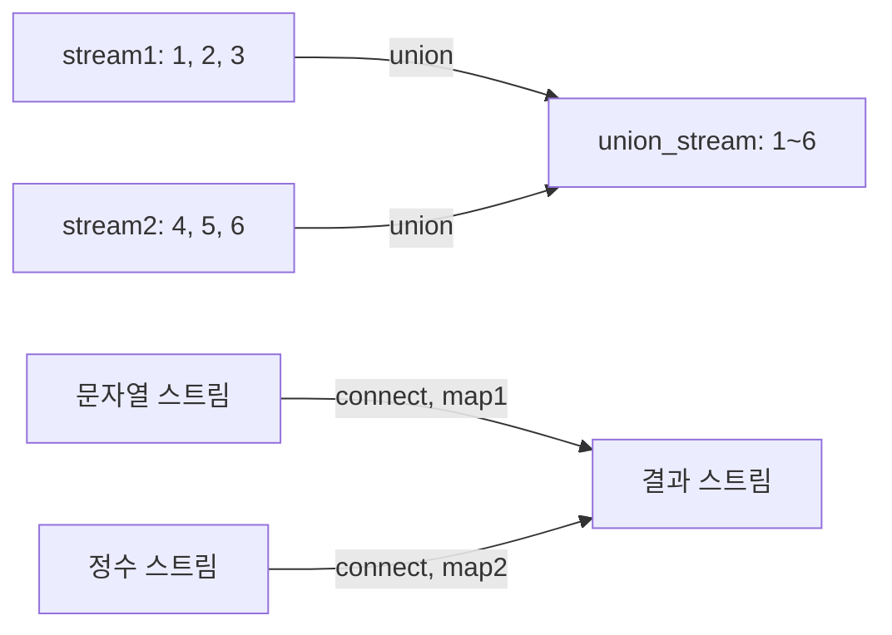

결론: `union`은 동종 스트림 병합(merge)이고, `connect`는 다른 타입 두 스트림 연결 후 입력별 함수 적용(업계 용어로 공동 처리, co-processing)이다. `connect`는 조인(join)이 아니다.

### 4-7. 데이터 스트림 분할

- 하나의 스트림을 조건이나 처리 목적에 따라 여러 하위 스트림으로 나누는 작업이다.
- 하위 스트림마다 서로 다른 처리 로직이나 파이프라인을 적용할 수 있다.
- 한 레코드가 여러 조건을 만족하면 여러 갈래에 출력될 수 있다.
- 방법은 두 가지다. Filter 방식, Side Output 방식.
- 사이드 아웃풋(Side Output) — `OutputTag`로 이름표를 붙여 본 흐름 옆으로 따로 빼는 출력 방식. 강의는 정의만 소개하고 코드는 없다.

#### Filter 방식: 짝수/홀수 분리

```python
data = env.from_collection([1, 2, 3, 4, 5, 6], type_info=Types.INT())
even_stream = data.filter(lambda x: x % 2 == 0)
odd_stream = data.filter(lambda x: x % 2 != 0)
```

- 결과: 짝수 `[2, 4, 6]`, 홀수 `[1, 3, 5]`

#### Filter 방식: 택배 물류 분기 예제

- 입력은 `(무게, 주소, 냉장 여부)` 튜플이다.
- 조건별로 filter를 걸고, 라벨을 `map`으로 붙인 뒤, `union`으로 다시 합친다.

```python
heavy = ds.filter(lambda x: x[0] > 20)
remote = ds.filter(lambda x: "산간" in x[1])
cold = ds.filter(lambda x: x[2])
normal = ds.filter(lambda x: not (x[0] > 20 or "산간" in x[1] or x[2]))

heavy_output = heavy.map(lambda x: f"[무거운 택배] {x}", output_type=Types.STRING())
remote_output = remote.map(lambda x: f"[산간 택배] {x}", output_type=Types.STRING())
cold_output = cold.map(lambda x: f"[냉장 택배] {x}", output_type=Types.STRING())
normal_output = normal.map(lambda x: f"[일반 택배] {x}", output_type=Types.STRING())

result_stream = heavy_output.union(remote_output, cold_output, normal_output)
```

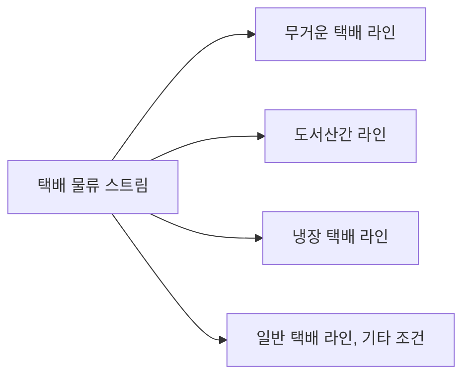

- 결과: 강남구 25 → 무거운, 강원도 산간 15 → 산간, 부산 해운대 냉장 → 냉장, 서울 관악구 5 → 일반.
- `normal`은 앞 세 조건의 부정이어서 어디에도 안 걸린 레코드만 남는다.

결론: 강의의 스트림 분할은 업계 용어로 스트림 분기(stream branching)이고, 같은 소스에 filter를 여러 개 거는 팬아웃(fan-out) 구조다. 합칠 때는 `union`을 쓴다.

### 4-8. 연산자 한눈 비교 (보충·정리: 강의 표가 아니라 요약이 합성함)

| 연산자 | 상태 필요 | 입력 → 출력 모양 | 대표 쓰임 |
|---|---|---|---|
| `map` | 없음 | 1 → 1 | 포맷 변경, 필드 추출 |
| `flat_map` | 없음 | 1 → 0~N | 분해 |
| `filter` | 없음 | N → 일부 | 노이즈 제거 |
| `key_by` | 이후 연산에서 사용 | 같은 키 → 같은 subtask | 그룹별 준비 |
| `reduce` | 키별 누적값 유지 | 키별 N → 누적값 갱신 출력 | 합계, 최대/최소 |
| `process` | 직접 구현(Keyed 시) | 이벤트별 로직 자유 (예제는 1개 출력) | 커스텀 처리 |
| `union` | 강의 언급 없음 | 같은 타입 여러 스트림 → 1개 | 병합 |
| `connect` | 강의 언급 없음 | 다른 타입 두 스트림 → 1개 | 입력별 함수 적용 |

---

## 5. State(상태)

### 5-1. State란

- 상태(State) — 여러 이벤트에 걸쳐 정보를 기억해 두는 것.
- Stateless 연산과 달리 이전 이벤트 정보를 기억한다.
- 주요 사용 사례: 윈도우 집계(windowed aggregates), 이벤트 순서 탐지, 사용자별 누적 클릭 수. 이전 합계·횟수 등 필요한 정보만 유지한다.
- 관리되는 상태는 체크포인트에 포함하면 장애 시 복원할 수 있다.

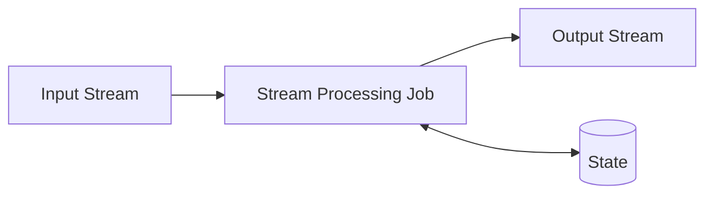

### 5-2. Stateless vs Stateful

| | Stateless | Stateful |
|---|---|---|
| 처리 방식 | 각 레코드를 독립 처리. 이전 입력을 기억하지 않음 | 이전에 처리한 데이터를 기반으로 결과 계산 |
| 특징 | 구조가 단순하고 확장이 쉬움 | 누적합·횟수·윈도우처럼 이전 정보가 필요하면 상태 유지 |
| 예시 | `map()`, `flat_map()`, `filter()` | `key_by()` + `sum()` / `reduce()` |
| 사용 사례 | 문자열 대문자 변환, null 제거 필드 분리 | 단어 개수 세기, 세션 윈도우, 이벤트 시퀀스 탐지 |

- Stateless 예제들은 과거 상태가 필요 없다. 다만 API 이름만으로 상태 유무를 단정하지는 않는다.
- Stateful은 내부 State를 유지한다. 체크포인트 등 복구 설정이 있어야 장애 시 상태를 복원할 수 있다.
- 상태 없이는 계산이 불가능한 경우에 쓴다.

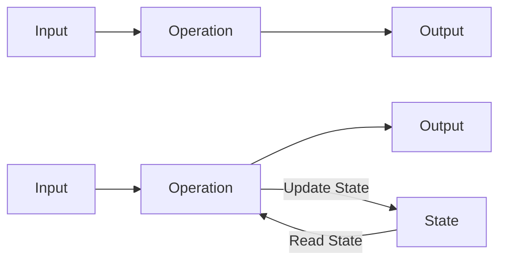

### 5-3. 상태와 데이터 저장

- 중간 결과나 정보를 State로 저장한다.
- 예: A의 이전 합계 100에 새 금액 50을 더해 A=150으로 갱신한다. B의 합계는 그대로 유지한다. 같은 연산 안에서도 키별 상태는 분리된다.
- 상태는 파이프라인 곳곳에 놓인다. 강의 그림은 Source Offsets, User State, Window State, Sink Offsets를 파이프라인 곳곳의 상태로 표시한다. (보충: offset은 읽은·쓴 위치를 뜻한다.)

```mermaid
flowchart LR
    A["Source<br/>Source Offsets"] -->|records| B["ProcessFn<br/>User State"]
    B -->|"transformed events"| C["Window<br/>Window State"]
    C -->|"aggregated results"| D["Sink<br/>Sink Offsets"]
```

### 5-4. 상태의 유형

- 키가 있는 상태(Keyed State) — 특정 키와 연결된 상태. 키마다 별도의 상태를 유지한다.
  - `key_by()` 이후의 함수에서 사용한다.
  - 하나의 subtask가 여러 키를 맡아도 각 키의 상태는 구분된다.
  - 예: 사용자 ID별 세션 정보 저장. 키별 집계·세션 분석에서는 `key_by`로 그룹을 먼저 지정한다.
- Operator State, Broadcast State도 존재한다. 강의는 이름만 언급한다.

### 5-5. 상태 관리가 중요한 이유

- 정확성 보장: 중간 결과를 저장해 처리 정확성을 유지한다.
- 장애 복구: 체크포인트는 자동 복구, 세이브포인트는 계획된 이전·재배포에 쓴다.
  - 체크포인트(checkpoint) — 장애가 나면 자동으로 복구하는 데 쓰는 장치.
  - 세이브포인트(savepoint) — 계획된 이전·재배포에 쓰는 것.
- 성능 최적화: 효율적인 상태 관리로 메모리 사용을 최적화한다. 상태 크기, 만료 정책, 백엔드를 함께 설계한다.

### 5-6. State Backends

- 상태 백엔드(State Backend) — 실행 중인 상태를 어디에 어떻게 들고 있을지 정하는 저장 방식. 체크포인트 저장소와는 구분한다.
- `HashMapStateBackend`: JVM heap(메모리)을 사용한다.
- `EmbeddedRocksDBStateBackend`: 로컬 RocksDB를 사용한다.
- Task는 입력을 받으면 ① 입력 소비 → ② 상태 조회 → ③ 상태 갱신 → ④ 출력 방출 순서로 백엔드와 오간다.

### 5-7. 코드 예시: KeyedSum

- `KeyedProcessFunction`에서 `ValueState`로 키별 누적 합계를 관리한다.
- `open()`: 상태를 준비한다.
- `process_element()`: 조회 → 갱신 → 출력.

```python
class KeyedSum(KeyedProcessFunction):
    def __init__(self):
        self.state = None

    def open(self, runtime_context):
        descriptor = ValueStateDescriptor("sum", Types.FLOAT())
        self.state = runtime_context.get_state(descriptor)

    def process_element(self, value, ctx):
        current_sum = self.state.value()
        if current_sum is None:
            current_sum = 0.0
        new_sum = current_sum + value[1]
        self.state.update(new_sum)
        yield value[0], new_sum

result_stream = (
    data_stream
    .key_by(lambda x: x[0], key_type=Types.STRING())
    .process(
        KeyedSum(),
        output_type=Types.TUPLE([Types.STRING(), Types.FLOAT()])
    )
)
```

- 입력: `("A",100.0) ("B",200.0) ("A",50.0) ("B",30.0) ("A",20.0)`
- 출력: `('A',100.0) ('B',200.0) ('A',150.0) ('B',230.0) ('A',170.0)`
- `key_by` 덕분에 상태가 키별로 따로 쌓인다. A와 B의 합계가 섞이지 않는다.

결론: 이 절의 핵심은 키 단위 상태 관리(keyed state management)다. 상태 복구는 체크포인팅(checkpointing)이 맡는다.

---

## 6. Flink Table API

### 6-1. Table API란

- 선언형 API(declarative API) — "어떻게"가 아니라 "무엇을 원하는지"를 적는 방식. SQL이 대표적이다.
- Flink가 제공하는 고수준 선언형 API다. 배치 모드와 스트리밍 모드 모두 지원한다.
- Java / Python을 지원한다.
- SQL과 비슷한 방식으로 스트림/배치를 처리한다.
- Kafka, CSV, JDBC 등 다양한 입출력 커넥터를 쓴다.
- `TableEnvironment`에서 테이블 정의와 쿼리 실행을 관리한다.
- 쓰는 이유: SQL의 선언적 형태에 유연함을 더한 구조다. DataStream과 연동할 때 스키마·변경 로그를 확인한다. 실시간과 배치를 모두 지원한다.

### 6-2. Table API vs DataStream API

| | DataStream API | Table API / SQL |
|---|---|---|
| 추상화 수준 | 낮음 (연산자 직접 구성) | 높음 (SQL/선언적 질의) |
| 주요 사용 목적 | 실시간 이벤트 처리, 복잡한 로직 | 스트림/배치 분석, 집계, SQL 쿼리 |
| 언어 스타일 | 함수형 API | SQL 및 선언적 API |
| 변환 가능성 | 변환 시 스키마 확인 | 변환 시 변경 로그 확인 |
| 대표 연산 | map, flat_map, key_by, window | SELECT, GROUP BY, JOIN, WHERE |
| 사용자 대상 | 개발자 (제어 중심) | 분석가/엔지니어 (분석 중심) |

### 6-3. 배치 예제: 카테고리별 매출 합계

- 목표: 온라인 판매 CSV에서 `수량 × 단가`의 카테고리별 합계를 구한다.
- 순서: 데이터 구조 확인 → 원본 결측치 정제 → 배치 집계 → 카테고리별 합계와 출력 part 파일 확인.

#### 정제 (pandas로 CSV 전처리)

- 수치형 컬럼을 숫자로 변환한다. 변환이 안 되는 값은 결측으로 처리한다 (`errors="coerce"`).
- 집계에 필요한 수량·단가·카테고리가 유효한 행만 남긴다 (수량 > 0, 단가 > 0, 카테고리가 비어 있지 않음).
- 그 밖의 수치 열 결측은 0으로 채우고 float로 맞춘다.
- Flink가 읽을 스키마와 CSV 컬럼 순서를 맞춘다.

#### 집계 (Table API / SQL)

- 배치 모드의 `TableEnvironment`를 만든다.
- 소스 테이블: CSV를 읽는 테이블을 SQL로 등록한다. 컬럼 순서·타입과 읽기 옵션을 정의한다.

```python
env_settings = EnvironmentSettings.in_batch_mode()
t_env = TableEnvironment.create(environment_settings=env_settings)

t_env.execute_sql(f"""
    CREATE TABLE sales (
        InvoiceNo STRING,
        Quantity DOUBLE,
        UnitPrice DOUBLE,
        Category STRING
    ) WITH (
        'connector' = 'filesystem',
        'path' = '{input_path}',
        'format' = 'csv'
    )
""")
```

- 강의 원본은 17개 컬럼 전체를 정의한다. 여기서는 일부만 적었다.
- 집계 쿼리: 카테고리별 매출 합계를 계산한다.

```python
result = t_env.sql_query("""
    SELECT
        Category,
        ROUND(COALESCE(SUM(Quantity * UnitPrice), 0.0), 2) AS TotalSales
    FROM sales
    GROUP BY Category
""")
```

- 결과 테이블(Sink)을 만들고 `execute_insert()`로 저장한다.

```python
t_env.execute_sql(f"""
    CREATE TABLE sales_summary (
        Category STRING,
        TotalSales DOUBLE
    ) WITH (
        'connector' = 'filesystem',
        'path' = '{output_path}',
        'format' = 'csv',
        'sink.parallelism' = '1'
    )
""")

result.execute_insert("sales_summary").wait()
```

- `execute_insert()`는 Flink Job을 실행해 결과를 Sink 테이블에 기록한다.
- 출력 경로는 디렉터리다. 현재 Sink 병렬도는 1이다. part 파일이 하나 보인다.
- 확인 결과: 5개 카테고리(Apparel, Electronics, Accessories, Stationery, Furniture)의 합계가 나온다.

```mermaid
flowchart LR
    CSV["정제된 CSV"] --> SRC["소스 테이블 sales"]
    SRC --> Q["SQL 집계<br/>GROUP BY Category"]
    Q --> SNK["Sink 테이블 sales_summary"]
    SNK --> OUT["part 파일 CSV"]
```

결론: Table API는 소스 테이블 → SQL 쿼리 → 싱크 테이블로 이어지는 선언형(declarative) 파이프라인이다. 같은 일을 DataStream으로 하면 연산자를 직접 엮어야 한다.

---

## 7. Kafka와 Flink 연계 (실시간 처리)

- 실시간 처리 — 주기적 배치 결과를 기다리지 않고, 새 사용자 행동을 계속 처리하는 Flink의 기본 방식.
- 지속 갱신한 결과를 알림·추천에 쓴다. 지연 시간은 구성과 부하에 따라 다르다.
- 구성 목표: `Producer → user_behaviors → Flink → behavior_stats`.
  - Producer가 사용자 행동 이벤트를 Kafka 토픽 `user_behaviors`로 보낸다.
  - Flink가 읽어 집계해 토픽 `behavior_stats`로 다시 보낸다.
- 토픽(topic) — Kafka에서 메시지를 종류별로 모아 두는 통(채널).
- 프로듀서(Producer) — Kafka로 메시지를 보내는 쪽.

```mermaid
flowchart LR
    P["Python 프로듀서<br/>데이터 생성기"] --> T1["Kafka 토픽<br/>user_behaviors"]
    T1 --> F["Flink<br/>SQL 집계"]
    F --> T2["Kafka 토픽<br/>behavior_stats"]
```

### 7-1. 입력 이벤트

- 프로듀서가 JSON 이벤트를 반복해서 보낸다.
- 필드: `user_id`, `item_id`, `category`(electronics, books, clothing, home, sports 중 하나), `behavior`(click, view, add_to_cart, purchase 중 하나), `ts`(발생 시각).

### 7-2. Flink 쪽 구성 (Streaming 모드)

- 스트리밍 모드의 `StreamTableEnvironment`를 만든다.

```python
env = StreamExecutionEnvironment.get_execution_environment()
env_settings = EnvironmentSettings.new_instance().in_streaming_mode().build()
table_env = StreamTableEnvironment.create(env, environment_settings=env_settings)
```

#### Kafka 소스 테이블

```python
table_env.execute_sql(f"""
    CREATE TABLE kafka_source (
        user_id STRING,
        item_id STRING,
        category STRING,
        behavior STRING,
        ts TIMESTAMP(3),
        proctime AS PROCTIME()
    ) WITH (
        'connector' = 'kafka',
        'topic' = 'user_behaviors',
        'properties.bootstrap.servers' = '{bootstrap_servers}',
        'properties.group.id' = 'flink-consumer-group',
        'scan.startup.mode' = 'earliest-offset',
        'format' = 'json'
    )
""")
```

- `connector = kafka`, `topic`로 읽을 토픽을 정한다.
- (보충) 아래 옵션 풀이는 강의에 없다. 강의는 코드만 보여 준다.
- `scan.startup.mode = earliest-offset` — 토픽의 맨 처음 데이터부터 읽는다.
- `format = json` — JSON을 컬럼으로 풀어 읽는다.
- `proctime AS PROCTIME()` — 처리 시각을 담는 컬럼.

#### Kafka 싱크 테이블 (Upsert 방식)

- 강의는 코드 주석에서 "집계 결과 갱신을 위한 Upsert 방식"이라고만 한다.
- (보충) 업서트(upsert) — 같은 키가 있으면 갱신(update), 없으면 삽입(insert)하는 쓰기 방식.

```python
table_env.execute_sql(f"""
    CREATE TABLE kafka_sink (
        category STRING,
        behavior STRING,
        behavior_count BIGINT,
        update_time TIMESTAMP(3),
        PRIMARY KEY (category, behavior) NOT ENFORCED
    ) WITH (
        'connector' = 'upsert-kafka',
        'topic' = 'behavior_stats',
        'properties.bootstrap.servers' = '{bootstrap_servers}',
        'key.format' = 'json',
        'value.format' = 'json'
    )
""")
```

- `connector = upsert-kafka`로 갱신 방식을 쓴다.
- (보충) `PRIMARY KEY (category, behavior)` — 이 조합이 같으면 같은 행으로 보고 값을 덮어쓴다. 강의에 설명은 없다.

#### 집계 작업 제출

```python
stmt_set = table_env.create_statement_set()
stmt_set.add_insert_sql("""
    INSERT INTO kafka_sink
    SELECT
        category,
        behavior,
        COUNT(*) AS behavior_count,
        CURRENT_TIMESTAMP AS update_time
    FROM kafka_source
    GROUP BY category, behavior
""")
job_client = stmt_set.execute().get_job_client()
```

- `category`와 `behavior`별 이벤트 수를 센다.
- `execute()`가 Flink Job을 제출한다.

### 7-3. 실행 결과

- 입력: 프로듀서가 보낸 개별 행동 이벤트 (`Sent: {...}`).
- 출력: 카테고리·행동별 누적 횟수가 계속 갱신돼 나온다.
  - 예: `{"category":"home","behavior":"add_to_cart","behavior_count":38}` → 이후 `39`.
- 전송한 데이터가 이후 작업에 쓸 집계 데이터로 변환되는 것을 확인한다.
- 같은 과정을 DataStream API로도 구성할 수 있다 (강의 언급).

결론: Kafka → Flink → Kafka는 스트림 집계(streaming aggregation)의 전형적인 구조이고, 업서트 싱크(upsert sink)로 키별 최신 값을 유지한다.

---

다음 편: 3편 Checkpointing and Window


---

# Flink Checkpointing & Window 요약 (3/3)

용어 풀이는 이해를 돕는 일반 설명이다. 강의가 직접 정의한 것이 아닐 수 있다. 강의 근거가 아닌 서술은 (보충)으로 따로 표시했다.

앞 편 복습 (이 PDF 범위 밖, 앞 편 내용)
- Flink는 끝없이 들어오는 데이터(스트림)를 실시간으로 처리하는 엔진이다.
- 데이터는 소스(Source, 입구) → 연산자(Operator, 가공 단계) → 싱크(Sink, 출구)로 흐른다.
- 작업 전체는 JobManager(총괄 관리자)가 지휘하고, 실제 계산은 TaskManager(일꾼)가 한다.

---

## 1. 체크포인팅(Checkpointing)

### 1-1. 왜 필요한가
- 문서 편집기의 자동 저장과 같다. 강의는 PowerPoint의 "자동 복구 정보 저장 간격"을 예로 든다.
- 시스템에 장애가 나거나 프로그램이 중간에 멈춰도, 마지막으로 저장한 지점부터 이어서 복구한다.
- 이 저장이 없으면 데이터 유실이 생긴다.
- 연산자가 들고 있던 값과 소스를 어디까지 읽었는지를 잃기 때문이다. (보충)

### 1-2. 체크포인트란
- 체크포인트(checkpoint)는 실행 중인 애플리케이션의 현재 상태를 백업해 둔 스냅샷(snapshot, 그 순간을 찍은 사진)이다.
- 연산자 상태(operator state, 연산자가 계산 중 들고 있는 값)와 소스의 처리 위치를 일관되게 저장한다.
- 스냅샷은 주기적으로 체크포인트 저장소(checkpoint storage)에 보관한다.
- 장애가 나면 마지막으로 완료된 체크포인트로 상태를 복원한다.
- 강의 그림에서 저장 대상은 이렇다.
  - Source: offsets(어디까지 읽었는지)
  - ProcessFn: user state(사용자가 만든 상태)
  - Window: window(창 안에 쌓인 값)
  - Sink: offsets

```mermaid
sequenceDiagram
    participant OP as 연산자들
    participant ST as 체크포인트 저장소
    OP->>ST: 체크포인트 시점에 상태 저장
    Note over OP: 연산자 하나에 장애 발생
    OP->>OP: 영향받은 연산자 재시작
    ST-->>OP: 저장된 상태 복원
    Note over OP: 기록된 위치부터 다시 읽기 시작
```

**결론:** 체크포인트는 장애 허용(fault tolerance)을 위한 상태 스냅샷이다.

### 1-3. 내부 일관성과 exactly-once
- 체크포인트가 보장하는 것은 Flink 내부 상태의 일관된 복구(consistent recovery)다.
- 입력부터 출력까지 end-to-end exactly-once(전 구간에서 정확히 한 번만 처리됨)를 얻으려면 조건이 더 붙는다.
  - 재생 가능한(replayable) source: 같은 데이터를 다시 읽어 줄 수 있는 입구
  - transactional sink: 쓰기를 묶어서 한 번에 성공/실패시키는 출구
  - 또는 idempotent sink: 같은 쓰기를 여러 번 해도 결과가 같은 출구

**결론:** 배리어는 내부 상태의 일관된 복구 지점을 만든다. 외부 출력의 exactly-once는 소스와 싱크의 보장에 달렸다.

### 1-4. 체크포인트 저장소
- 로컬 저장만으로는 노드 장애 시 내구성(durability, 장애가 나도 데이터가 남는 성질)을 보장하기 어렵다.
- 다른 노드에서도 읽을 수 있는 공유 저장 경로가 필요하다.
- 기본 checkpoint storage는 JobManager 메모리다.
- 내구성 있는 저장은 공유 파일시스템(DFS) 경로를 설정해서 얻는다.
- 로컬 복구(local recovery)는 별도 기능이다.
  - 기본은 비활성화다.
  - 켜면 TaskManager의 로컬 상태를 활용한다.

```mermaid
flowchart TB
    JM["JobManager (완료된 체크포인트 정보)"]
    DFS[("DFS 공유 파일시스템")]
    W1["Worker Node 1 - TaskManager 1"]
    W2["Worker Node 2 - TaskManager 2"]
    L1[("Local Store 1")]
    L2[("Local Store 2")]
    W1 -->|"모든 태스크 상태 저장 (primary copy)"| DFS
    W2 -->|"모든 태스크 상태 저장 (primary copy)"| DFS
    W1 -.->|"secondary copy"| L1
    W2 -.->|"secondary copy"| L2
    JM --- DFS
```

- 완료된 체크포인트는 DFS 안의 파일만 참조한다. (그림 설명)

**결론:** 내구성(durability)이 필요하면 공유 파일시스템 경로를 설정한다. 설정하지 않은 기본값은 JobManager 메모리다.

### 1-5. 배리어(Barrier)
- 배리어(barrier)는 데이터 스트림 사이에 세우는 장벽이다. 스트림에 섞여 흐르는 구분 표지판이라고 보면 된다.
- 소스 노드들이 일정 주기마다 모든 스트림에 체크포인트 배리어를 흘려보낸다.
- 배리어가 연산자 같은 특정 지점에 도달하면 그 지점이 자기 상태를 저장한다.
- 배리어는 스트림의 레코드를 "체크포인트 n-1에 속함 / n에 속함 / n+1에 속함"으로 가른다.

**왜 동기화가 필요한가**
- 연산자가 입력 스트림을 여러 개 받으면, 입력마다 배리어가 도착하는 시각이 다르다.
- 제각각 저장하면 연산자 상태와 소스 위치의 짝이 어긋나서 복구 지점이 일관되지 않는다. (보충)

**배리어 동기화(barrier alignment, 배리어 정렬)**
- 모든 입력으로부터 배리어를 하나씩 다 받을 때까지 기다린다.
- 정렬된 체크포인트에서는 배리어가 먼저 도착한 입력만 잠시 멈춘다.
- 모든 입력의 배리어가 도착하면 일관된 상태를 저장하고 입력 처리를 재개한다.
- 강의 그림은 세 단계다.
  - Begin alignment: 한쪽 입력에서 배리어가 먼저 도착한다.
  - End alignment + snapshot state: 양쪽 배리어가 모두 도착해 상태를 스냅샷한다.
  - Write state snapshot: 스냅샷을 체크포인트 저장소에 쓴다.

```mermaid
flowchart LR
    A["입력1 배리어 먼저 도착"] --> B["입력1만 잠시 멈춤"]
    B --> C["입력2 배리어 도착"]
    C --> D["연산자 상태 스냅샷"]
    D --> E["체크포인트 저장소에 기록"]
```

- 입력 처리를 재개하는 시점은 11쪽 그림에 나오지 않는다. 본문(14쪽)은 "일관된 상태를 저장하고 입력 처리를 재개"라고만 한다.

**결론:** 배리어 정렬(barrier alignment)로 연산자 상태와 소스 위치의 일관된 복구 지점을 만든다.

### 1-6. 배리어 적용 순서
1. Checkpoint Coordinator가 일정 주기마다 모든 소스 노드에게 신호를 보낸다. (강의 7쪽 그림에서는 JobManager가 "checkpoint 시작"을 지시한다.)
2. 각 Source는 그 시점까지의 데이터를 기록하고, 다운스트림(downstream, 아래쪽 단계)으로 체크포인트 배리어를 보낸다.
3. 연산자는 모든 입력의 배리어가 도착하면 일관된 상태를 저장한다. 먼저 온 입력은 잠시 멈춘다.
4. 저장한 위치 정보(상태 핸들, 저장된 상태가 어디 있는지 알려주는 주소표)를 JobManager에게 보낸다.
5. 모든 연산자가 상태 저장을 마치면, 완료 메타데이터(metadata, 데이터에 대한 정보)를 설정된 저장소에 기록한다.

```mermaid
sequenceDiagram
    participant C as Checkpoint Coordinator
    participant S as Source S1 S2
    participant O as Operator
    participant J as JobManager
    participant ST as 설정된 저장소
    C->>S: 일정 주기마다 신호
    S->>S: 그 시점까지 데이터 기록
    S->>O: 체크포인트 배리어 전달
    O->>O: 모든 입력의 배리어 도착 후 상태 저장
    O->>J: 저장한 위치 정보(상태 핸들) 전송
    J->>ST: 모든 연산자 완료 시 완료 메타데이터 기록
```

### 1-7. 세이브포인트(SavePoint)
- 게임의 저장 기능과 같다.
- 체크포인트와 같은 매커니즘으로 만든다.
- 연산자 상태와 소스 처리 위치를 복구 가능한 스냅샷으로 저장한다.
- 강의는 SavePoint를 "사용자 요청으로 생성, 보관·삭제 관리, 작업 종료·복원 후에도 유지"로 설명한다.

| 구분 | 체크포인트 | 세이브포인트 |
|---|---|---|
| 만드는 방식 | 주기적으로 자동 생성 | 사용자 요청으로 생성 |
| 만드는 원리 | 배리어 기반 스냅샷 | 같은 매커니즘 |
| 보관·삭제 | 강의에 명시 없음 | 사용자가 관리 |
| 작업 종료·복원 후 | 강의에 명시 없음 | 유지됨 |

### 1-8. 장애 발생 시 복구 과정
1. 애플리케이션을 다시 재시작(restart)한다. 강의 그림상 연산자는 빈 상태(empty operator)로 다시 뜬다.
2. 가장 최근에 성공해 둔 체크포인트 데이터를 불러온다.
3. 연산자들의 상태를 복원한다.
4. 체크포인트에 기록된 위치부터 다시 읽기 시작한다.

체크포인트 사이에 진행된 부분은 장애로 처리되지 못했으니 다시 처리한다.
- 소스 쪽에서 해당 체크포인트 이후의 데이터부터 다시 보내준다.
- 그래서 복구 시 체크포인트 이후 레코드는 재처리될 수 있다.
- 외부 sink의 중복 방지는 sink의 보장에 따라 달라진다.

```mermaid
sequenceDiagram
    participant SRC as Source
    participant OP as Operator
    participant ST as 체크포인트 저장소
    OP->>ST: 체크포인트 n 완료
    Note over SRC,OP: 체크포인트 n 이후 계속 처리
    Note over OP: 장애 발생, 처리 중이던 부분 유실
    OP->>OP: 빈 상태로 재시작
    ST-->>OP: 가장 최근 완료 체크포인트 n 복원
    ST-->>SRC: 기록된 읽기 위치 복원
    SRC->>OP: 체크포인트 n 이후 데이터부터 다시 전송
    Note over OP: 이 구간 레코드는 재처리될 수 있음
```

**결론:** 복구는 마지막 완료 체크포인트의 상태를 복원하고, 소스가 그 이후 데이터를 다시 보내는 방식이다. 체크포인트 이후 레코드는 재처리될 수 있고, 외부 출력의 중복 방지는 sink의 보장에 달렸다. (보충: 외부 sink가 중복을 막지 못하면 외부 출력은 at-least-once(최소 한 번 처리)처럼 보일 수 있다)

---

## 2. 윈도우(Window)

### 2-1. 왜 필요한가
- 스트림은 끝이 없다. 끝없는 데이터를 분석하려면 데이터를 유한한 덩어리로 나누는 개념이 필요하다.
- 윈도우(window)는 연속적인 데이터 스트림을 특정 기준에 따라 유한한 세그먼트(segment, 구간)로 분할하는 방법이다.
- 윈도우를 쓰면 무한에 가까운 흐름을 잘게 나누어 각 조각마다 합계나 평균 같은 계산을 한다.

윈도우가 주는 이점
- 무한 스트림의 처리: 끝없는 스트림도 누적 평균은 구할 수 있다. 하지만 "1분 단위 평균"처럼 시간 구간별 값이 필요하면 윈도우로 나누어 집계해야 한다.
- 변화 추적과 시간별 통계: 윈도우별로 구분하면 시간 흐름에 따른 변화 추이를 볼 수 있다.
- 연속 계산과 자원 절약: 모든 데이터를 모을 때까지 기다리지 않고 부분 결과를 계속 계산한다. 메모리와 저장공간을 효율적으로 쓴다.

**결론:** 윈도잉(windowing)은 무한 스트림(unbounded stream)을 유한 구간으로 쪼개 집계(aggregation)하는 기법이다.

### 2-2. 윈도우 종류 한눈에 보기

| 종류 | 크기 | 겹침 | 구간을 정하는 기준 | 필요한 설정 |
|---|---|---|---|---|
| 텀블링(Tumbling) | 고정 | 없음, 빈틈도 없음 | 고정 길이로 자름 | 윈도우 크기 |
| 슬라이딩(Sliding) | 고정 | 있을 수 있음 | 슬라이드 간격만큼 밀면서 생성 | 윈도우 크기 + 슬라이드 간격 |
| 세션(Session) | 가변(동적) | 강의에 명시 없음 | 데이터 발생 패턴 | 세션 간격(gap) |
| 글로벌(Global) | 시간 제한 없음 | 강의에 명시 없음 | 키별 또는 전체 입력에 하나 | 트리거(별도 지정) |

### 2-3. 텀블링 윈도우(Tumbling Window)
- 텀블링(tumbling)은 고정 크기의 창을 서로 겹치지 않게, 빈틈없이 늘어놓는 방식이다.
- 각 윈도우는 고정 길이를 가진다. 예: 1분, 이벤트 100개.
- 각 데이터 요소는 정확히 하나의 윈도우에만 속한다. 다른 윈도우에 중복 소속되지 않는다.
- 매 분/시간/일별 집계, 배치(batch) 처리의 마이크로버전 등 일정한 시간·구간별 요약이 필요할 때 맞다.
- 동작: 윈도우 길이를 미리 설정하면 Flink가 스트림을 그 간격으로 잘라 독립적인 섹션으로 만든다.
- 이벤트 시간 5분 구간별로 묶고, 워터마크(watermark)가 창의 끝에 도달하면 집계 결과를 출력한다. (워터마크는 4절)

```mermaid
gantt
    title 텀블링 윈도우 5분
    dateFormat HH:mm
    axisFormat %H:%M
    section 시간축
    W1 :a1, 12:00, 5m
    W2 :a2, 12:05, 5m
    W3 :a3, 12:10, 5m
    W4 :a4, 12:15, 5m
    W5 :a5, 12:20, 5m
```

**결론:** 텀블링은 고정 크기, 비중첩(non-overlapping) 윈도우다.

### 2-4. 슬라이딩 윈도우(Sliding Window)
- 슬라이딩(sliding)은 텀블링처럼 고정 크기지만 서로 겹칠 수 있다.
- 윈도우 크기와 슬라이드 간격(slide) 파라미터를 둘 다 설정해야 한다.
- 윈도우들은 슬라이드 간격만큼 이동하면서 생성된다.
- 슬라이드 간격이 윈도우 크기보다 작으면, 새 윈도우가 시작될 때 이전 윈도우와 겹치는 부분이 생긴다. 한 데이터가 여러 윈도우에 중복으로 들어갈 수 있다.
- 강의 예: 크기 10분, 슬라이드 5분.
  - 첫 윈도우는 0~10분 데이터를 포함하고 10분에 종료된다.
  - 5분이 지나면 두 번째 윈도우가 5~15분으로 생성된다.
  - 5~10분 구간의 데이터는 첫 번째와 두 번째 윈도우에 겹쳐 중복된다.

```mermaid
gantt
    title 슬라이딩 윈도우 크기 10분 슬라이드 5분
    dateFormat HH:mm
    axisFormat %H:%M
    section 시간축
    W1 :b1, 12:00, 10m
    W2 :b2, 12:05, 10m
    W3 :b3, 12:10, 10m
    W4 :b4, 12:15, 10m
```

**결론:** 슬라이딩은 겹치는(overlapping) 고정 크기 윈도우다. 이동 평균(moving average) 같은 계산에 쓰는 형태다. (보충)

### 2-5. 세션 윈도우(Session Window)
- 세션(session)은 고정된 크기가 없는 동적 윈도우다.
- 데이터가 발생하는 패턴에 따라 윈도우 구간이 정해진다.
- 세션 간격(session gap)이라 불리는 비활동 기간(threshold, 임계값)이 기준이다. 일정 시간 이상 이벤트가 없으면 하나의 세션 윈도우가 끝나고 다음 윈도우가 시작된다.
- 동작: 이벤트 사이의 간격을 추적한다. 같은 키의 이벤트 시각 간격이 세션 gap 안에서 이어지면 같은 세션으로 병합한다.
- 이벤트 시간 세션은 워터마크가 세션 종료 시각에 도달하면 결과를 출력한다.
- 강의 그림 예: gap 5분
  - 12:04, 12:09 이벤트는 한 세션(W1)이다. 마지막 이벤트 12:09 + 5분 = 12:14에 닫힌다. 그림에는 12:05 부근에 이벤트 점이 하나 더 있다(시각 글자는 없다).
  - 12:15 이벤트로 W2가 시작되고 12:15 + 5분 = 12:20에 닫힌다.
  - 12:22 이벤트는 새 세션(W3)이다. 끝 시각은 그림에 명시되어 있지 않다.

```mermaid
gantt
    title 세션 윈도우 gap 5분
    dateFormat HH:mm
    axisFormat %H:%M
    section 시간축
    W1 이벤트 12시04분과 12시09분 :c1, 12:04, 10m
    W2 이벤트 12시15분 :c2, 12:15, 5m
    W3 시작 12시22분 (끝 시각 없음, 그림상 대략 4분 길이) :c3, 12:22, 4m
```

**결론:** 세션은 활동 기반(activity-based) 동적 윈도우다. 구간 길이를 데이터가 정한다.

### 2-6. 글로벌 윈도우(Global Window)
- 글로벌(global)은 키별 또는 전체 입력에 적용되는, 시간 제한이 없는 하나의 큰 윈도우다.
- 기본 트리거가 발화하지 않는다. 결과를 내려면 CountTrigger 같은 트리거를 따로 지정해야 한다.
- 기본적으로 상태가 자동 정리되지 않는다. 누적량에 주의해야 한다.
- 동작: 각 키 또는 전체 입력이 하나의 글로벌 윈도우에 계속 누적된다. 원하는 시점의 출력을 트리거로 지정한다. 예: 100개마다 FIRE_AND_PURGE.

**결론:** 글로벌 윈도우는 트리거 의존형이다. 상태가 자동으로 정리되지 않아 누적량에 주의해야 한다(29쪽). (보충: 업계에서는 상태가 계속 쌓이는 문제를 state growth라 부른다)

### 2-7. 윈도우 구현 예제 (이벤트 시간)
- 입력 데이터는 (사용자, 값, 이벤트 시각 ms) 형태다. 세 번째 필드를 이벤트 시각으로 쓴다.

```python
class EventTimestampAssigner(TimestampAssigner):
    def extract_timestamp(self, element, record_timestamp):
        return element[2]
```

- 입력: ("user1", 1, 1000), ("user1", 3, 2000), ("user1", 4, 4000), ("user1", 9, 9000), ("user1", 5, 10000), ("user1", 7, 12000)
- 사용자별(key_by)로 윈도우를 적용하고 값 합계와 최대 이벤트 시각을 reduce로 구한다.

| 윈도우 | 코드 | 출력 |
|---|---|---|
| 텀블링 5초 | `TumblingEventTimeWindows.of(Time.seconds(5))` | ('user1', 8, 4000), ('user1', 9, 9000), ('user1', 12, 12000) |
| 슬라이딩 10초, 이동 5초 | `SlidingEventTimeWindows.of(Time.seconds(10), Time.seconds(5))` | ('user1', 8, 4000), ('user1', 17, 9000), ('user1', 21, 12000), ('user1', 12, 12000) |
| 세션 gap 3초 | `EventTimeSessionWindows.with_gap(Time.seconds(3))` | ('user1', 8, 4000), ('user1', 21, 12000) |

- 슬라이딩 결과에서는 각 값이 윈도우 두 개씩에 중복으로 들어가므로 합계가 겹쳐 잡힌다. (보충: 입력값으로 계산한 설명)
- 세션은 4000과 9000 사이가 5초라서 gap 3초를 넘어 두 세션으로 갈린다. (보충: 입력값으로 계산한 설명)

글로벌 윈도우 예제는 정수 입력 3건마다 출력한다.

```python
result_stream = (stream.window_all(GlobalWindows.create())
                 .trigger(PurgingTrigger.of(CountTrigger.of(3)))
                 .reduce(lambda a, b: a + b))
```

- 입력 [1, 3, 4, 9, 5, 7]에서 출력은 8, 21이다.
- 마지막 3건 미만은 출력되지 않는다.

---

## 3. 트리거(Triggers)

### 3-1. 왜 필요한가, 개념
- 트리거(trigger)는 윈도우가 언제 결과를 내보낼지 정하는 조건/규칙이다. 총의 방아쇠처럼 "지금 쏜다"를 결정한다.
- 윈도우만 있으면 "구간을 어떻게 나눌까"만 정해진다. "그 구간의 결과를 언제 꺼낼까"는 트리거가 정한다.
- 시간 윈도우는 기본 발화 규칙이 있다. 글로벌 윈도우는 기본 발화가 없다.
- 강의가 기본 발화 규칙이 있는 것으로 든 윈도우: 이벤트 시간 기반 윈도우, 처리 시간 기반 윈도우, 세션 윈도우.

**결론:** 트리거는 윈도우 출력 시점(firing policy)을 정하는 규칙이다.

### 3-2. 트리거 종류
- 시간 기반 트리거: 시간 기준과 윈도우의 종료 조건에 따라 결과를 출력한다. 예: Event-Time에서는 워터마크가 창 종료 시각에 도달하면 출력.
- 카운트 기반 트리거: 윈도우에 누적된 이벤트 개수가 특정 숫자에 도달하면 출력한다. 예: 100개가 모일 때마다.
- 복합 조건 트리거: 시간 OR 카운트처럼 여러 조건 중 하나만 맞아도 출력하거나, AND 조건으로 조합한다. 예: 1분이 지났거나 50개가 모이면 출력.
- 사용자 정의 트리거: 특정 값 이상이 되면 출력하는 등, Trigger 인터페이스를 구현해 on_element에서 임의의 조건으로 FIRE시킨다.

### 3-3. 기본 Trigger 유형

| 트리거 | 발화 조건 |
|---|---|
| ProcessingTimeTrigger | 처리 시간 기준 특정 시점에 FIRE |
| EventTimeTrigger | 워터마크가 end - 1ms에 도달하면 FIRE (이벤트 시간 창의 기본 트리거) |
| CountTrigger | 누적 이벤트 개수가 기준에 도달하면 FIRE |

### 3-4. TriggerResult
- 트리거가 매번 돌려주는 판정 값이다. 판정은 네 가지다.

| TriggerResult | 하는 일 | 쓰는 때 |
|---|---|---|
| FIRE | 현재까지 수집된 데이터를 출력하지만 윈도우는 유지 | 부분 출력을 원할 때 |
| FIRE_AND_PURGE | 결과를 출력한 뒤 윈도우 내용만 비움 | 다음 입력부터 다시 집계할 때 |
| CONTINUE | 현재 윈도우를 유지하고 아무 작업도 안 함 | 기준이 충족되지 않았을 때 |
| PURGE | 출력 없이 윈도우 내용만 비움 | 현재 집계 내용을 제거할 때 |

- PURGE는 "비운다"는 뜻이다. 글로벌 윈도우에서 누적을 정리하는 도구가 된다. (보충)

### 3-5. CustomTrigger
- Trigger 클래스를 상속하고 필수 메서드를 구현한다.
- PyFlink에서는 추상 메서드 5개를 모두 구현해야 한다. 쓰지 않는 시간 콜백(callback, 때가 되면 불리는 함수)은 CONTINUE를 반환하고, 쓰지 않는 on_merge는 pass로 둔다.

| 메서드 | 실행되는 때 | 구현 |
|---|---|---|
| on_element(self, element, timestamp, window, ctx) | 새 데이터가 들어올 때 | 필수 |
| on_processing_time(self, time, window, ctx) | 특정 처리 시간이 도래할 때 | 필수 |
| on_event_time(self, time, window, ctx) | 특정 이벤트 시간이 도래할 때 | 필수 |
| on_merge(self, window, ctx) | 여러 윈도우가 병합될 때 | 필수 |
| clear(self, window, ctx) | 윈도우 정리 시 트리거 상태 정리 | 필수 |

### 3-6. CustomTrigger 예제: CustomCountTrigger
- 지정한 개수마다 출력하고 윈도우 내용을 비우는 트리거다.
- 들어온 개수를 상태(ValueState, 값 하나를 기억하는 저장칸)에 누적하고, 기준 이상이면 상태를 비운 뒤 FIRE_AND_PURGE를 반환한다.

```python
class CustomCountTrigger(Trigger):

    def __init__(self, count_threshold):
        super().__init__()
        self.count_threshold = count_threshold

    @staticmethod
    def of(count_threshold):
        return CustomCountTrigger(count_threshold)

    def on_element(self, element, timestamp, window, ctx):
        count_state_desc = ValueStateDescriptor("count", Types.INT())
        count_state = ctx.get_partitioned_state(count_state_desc)

        current_count = count_state.value() or 0
        current_count += 1
        count_state.update(current_count)

        if current_count >= self.count_threshold:
            count_state.clear()
            return TriggerResult.FIRE_AND_PURGE

        return TriggerResult.CONTINUE

    def on_processing_time(self, time, window, ctx):
        return TriggerResult.CONTINUE

    def on_event_time(self, time, window, ctx):
        return TriggerResult.CONTINUE

    def on_merge(self, window, ctx):
        return None

    def clear(self, window, ctx):
        count_state_desc = ValueStateDescriptor("count", Types.INT())
        ctx.get_partitioned_state(count_state_desc).clear()
```

- 사용: `stream.window_all(GlobalWindows.create()).trigger(CustomCountTrigger.of(5)).reduce(lambda a, b: a + b)`
- 입력 [1, 3, 4, 9, 5, 7]에서 5건마다 FIRE_AND_PURGE한다. 출력은 22(= 1+3+4+9+5)다. 남은 1건(7)은 출력되지 않는다.

```mermaid
flowchart TD
    A["새 데이터 도착: on_element"] --> B["개수 상태 +1"]
    B --> C{"개수 >= 기준?"}
    C -->|"아니오"| D["CONTINUE: 아무것도 안 함"]
    C -->|"예"| E["상태 비움"]
    E --> F["FIRE_AND_PURGE: 결과 출력 후 윈도우 비움"]
```

**결론:** 트리거는 FIRE/PURGE 조합으로 출력 시점과 상태 정리(state cleanup)를 함께 제어한다.

---

## 4. 워터마크(Watermarks)와 지연 데이터(Late Elements) 처리

### 4-1. 이벤트 시간 vs 처리 시간
- 이벤트 시간(Event Time): 데이터가 실제 현실에서 발생한 시각이다.
  - 이벤트 시각으로 윈도우를 배정한다.
  - 지연과 순서 뒤바뀜(out-of-order)을 어디까지 받아줄지는 워터마크와 허용 지연 설정으로 정한다.
  - 올바르게 동작하려면 워터마크를 통해 Flink가 시간 진행을 파악해야 한다.
- 처리 시간(Processing Time): Flink 태스크가 이벤트를 실제로 처리하는 현재 시스템 시간이다.
  - 구현은 간단하다.
  - 처리 지연과 실행 시점에 따라 윈도우 배정이 달라질 수 있다.
- 앞 절(2절)의 시간 윈도우 예제는 고정 입력의 Event Time을 사용했다. 그 예제는 `WatermarkStrategy.no_watermarks()`와 `env.set_parallelism(1)`을 쓴다. 4-5절 예제는 `for_bounded_out_of_orderness(1초)`를 쓴다.

| 구분 | 이벤트 시간 | 처리 시간 |
|---|---|---|
| 기준 | 데이터가 발생한 시각 | Flink가 처리하는 시각 |
| 장점 | 지연·순서 뒤바뀜을 설정으로 수용 | 구현이 간단 |
| 단점·주의 | 워터마크가 필요 | 처리 지연과 실행 시점에 따라 윈도우 배정이 달라짐 |

### 4-2. 워터마크가 왜 필요한가
- 이벤트 시간으로 윈도우를 쓰면, 이벤트가 발생한 실제 시각(Event Time)과 시스템이 처리하는 시각(Processing Time) 사이에 차이가 생길 수 있다.
- 네트워크 지연이나 시스템 부하 때문에 이벤트가 생성 순서와 다르게 도착하기도 한다.
- 아무 대책 없이 이벤트 시간 윈도우를 쓰면, 윈도우가 이미 닫힌 뒤에 늦게 도착한 이벤트가 생긴다. 그러면 데이터 손실이나 잘못된 결과가 나올 수 있다.

### 4-3. 워터마크란
- 워터마크(watermark)는 이벤트 시간이 어디까지 진행됐는지 나타내는 기준값이다. 스트림에 섞여 흐르는 "지금 시각은 여기까지" 표지판이다.
- 강의 예인 Bounded out-of-order(제한된 순서 뒤바뀜 허용): 워터마크 = 최대 이벤트 시각 - 지연 범위 - 1ms.
- 워터마크가 창의 최대 타임스탬프(window.end - 1ms)에 도달하면 기본 트리거가 발화한다.
- 강의 그림: 스트림에 1h10m1s, 1h11m13s, 1h13m30s, 1h14m31s 이벤트가 흐르고, 그 뒤에 "Watermark 1h14m31s"가 따라온다.

```mermaid
flowchart LR
    E["이벤트들 도착 (순서가 뒤바뀔 수 있음)"] --> W["워터마크 = 최대 이벤트 시각 - 지연 범위 - 1ms"]
    W --> C{"워터마크가 window.end - 1ms 이상?"}
    C -->|"아니오"| K["계속 수집"]
    C -->|"예"| F["기본 트리거 발화: 결과 출력"]
```

**결론:** 워터마크는 이벤트 시간 처리의 진행 시계(event-time clock)다. 순서 뒤바뀜 허용 범위(out-of-orderness)를 이 값에 반영한다.

### 4-4. 지연 데이터(Late Elements)와 허용 지연(Allowed Lateness)
- 지연 도착 데이터(late element)는 윈도우가 이미 닫힌 뒤에 늦게 도착한 이벤트다(45쪽).
- 대책이 없으면 창이 닫힌 뒤 도착한 데이터는 손실되거나 잘못된 결과를 낳을 수 있다. (4-2절, 45쪽)
- allowed_lateness(허용 지연)를 설정하면 워터마크가 종료 시각을 지난 뒤에도 일정 기간 늦은 데이터를 받아준다.
  - allowed_lateness(ms) 동안 창 상태를 유지한다.
  - 그 기간에 도착한 늦은 이벤트는 창 상태에 반영되고 결과를 다시 발화(re-fire)할 수 있다.
  - cleanup(정리) 이후에 들어온 입력은 drop(버림) 또는 side output(본 흐름 말고 따로 빼서 받는 별도 출력)으로 처리한다.
- PyFlink 예: `allowed_lateness(3000)` (단위는 ms)
- 강의 그림으로 본 purge와 drop의 차이
  - 워터마크 1h13m: 창 안의 1h10m~1h12m 이벤트가 Purge(창에서 비워짐)로 표시된다. (47쪽)
  - 워터마크 2h15m: 같은 1h10m~1h12m 이벤트가 Drop(버려짐)으로 표시된다. (48쪽)

타임라인(강의 그림)

```mermaid
flowchart LR
    S["start 창 시작"] -->|"window"| E["end 창 끝"]
    E -->|"watermark delay"| F["first firing 첫 발화"]
    F -->|"allowed lateness"| P["window purged 창 정리"]
```

```mermaid
flowchart TD
    L["늦은 이벤트 도착"] --> Q{"창 정리(cleanup) 전인가?"}
    Q -->|"예, 허용 지연 안"| U["창 상태에 반영 후 결과 재발화"]
    Q -->|"아니오, 정리 후"| D["drop 또는 side output"]
```

**결론:** 허용 지연(allowed lateness)은 정리 시점을 미뤄 늦은 데이터를 받는 옵션이다. 강의 내용은 allowed_lateness 동안 창 상태를 유지한다는 것까지다. (보충: 완전성(completeness)·지연 시간(latency)·상태 보관 비용을 맞바꾼다는 설명은 강의에 없는 일반론)

### 4-5. 이벤트 시간, 워터마크, 지연 처리 예제
- 입력: datagen(가짜 데이터 생성기)으로 순번 0~25를 초당 1건씩 만든다. 약 26초 동안 입력이 생긴다.
- 센서 이벤트를 만든다.
  - 이벤트 시각 = (n + 1) * 1000 ms
  - n=7, n=18인 데이터(강의 표현으로는 8번째, 19번째)에는 과거 이벤트 시각을 부여한다. (n=7은 3000, n=18은 4000)
  - 값 = 20 + n
- 설정
  - 워터마크: 최대 관측 이벤트 시각에서 1초 지연을 고려한 bounded out-of-orderness
  - 윈도우: 5초 텀블링 이벤트 시간 윈도우
  - allowed_lateness: 3초
  - 허용 지연 이후 입력은 side output으로 받아 "TOO LATE"로 출력, 윈도우 결과는 "WINDOW"로 출력

```python
watermarks = (WatermarkStrategy.for_bounded_out_of_orderness(Duration.of_seconds(1))
              .with_timestamp_assigner(EventTimestampAssigner()))
timed_stream = stream.assign_timestamps_and_watermarks(watermarks)

late_tag = OutputTag("too-late", Types.TUPLE([Types.STRING(), Types.INT(), Types.LONG()]))

windowed = (timed_stream.key_by(lambda x: x[0])
            .window(TumblingEventTimeWindows.of(Time.seconds(5)))
            .allowed_lateness(3000)
            .side_output_late_data(late_tag)
            .reduce(lambda a, b: (a[0], a[1] + b[1], max(a[2], b[2]))))

window_output = windowed.map(lambda x: f"WINDOW: {x}", output_type=Types.STRING())
late_output = windowed.get_side_output(late_tag).map(
    lambda x: f"TOO LATE: {x}", output_type=Types.STRING()
)
result_stream = window_output.union(late_output)
```

출력

```
WINDOW: ('sensor1', 86, 4000)
WINDOW: ('sensor1', 113, 4000)
WINDOW: ('sensor1', 103, 9000)
WINDOW: ('sensor1', 155, 14000)
TOO LATE: ('sensor1', 38, 4000)
WINDOW: ('sensor1', 142, 18000)
WINDOW: ('sensor1', 205, 24000)
WINDOW: ('sensor1', 89, 26000)
```

예제 값으로 읽어 보면 이렇다. (보충)
- 첫 창(0~5초)은 86으로 한 번 나갔다가, 이벤트 시각 3000인 늦은 데이터(값 27)가 허용 지연 안에 도착해 113으로 다시 발화한다. 같은 창이 같은 최대 시각 4000으로 두 번 나오는 이유다.
- 이벤트 시각 4000인 값 38은 이미 창이 정리된 뒤에 도착해 TOO LATE로 빠진다.
