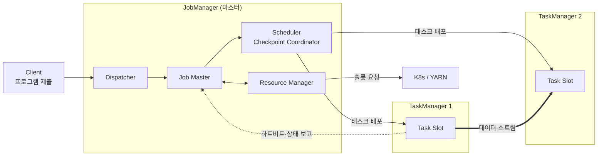
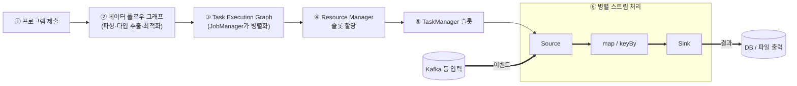

# Flink 핵심 요약

원문 3편(기초 개념, DataStream, Checkpointing과 Window)을 합친 요약본이다. 코드는 PyFlink 기준이다.

---

## 1. 왜 Flink인가

### 배치의 한계

- 배치 처리(batch processing) — 데이터를 모아 두었다가 한 번에 처리하는 방식. 예: 24시간 판매 데이터를 자정에 집계.
- 장점: 구현·운영이 쉽고 결과가 안정적이며 대용량에 맞다.
- 한계:
  - 높은 지연 시간(latency) — 모을 때까지 기다리므로 결과가 늦다.
  - 실시간 대응 불가, 데이터 품질 문제를 늦게 발견.
  - 오류가 나면 배치 전체가 영향을 받는다.
  - 데이터가 늘수록 배치 크기와 처리 시간도 같이 늘어난다.

### 배치 한계에 대한 Flink의 해법

| 배치의 한계 | Flink의 해법 |
|---|---|
| 높은 지연 시간 | 실시간 스트림 처리, 이벤트 시간 기반 처리 |
| 유연성 부족 | 배치와 스트림을 같은 API로 처리 |
| 오류 처리 복잡 | 체크포인트(checkpoint) 기반 장애 허용, 상태(state) 기반 연산 |
| 리소스 문제 | 파이프라인 병렬 처리 |
| 데이터 품질 관리 | 윈도우 기반 검증, 스트리밍 ETL(Kafka -> Flink -> DWH) |

### 스트림 처리와 스트림의 종류

- 스트림 처리(stream processing) — 이벤트가 생기는 즉시 하나씩 처리하는 방식. 판매가 생기는 순간 대시보드가 갱신된다.
- 무한 스트림(unbounded stream) — 시작은 있으나 끝이 없는 데이터 흐름. 다 모은 뒤 처리하는 것이 불가능하다.
- 유한 스트림(bounded stream) — 끝이 있는 데이터 흐름. 이 처리가 곧 배치다.
- 유한 스트림은 무한 스트림의 한 구간을 잘라낸 것으로 볼 수 있다.

### 진짜 저지연 (마이크로배치가 아님)

- 마이크로 배치(micro-batching) — 아주 작은 배치를 짧은 주기로 반복 실행하는 방식.
- Flink는 마이크로 배치가 아니라 이벤트가 들어오는 즉시 처리하는 True Streaming이다. 그래서 지연이 매우 낮다.
- 체크포인트로 Flink 내부 상태를 exactly-once(정확히 한 번 반영)로 복구한다. 외부 출력의 보장은 source와 sink 설정에 달렸다.
- Kafka, S3, JDBC, Elasticsearch 등 다양한 시스템과 연결된다.
- 지원 API:
  - SQL / Table API — 선언적 고수준 API. 유한·무한 스트림 모두 사용.
  - DataStream API — 레코드 처리, 상태, 시간 로직을 직접 짜는 저수준 API.
  - CEP(Complex Event Processing) — 복잡한 이벤트 패턴 탐지.
  - 언어는 Java, Python. DataSet API는 Flink 2에서 제거됐다.


---

## 2. 아키텍처

### 구성 요소

- 클라이언트(Client) — Flink 프로그램을 최적화해 데이터 플로우 그래프로 만들고 JobManager에 제출한다.
- JobManager(마스터, 컨트롤 타워) — 작업 실행을 총괄한다. 내부 구성:
  - Resource Manager — K8s, YARN 같은 환경에서 리소스를 협상해 할당받는다.
  - Dispatcher — 애플리케이션 제출용 REST 인터페이스를 제공한다.
  - Job Master — 하나의 JobGraph 실행을 관리한다.
  - 그 밖에 Scheduler, Checkpoint Coordinator가 있다.
- TaskManager(워커) — 실제 연산(Operator)을 실행하는 JVM 프로세스. Task Slot이 여러 개 있다.
- 슬롯(Task Slot) — TaskManager가 내주는 논리적 리소스 단위. 슬롯 하나가 연산 파이프라인 하나를 실행한다.
- JobManager와 TaskManager는 태스크 배포·취소, 체크포인트 트리거, 상태 보고, 하트비트를 주고받는다. TaskManager끼리는 데이터 스트림을 교환한다.



### 실행 흐름

1. 프로그램을 제출하면 파싱·타입 추출·최적화를 거쳐 데이터 플로우 그래프가 된다.
2. JobManager가 이를 Task Execution Graph로 바꿔 병렬화한다.
3. Resource Manager가 슬롯을 할당한다.
4. TaskManager가 슬롯에서 병렬로 스트림을 처리한다.



### 체이닝과 슬롯 공유

- 한 슬롯이 반드시 서브태스크 하나만 실행하는 것은 아니다.
- 체이닝(chaining) — 연산자 여러 개를 하나의 실행 단위로 묶는 것. 태스크 간 데이터 전달 비용이 줄어든다.
- 슬롯 공유(slot sharing) — 서로 다른 실행 단위가 한 슬롯을 같이 쓰는 것.
- Job은 TaskManager 개수를 직접 지정하지 않는다. 병렬도(parallelism) — 한 연산을 몇 개의 서브태스크로 쪼개 돌릴지 — 를 정하면 Flink가 필요한 슬롯 수를 계산하고 서브태스크를 슬롯에 배치한다. TaskManager 확보 방식은 실행 환경이 정한다.

---

## 3. Job 코드 뼈대

### 5단계

1. 실행 환경 생성 — `StreamExecutionEnvironment`. 소스, 변환, 싱크를 만드는 중심 객체.
2. Source — 외부 데이터를 Flink 스트림으로 불러온다.
3. Transformation — 데이터를 가공한다.
4. Sink — 결과를 외부(콘솔, 파일, DB)로 내보낸다.
5. `env.execute()` — Job을 제출해 실제로 실행한다.

```python
from pyflink.datastream import StreamExecutionEnvironment

env = StreamExecutionEnvironment.get_execution_environment()
data_stream = env.from_collection([1, 2, 3, 4, 5])
transformed_stream = data_stream.map(lambda x: x * 2)
transformed_stream.print()
env.execute("Simple Flink Job")
```

### Source와 Sink 종류

| 구분 | Source | Sink |
|---|---|---|
| 파일 | 로컬, HDFS, S3 (CSV, JSON, Parquet) | FileSink |
| 메시징 | Kafka, Kinesis | KafkaSink |
| DB / CDC | MySQL, PostgreSQL 변경 이벤트 | JDBC Sink, ElasticsearchSink |
| 사용자 정의 | Source API로 직접 구현 | Sink API로 직접 구현 |

- CDC(Change Data Capture) — DB의 변경 사항을 이벤트 스트림으로 받는 것.
- `print()`는 학습용이다. 클러스터에서는 TaskManager 로그에서 확인한다.
- 소스·싱크마다 Connector가 필요하고 Flink 버전과의 호환성을 확인해야 한다.

### 지연 평가

- 지연 평가(lazy evaluation) — 코드를 읽는 시점에는 실행하지 않고 계획만 세우고, 나중에 한꺼번에 실행하는 방식.
- map, filter, flat_map은 호출 즉시 레코드를 처리하지 않고 실행할 그래프만 구성한다.
- 왜 그런가: 전체 흐름을 본 뒤에야 병렬 실행 방식과 체이닝 여부를 최적화할 수 있다.
- Sink를 연결하는 것만으로는 실행되지 않는다. `execute()` 또는 `execute_and_collect()`가 Job을 제출해야 실행된다.

### DAG

- DAG(Directed Acyclic Graph) — 방향은 있고 순환은 없는 그래프. 노드는 연산자, 간선은 데이터 흐름이다.
- Source에서 Sink까지 연산자의 연결 구조를 나타낸다.
- DAG는 논리적 흐름이다. 실제 실행 구조는 병렬도에 따라 달라진다. 예: Source A(병렬도 2)는 서브태스크 A1, A2가 되고, Sink D(병렬도 1)는 D1 하나가 된다. 이 서브태스크들이 TaskManager 슬롯에 나뉘어 올라간다.

---

## 4. 변환 함수

| 함수 | 역할 | 용도 |
|---|---|---|
| map | 입력 1개를 출력 1개로 변환 (1:1) | 포맷 변경, 필드 추출, 단순 계산 |
| flat_map | 입력 1개에서 0개 이상 출력 생성 | 복합 데이터 분해, 조건별 다수 결과 |
| filter | 조건으로 선별 | 노이즈 제거, 유효 데이터만 통과 |
| key_by | 같은 키를 같은 서브태스크로 보냄 | 그룹 집계, 상태, 윈도우의 사전 단계 |
| reduce | 키별 누적값을 갱신하며 출력 | 합계, 최대·최소 |
| process | 이벤트별 로직을 직접 구현 | 키별 상태·타이머는 KeyedProcessFunction |
| union | 같은 타입의 여러 스트림을 병합 | 전체 순서나 중복 제거는 보장하지 않음 |
| connect | 다른 타입의 두 스트림을 연결 | 입력별 함수 적용. 자동 JOIN은 아님 |

- 변환 함수는 병렬 처리에 최적화돼 있다. 장애 복구는 체크포인트 등을 따로 설정해야 한다.

```python
ds = env.from_collection(
    [("A", 1), ("B", 2), ("A", 3), ("B", 4)],
    type_info=Types.TUPLE([Types.STRING(), Types.INT()])
)
keyed_stream = ds.key_by(lambda x: x[0])
summed_stream = keyed_stream.reduce(lambda a, b: (a[0], a[1] + b[1]))
```

### 스트림 분할

- 하나의 스트림을 조건별 하위 스트림으로 나눠 서로 다른 로직을 적용한다.
- 한 레코드가 여러 조건을 만족하면 여러 갈래에 모두 들어간다.
- 방법은 filter 여러 개, 또는 Side Output(OutputTag를 쓰는 별도 출력 통로)이다.
- 예: 택배 스트림을 `filter`로 무거운 택배, 도서산간, 냉장, 일반 4갈래로 나누고, 필요하면 `union`으로 다시 합친다. 예) `heavy = ds.filter(lambda x: x[0] > 20)`

---

## 5. 상태(State)

### Stateless vs Stateful

| 구분 | Stateless(무상태) | Stateful(상태 유지) |
|---|---|---|
| 정의 | 각 레코드를 독립 처리, 이전 입력을 기억하지 않음 | 이전 데이터를 기억해 결과를 계산 |
| 예 | map, flat_map, filter | key_by + sum / reduce |
| 사용 사례 | 대문자 변환, null 제거 | 단어 수 세기, 세션 윈도우, 이벤트 순서 탐지 |
| 특징 | 단순하고 확장이 쉬움 | 복구 설정(체크포인트)이 있어야 장애 시 복원 |

- 상태(state) — 여러 이벤트에 걸쳐 유지하는 정보. 예: 사용자별 누적 클릭 수.
- API 이름만 보고 상태 유무를 단정하지 않는다. 과거 정보가 필요한지로 판단한다.
- 상태는 정확성(중간 결과 보존), 장애 복구(체크포인트에 포함), 성능(메모리 사용 최적화)에 중요하다. 상태 크기, 만료 정책, 백엔드를 함께 설계한다.

### 상태의 유형

- 키 상태(Keyed State) — 키마다 따로 유지하는 상태. `key_by()` 뒤의 함수에서 쓴다.
- 한 서브태스크가 여러 키를 맡아도 키별 상태는 분리된다. 예: A의 합계 100에 50을 더해 150이 돼도 B의 합계는 그대로다.
- 그 밖에 Operator State, Broadcast State가 있다.

### ValueState 예제

- `open()`에서 상태를 준비하고 `process_element()`에서 조회 -> 갱신 -> 출력 순으로 처리한다.

```python
class KeyedSum(KeyedProcessFunction):
    def __init__(self):
        self.state = None

    def open(self, runtime_context):
        descriptor = ValueStateDescriptor("sum", Types.FLOAT())
        self.state = runtime_context.get_state(descriptor)

    def process_element(self, value, ctx):
        current_sum = self.state.value()
        if current_sum is None:
            current_sum = 0.0
        new_sum = current_sum + value[1]
        self.state.update(new_sum)
        yield value[0], new_sum

```

- ValueState — 키마다 값 하나를 저장하는 상태. 입력 A:100, B:200, A:50이면 A는 100 -> 150으로 갱신된다.

### State Backend

- State Backend — 실행 중인 상태를 어디에 어떻게 저장하고 관리할지 정하는 구성 요소. 체크포인트 저장소와는 별개다.
- 흐름: 입력 소비 -> 상태 조회 -> 상태 갱신 -> 출력.

| Backend | 저장 위치 |
|---|---|
| HashMapStateBackend | JVM heap 메모리 |
| EmbeddedRocksDBStateBackend | 로컬 RocksDB |

---

## 6. Table API

- Table API — Flink가 제공하는 고수준 선언형 API. SQL과 비슷하게 쓴다. 배치와 스트리밍을 모두 지원하고 Java, Python을 쓸 수 있다.
- `TableEnvironment`가 테이블 정의와 쿼리 실행을 관리한다.
- DataStream과 연동할 때는 스키마와 변경 로그(changelog)를 확인해야 한다.

### DataStream API와 비교

| 구분 | DataStream API | Table API / SQL |
|---|---|---|
| 추상화 수준 | 낮음 (연산자 직접 구성) | 높음 (선언적 질의) |
| 주 목적 | 실시간 이벤트 처리, 복잡한 로직 | 스트림·배치 분석, 집계 |
| 스타일 | 함수형 API | SQL, 선언적 API |
| 변환 시 확인 | 스키마 | 변경 로그 |
| 대표 연산 | map, flat_map, key_by, window | SELECT, GROUP BY, JOIN, WHERE |
| 사용자 | 개발자 (제어 중심) | 분석가·엔지니어 (분석 중심) |

### 집계 흐름 (배치 CSV 예)

1. 입력 CSV를 전처리한다 (숫자 변환, 결측·무효 행 제거, 컬럼 순서를 Flink 스키마와 맞춤).
2. `EnvironmentSettings.in_batch_mode()`로 배치 환경을 만든다.
3. 소스 테이블을 `CREATE TABLE ... WITH ('connector' = 'filesystem', 'format' = 'csv')`로 등록한다.
4. `sql_query`로 집계한다.
5. Sink 테이블을 만들고 `execute_insert()`로 기록한다. 이 호출이 Job을 실행한다.

```python
result = t_env.sql_query("""
    SELECT Category, ROUND(COALESCE(SUM(Quantity * UnitPrice), 0.0), 2) AS TotalSales
    FROM sales
    GROUP BY Category
""")

result.execute_insert("sales_summary").wait()
```

- 출력 경로는 파일이 아니라 디렉터리다.

---

## 7. Kafka 연계

- 목적: 주기적 배치 결과를 기다리지 않고 새 사용자 행동을 지속 처리해 갱신되는 결과를 알림·추천에 쓴다. 지연은 구성과 부하에 따라 다르다.
- 구성: Python 프로듀서 -> Kafka `user_behaviors` -> Flink -> Kafka `behavior_stats`.
- 토픽 2개를 만들고 Flink-Kafka 커넥터 JAR를 `pipeline.jars`에 등록한다. 커넥터가 있어야 Flink가 Kafka를 읽고 쓴다.

### Source 테이블

```python
table_env.execute_sql(f"""
CREATE TABLE kafka_source (
    user_id STRING,
    category STRING,
    behavior STRING,
    ts TIMESTAMP(3),
    proctime AS PROCTIME()
) WITH (
    'connector' = 'kafka',
    'topic' = 'user_behaviors',
    'scan.startup.mode' = 'earliest-offset',
    'format' = 'json'
)
""")
```

- `scan.startup.mode = earliest-offset`은 토픽의 가장 처음부터 읽는다는 뜻이다.
- `proctime AS PROCTIME()`은 처리 시간 컬럼이다.

### Sink 테이블: upsert

- upsert — 같은 키의 행이 있으면 갱신하고 없으면 삽입하는 것.
- 왜 필요한가: `GROUP BY` 집계 결과는 같은 키(category, behavior)의 값이 계속 바뀐다. 추가만 하는(append) 싱크로는 이 갱신을 표현하지 못한다.
- `upsert-kafka` 커넥터는 PRIMARY KEY가 필요하다. `NOT ENFORCED`는 Flink가 PK 유일성을 검사하지 않는다는 뜻이다. 키를 Kafka 메시지 key로 쓴다.

```python
table_env.execute_sql(f"""
CREATE TABLE kafka_sink (
    category STRING,
    behavior STRING,
    behavior_count BIGINT,
    update_time TIMESTAMP(3),
    PRIMARY KEY (category, behavior) NOT ENFORCED
) WITH (
    'connector' = 'upsert-kafka',
    'topic' = 'behavior_stats',
    'properties.bootstrap.servers' = '{bootstrap_servers}',
    'key.format' = 'json',
    'value.format' = 'json'
)
""")
```

### 집계 Job 제출

```python
stmt_set = table_env.create_statement_set()
stmt_set.add_insert_sql("""
INSERT INTO kafka_sink
SELECT category, behavior, COUNT(*) AS behavior_count, CURRENT_TIMESTAMP AS update_time
FROM kafka_source
GROUP BY category, behavior
""")
job_client = stmt_set.execute().get_job_client()
```

- 같은 과정을 DataStream API로도 구성할 수 있다.
- 결과 토픽에는 같은 (category, behavior)의 갱신된 카운트가 계속 쌓인다.

---

## 8. Checkpointing

### 체크포인트

- 체크포인트(checkpoint) — 실행 중인 애플리케이션 상태의 스냅샷(snapshot, 특정 시점의 백업).
- 저장 대상: 연산자 상태와 소스의 처리 위치(오프셋).
- 장애가 나면 마지막으로 완료된 체크포인트에서 이어서 복구해 데이터 유실을 막는다.
- 체크포인트는 Flink 내부 상태의 일관된 복구를 지원한다. end-to-end exactly-once는 재생 가능한 source와 transactional 또는 idempotent sink가 있어야 한다.
  - idempotent(멱등) sink — 같은 쓰기를 여러 번 해도 결과가 한 번 쓴 것과 같은 싱크.
- 저장소:
  - 기본 checkpoint storage는 JobManager 메모리다.
  - 로컬 저장만으로는 노드 장애 시 내구성을 보장하기 어려우므로 다른 노드에서도 읽을 수 있는 공유 파일시스템(DFS) 경로를 설정한다.
  - 로컬 복구(local recovery)는 별도 기능이고 기본은 비활성이다. 켜면 TaskManager의 로컬 상태를 활용한다.

### 배리어

- 배리어(checkpoint barrier) — 데이터 스트림 사이에 끼워 넣는 장벽 표지. 이 표지를 기준으로 "여기까지가 체크포인트 n에 속한다"고 나눈다.
- 적용 순서:
  1. Checkpoint Coordinator가 주기적으로 모든 소스에 신호를 보낸다.
  2. 각 Source가 그 시점의 위치를 기록하고 배리어를 다운스트림으로 흘려보낸다.
  3. 배리어가 연산자에 도달하면 그 연산자가 자기 상태를 저장한다.
  4. 입력이 여러 개인 연산자는 정렬(alignment)한다. 배리어가 먼저 온 입력은 잠시 멈추고, 모든 입력의 배리어가 도착하면 일관된 상태를 저장한 뒤 처리를 재개한다.
  5. 저장한 위치 정보(상태 핸들)를 JobManager에 보낸다.
  6. 모든 연산자가 끝나면 완료 메타데이터를 저장소에 기록한다.
- 왜 입력을 맞추는가: 서로 다른 시점의 데이터가 한 스냅샷에 섞이지 않게 해서 상태와 소스 위치의 일관된 복구 지점을 만들기 위해서다.

### 세이브포인트

- 세이브포인트(savepoint) — 사용자가 직접 요청해 만드는 스냅샷. 체크포인트와 같은 메커니즘을 쓴다. 게임의 수동 저장에 해당한다.
- 보관과 삭제를 사용자가 관리한다. 작업을 종료한 뒤나 복원한 뒤에도 남는다.
- 용도: 계획된 이전·재배포.

| 구분 | 체크포인트 | 세이브포인트 |
|---|---|---|
| 생성 | 주기적, 자동 | 사용자 요청 |
| 용도 | 장애 시 자동 복구 | 계획된 이전·재배포 |
| 수명 | Flink가 관리 | 사용자가 관리, 작업 종료 후에도 유지 |

### 장애 복구 순서

1. 애플리케이션을 재시작한다. 이때 연산자의 상태는 비어 있다.
2. 가장 최근에 성공한 체크포인트에서 상태를 복원한다.
3. 체크포인트에 기록된 위치부터 소스를 다시 읽는다.
4. 입력 버퍼가 다시 채워지고 처리가 재개된다.

- 체크포인트 이후 진행분은 장애로 처리되지 못했으므로 다시 처리한다. 소스가 그 지점 이후 데이터를 다시 보낸다.
- 이 때문에 체크포인트 이후 레코드가 재처리될 수 있다. 외부 sink의 중복 방지는 sink의 보장에 달렸다.

---

## 9. Window

### 윈도우

- 윈도우(window) — 끝없는 스트림을 유한한 구간으로 잘라 집계하는 방법.
- 왜 필요한가:
  - 무한 스트림을 유한한 조각으로 나눠야 합계·평균을 낼 수 있다.
  - 1분 단위 평균처럼 시간 구간별 변화를 볼 수 있다.
  - 전부 모일 때까지 기다리지 않고 부분 결과를 계속 내며 메모리와 저장공간도 아낀다.

### 윈도우 종류 비교

| 윈도우 | 크기 | 겹침 | 구간 결정 방식 | 적합한 용도 |
|---|---|---|---|---|
| 텀블링(Tumbling) | 고정 | 없음. 모든 요소가 정확히 한 윈도우에 속함 | 고정 길이로 빈틈없이 배치 | 분·시간·일별 집계 |
| 슬라이딩(Sliding) | 고정 | 있음. 크기와 슬라이드 간격 두 파라미터 필요 | 슬라이드 간격마다 새 윈도우 생성 | 이동 집계 |
| 세션(Session) | 가변 | 없음 | 비활동 간격(session gap)을 넘으면 종료 | 사용자 활동 단위 묶기 |
| 글로벌(Global) | 없음 | 해당 없음 | 키별 또는 전체를 하나의 윈도우에 누적 | 개수 기반 출력 |

- 텀블링: 5분 윈도우는 12:00, 12:05, 12:10 ...로 이어진다. 워터마크가 창의 끝에 닿으면 집계 결과를 낸다.
- 슬라이딩: 크기 10분, 간격 5분이면 0~10분, 5~15분 윈도우가 생긴다. 5~10분 데이터는 두 윈도우에 중복 포함된다.
- 세션: 같은 키의 이벤트 간격이 gap 안이면 같은 세션으로 병합한다. gap 5분이면 12:04, 12:09 이벤트는 한 세션이고, 12:14 이후 12:15 이벤트는 새 세션이다.
- 글로벌: 시간 제한이 없고 기본 트리거가 발화하지 않는다. 상태가 자동으로 정리되지 않으므로 누적량에 주의한다. 결과를 내려면 CountTrigger 같은 트리거를 따로 지정한다. 예: 100개마다 FIRE_AND_PURGE.

### 구현 코드 (이벤트 시간)

입력은 `(사용자, 값, 이벤트 시각 ms)` 튜플이다. 타임스탬프 추출기를 먼저 만든다.

```python
class EventTimestampAssigner(TimestampAssigner):
    def extract_timestamp(self, element, record_timestamp):
        return element[2]

timed_stream = stream.assign_timestamps_and_watermarks(
    WatermarkStrategy.no_watermarks().with_timestamp_assigner(EventTimestampAssigner())
)
```

윈도우 지정만 바뀐다.

```python
result_stream = (timed_stream.key_by(lambda x: x[0])
                 .window(TumblingEventTimeWindows.of(Time.seconds(5)))
                 .reduce(lambda a, b: (a[0], a[1] + b[1], max(a[2], b[2]))))
```

슬라이딩은 `SlidingEventTimeWindows.of(Time.seconds(10), Time.seconds(5))`, 세션은 `EventTimeSessionWindows.with_gap(Time.seconds(3))`으로 바꾼다.

글로벌 윈도우는 `window_all`과 트리거를 함께 쓴다. 3건마다 합계를 내고 윈도우를 비운다. 마지막에 3건이 안 되는 나머지는 출력되지 않는다.

```python
result_stream = (stream.window_all(GlobalWindows.create())
                 .trigger(PurgingTrigger.of(CountTrigger.of(3)))
                 .reduce(lambda a, b: a + b))
```

### 트리거 (Trigger)

- 트리거(trigger) — 윈도우가 언제 결과를 내보낼지 정하는 조건.
- 시간 윈도우는 기본 트리거가 있다. 글로벌 윈도우는 기본 발화가 없다.

#### 트리거 종류

- 시간 기반: 이벤트 시간이면 워터마크가 창 종료 시각에 닿을 때 출력.
- 카운트 기반: 누적 이벤트가 정해진 수에 이르면 출력. 예: 100개마다.
- 복합 조건: 시간 OR 카운트 등. 예: 1분이 지났거나 50개가 모이면.
- 사용자 정의: `Trigger`를 구현해 `on_element`에서 임의 조건으로 FIRE.

기본 제공 트리거:
- ProcessingTimeTrigger — 처리 시간 기준 시점에 FIRE.
- EventTimeTrigger — 워터마크가 end - 1ms에 닿으면 FIRE. 이벤트 시간 창의 기본값.
- CountTrigger — 누적 개수가 기준에 닿으면 FIRE.

#### TriggerResult

| 값 | 동작 | 사용 |
|---|---|---|
| FIRE | 지금까지 모은 데이터를 출력하고 윈도우는 유지 | 부분 출력 |
| FIRE_AND_PURGE | 출력한 뒤 윈도우 내용을 비움 | 다음 입력부터 새로 집계 |
| CONTINUE | 아무것도 하지 않고 유지 | 조건 미충족 |
| PURGE | 출력 없이 윈도우 내용만 비움 | 집계 내용 폐기 |

#### CustomTrigger

- PyFlink의 `Trigger`를 상속하면 추상 메서드 5개를 모두 구현해야 한다.

| 메서드 | 실행 시점 |
|---|---|
| on_element | 새 데이터가 들어올 때 |
| on_processing_time | 지정한 처리 시간이 되었을 때 |
| on_event_time | 지정한 이벤트 시간이 되었을 때 |
| on_merge | 여러 윈도우가 병합될 때 |
| clear | 윈도우 정리 시 트리거 상태 정리 |

- 쓰지 않는 시간 콜백은 CONTINUE를 반환하고 쓰지 않는 `on_merge`는 `pass`로 둔다.

- 트리거도 ValueState로 개수를 센다. 입력 `[1,3,4,9,5,7]`에 5건마다 발화하면 1+3+4+9+5=22 하나만 출력되고 남은 1건은 나오지 않는다.

---

## 10. Watermark와 지각 데이터

### 이벤트 시간 vs 처리 시간

| 구분 | 이벤트 시간(Event Time) | 처리 시간(Processing Time) |
|---|---|---|
| 정의 | 데이터가 현실에서 실제 발생한 시각 | Flink 태스크가 이벤트를 처리하는 시스템 시각 |
| 윈도우 배정 | 이벤트 시각 기준 | 처리 시점 기준 |
| 장점 | 지연·순서 뒤바뀜이 있어도 결과가 안정적 | 구현이 간단 |
| 단점·조건 | 워터마크로 시간 진행을 알려줘야 함 | 처리 지연과 실행 시점에 따라 배정이 달라짐 |

### 워터마크

- 네트워크 지연이나 부하로 이벤트가 생성 순서와 다르게 도착한다. 대책 없이 이벤트 시간 윈도우를 쓰면 윈도우가 닫힌 뒤 늦은 이벤트가 와서 데이터가 사라지거나 결과가 틀릴 수 있다.
- 워터마크(watermark) — "이벤트 시간이 여기까지 진행됐다"를 나타내는 기준값. "이 시각 이전 데이터는 더 안 온다"는 선언에 가깝다.
- 지연 허용 워터마크(bounded out-of-orderness) 공식: 최대 이벤트 시각 - 지연 범위 - 1ms.
- 워터마크가 `window.end - 1ms`에 닿으면 기본 트리거가 발화한다.

```python
watermarks = (WatermarkStrategy.for_bounded_out_of_orderness(Duration.of_seconds(1))
              .with_timestamp_assigner(EventTimestampAssigner()))
timed_stream = stream.assign_timestamps_and_watermarks(watermarks)
```

### 지각 데이터와 allowed lateness

- 지각 데이터(late element) — 워터마크가 윈도우 종료 시각을 지난 뒤에 도착한 데이터.
- `allowed_lateness`(허용 지연) — 윈도우 종료 후에도 정해진 시간 동안 창 상태를 유지하는 설정. 이 기간에 온 늦은 데이터는 창 상태에 반영되고 결과가 다시 발화될 수 있다.
- 시간 순서: 윈도우 start -> end -> 워터마크 지연 후 첫 발화 -> allowed lateness 동안 갱신 가능 -> 윈도우 정리(purge).
- 정리 이후에 온 입력은 버려지거나(drop), Side Output으로 따로 받는다.

- 예제 설정: 1초 지연 워터마크, 5초 윈도우, allowed lateness 3초, 허용 지연 이후 입력은 side output(`too-late`)으로 분리. 결과는 `WINDOW:`와 `TOO LATE:`로 구분해 출력한다.

```python
late_tag = OutputTag("too-late", Types.TUPLE([Types.STRING(), Types.INT(), Types.LONG()]))

windowed = (timed_stream.key_by(lambda x: x[0])
            .window(TumblingEventTimeWindows.of(Time.seconds(5)))
            .allowed_lateness(3000)
            .side_output_late_data(late_tag)
            .reduce(lambda a, b: (a[0], a[1] + b[1], max(a[2], b[2]))))

late_output = windowed.get_side_output(late_tag)
```

- `allowed_lateness`의 단위는 밀리초(ms)다.
