# Spark 기본 구조와 세팅 요약 (1/3) - 왜 생겼고, 무엇이며, 어떻게 쓰는가

> 용어 풀이는 이해를 돕는 일반 설명이다. 강의가 직접 정의한 것이 아닐 수 있다. 강의 근거가 아닌 서술은 (보충)으로 따로 표시했다. 강의 근거는 (N쪽)으로 쪽수를 달았다. 강의에 없는 내용은 지어내지 않고 "강의에서는 직접 다루지 않음"이라고 적었다.

## 1. Spark 개요: 왜 필요한가

- 3쪽 "챕터의 포인트"는 두 가지다. Spark 개요 및 실행 구조, Spark 설치 및 환경설정. (1쪽은 표지, 2쪽은 챕터 제목 슬라이드, 4쪽과 34쪽은 각 장의 구분 슬라이드, 51쪽은 "내일 방송에서 만나요!" 마무리 슬라이드다.)

### 1-1. Apache Spark란

- **Apache Spark — 여러 대의 컴퓨터에 데이터를 나눠 한꺼번에 처리하는 오픈소스 분산 처리 엔진.** (보충) 5쪽 "Apache Spark란?"은 로고만 보여 주고 정의 문장은 없다. 6쪽 그림이 Spark를 "General Unified Engine"이라 부른다.
- UC Berkeley AMP Lab에서 개발한 프로젝트다. 2010년에 오픈소스로 공개됐고, 이후 Apache 소속으로 발전했다. (6쪽)
  - **오픈소스(open source) — 소스 코드를 누구나 볼 수 있게 공개한 소프트웨어.** (보충)
- 개발 연표는 2009년 개발 시작, 2010년 오픈소스 공개, 2014년 Apache 프로젝트로 채택이다. (7쪽)
- **클러스터(cluster) — 한 몸처럼 같이 일하도록 묶은 여러 대의 컴퓨터.** (보충)

### 1-2. 이전에는 어떻게 처리했나

- **하둡(Hadoop) — 큰 데이터를 여러 컴퓨터에 나눠 저장하고 처리하게 해 주는 오픈소스 묶음.** (보충)
- 6쪽 그림은 시대 흐름을 세 덩어리로 보여 준다.
  - 2004~2013: Hadoop MapReduce. 범용 배치 처리(General Batch Processing — 모아 둔 데이터를 한꺼번에 처리하는 일반용 방식)를 맡았다. 배치는 1-4절에서 다시 설명한다.
  - 2004~2015(?): 목적별 특화 시스템(Specialized Systems)이 난립했다.
  - 2014~(?): Spark. 범용 통합 엔진(General Unified Engine)이다.
- 특화 시스템 이름으로 Giraph, Pregel, Tez, Drill, Mahout, Dremel, Storm, S4, Impala, GraphLab이 그림에 나온다. (6쪽)
- 특화 시스템이 풀던 문제 유형은 반복(iterative), 대화형(interactive), 머신러닝(ML), 스트리밍(streaming), 그래프(graph), SQL 등(etc)이다. (6쪽)
- **MapReduce — 큰 데이터를 쪼개(Map) 모은 뒤(Reduce) 계산하는 Hadoop의 처리 방식.** 강의는 이름과 한계만 다룬다. 작동 원리는 강의에서 직접 다루지 않음.
- **Hadoop 에코시스템(ecosystem) — 핵심인 HDFS, MapReduce, YARN과 그 역할을 맡는 여러 하위 프로젝트가 모인 환경.** (8쪽)
  - HDFS(Hadoop Distributed File System) — 파일을 여러 서버에 나눠 저장하는 분산 파일 시스템. (8쪽 그림)
  - YARN — 클러스터 자원을 나눠 주는 관리자. (8쪽 그림, 용어 풀이는 일반 설명)
  - 8쪽 왼쪽 그림에는 Storm, Solr, Mahout, Hive, Pig, HBase, Cassandra, Kafka, Flume, Sqoop, ZooKeeper 등도 함께 나온다. Spark 칸 위에는 GraphX, Spark MLlib, Spark Streaming, Spark SQL이 얹혀 있다.
  - 8쪽 오른쪽 그림은 Spark(Spark SQL, Spark Streaming, MLlib, GraphX가 Apache Spark Core 위에 있음)가 YARN 위에 놓이고, 그 아래가 HDFS인 구조다. 옆에 Hive, Services, MapReduce가 있고, YARN과 HDFS 사이에는 "Data access" 표시가 있다.
  - 맨 아래 Data Sources는 구조화 데이터(Hive, CSV, Excel), 비구조화 데이터(Text, Media), 데이터베이스(RDBMS, NoSQL)다.

### 1-3. 기존 방식의 한계 (강의에 나온 근거)

- Hadoop MapReduce는 느린 속도와 반복 작업의 비효율성이라는 구조적 한계가 있다. (7쪽)
- 특히 머신러닝, 스트리밍 분석처럼 반복적이고 실시간성이 요구되는 작업에 부적합하다. (7쪽)
- Spark는 이러한 문제를 해결하고자 개발됐다. (7쪽)
- 디스크 기반 처리로 속도 문제가 생긴다. (9쪽 소제목 "디스크 기반 처리로 인한 속도 문제") 업계 용어로는 디스크 I/O 병목(bottleneck — 한 곳이 느려 전체가 막히는 지점)이다. "디스크 I/O"라는 말은 11쪽에서 "디스크 I/O 최소화"로 나온다.
  - Spark 이전의 기술은 데이터를 처리할 때 디스크 기반 저장장치를 쓴다.
  - **디스크 I/O(Input/Output) — 디스크에 데이터를 읽고 쓰는 작업.**
  - 디스크는 메모리(RAM)보다 읽기/쓰기 속도가 현저히 느려서 처리 과정에서 속도 저하가 생긴다.
- (보충) 반복 연산은 같은 데이터를 여러 번 다시 읽는다. 단계마다 결과를 디스크에 쓰고 다음 단계가 다시 읽으면 느림이 단계 수만큼 쌓인다. 강의는 이 메커니즘을 직접 설명하지 않고 "디스크 기반이라 느리다"까지만 말한다.
- 개발 난이도 측면의 한계는 강의에서는 직접 다루지 않음. 사용 편의성은 Spark의 장점으로만 나온다(1-5절).

### 1-4. 데이터 처리 방식의 두 갈래

- 10쪽은 처리 방식을 둘로 나눈다.
  - **배치 처리(batch processing) — 데이터를 모아 저장해 둔 뒤 주기적으로 한꺼번에 처리하는 방식.** 그림은 Data → 저장소 → Processing/Results가 세 번 반복되고, 반복 사이에 시계 아이콘이 있는 구조다.
  - **스트림 처리(stream processing) — 실시간으로 들어오는 이벤트를 끊김 없이 계속 처리해 즉시 결과를 내는 방식.** 그림은 Real time events → Continuous data processing → Live results 구조다.
- 10쪽 슬라이드 제목은 "Spark의 필요성", 소제목은 "데이터 처리의 필요성 증가"다. (보충) 두 방식을 모두 감당하는 도구가 필요해졌다는 풀이는 강의 문장이 아니라 맥락 해석이다.

### 1-5. Spark의 설계 철학 (해법)

| 축 | 강의 내용 (쪽수) |
| --- | --- |
| 속도 | 메모리 기반 연산(In-Memory Computation)으로 디스크 I/O 최소화, DAG 기반 스케줄링으로 병렬 처리 최적화, Tungsten 엔진을 통한 코드 생성 최적화 (11쪽) |
| 사용 편의성 | 단일 PC와 클러스터 간 코드 차이가 최소화된 추상화 구조, RDD → DataFrame → Dataset의 계층적 API, Scala·Python·Java·R 등 다중 언어 지원 (11쪽) |
| 모듈성 | Spark SQL, Streaming, MLlib, GraphX 등 다양한 워크로드를 하나의 엔진에서 처리. 별도 시스템(Hive, Storm, Mahout 등) 통합 불필요 (12쪽) |
| 확장성 | 다양한 데이터 소스(HDFS, Cassandra, MongoDB, RDBMS, S3 등) 연동, 여러 파일 포맷(csv, parquet 등) 지원, 수많은 서드파티 패키지와 통합 가능 (12쪽) |

- **워크로드(workload) — 시스템이 처리해야 하는 일의 종류.** (보충) SQL, 스트리밍, 머신러닝, 그래프가 각각 다른 워크로드다.
- **병렬 처리(parallel processing) — 일을 쪼개 여러 곳에서 동시에 하는 것.** (보충)
- **추상화(abstraction) — 복잡한 내부를 감추고 단순한 사용법만 보여 주는 설계.** (보충)
- **API — 프로그램이 다른 프로그램의 기능을 부를 때 쓰는 약속된 창구.** (보충)
- **메모리 기반 연산(In-Memory Computation) — 중간 결과를 디스크 대신 메모리(RAM)에 두고 계산하는 방식.**
- **DAG(Directed Acyclic Graph) — 작업 사이 순서를 화살표로 이은, 순환 없는 그래프.** (보충) Spark는 이것으로 어떤 작업을 먼저, 어떤 작업을 동시에 할지 계획한다. 강의는 "DAG 기반 스케줄링"이라고만 말한다.
- **Tungsten — Spark의 실행 성능 최적화 엔진.** (보충) 강의는 "코드 생성 최적화"라고만 적었고 내부 동작은 다루지 않음.
- **RDD(Resilient Distributed Dataset) — Spark의 가장 기본이 되는 분산 데이터 모음.** (보충) 강의에서는 RDD → DataFrame → Dataset 순서의 계층적 API로만 언급하고 정의는 직접 다루지 않음.
- **DataFrame — 표(행과 열) 형태로 다루는 데이터 모음.** (보충) 정의는 일반 설명이다.
- **Dataset — DataFrame처럼 표 형태이되 데이터 타입을 미리 검사하는 API.** (보충) 강의는 이름만 언급한다.

### 1-6. Spark 사용 이유 (15쪽)

- 반복 연산에서 Hadoop MapReduce보다 빠른 처리 성능.
- 메모리 기반의 데이터 처리로 빠른 속도.
- Hadoop과의 유연한 연동성. 8쪽은 분석과 처리를 Spark로 하는 경우가 늘고 있다고 말하고, 8쪽 그림은 Spark를 YARN과 HDFS 위에 놓는다. (Spark를 꼭 YARN 위에서만 돌리는 것은 아니다. 19쪽은 Standalone, Kubernetes도 든다.)
- RDD의 계보(lineage)를 기반으로 장애 발생 시 연산을 자동으로 재실행하여 복구.
  - **계보(lineage) — 이 데이터가 어떤 변환을 거쳐 만들어졌는지 적어 둔 기록.** (33쪽에서 다시 나온다.)

### 1-7. Spark 활용 시 주의점 (16쪽)

- 엄밀한 실시간 처리 불가(Micro-batch 기반).
  - **마이크로 배치(micro-batch) — 실시간처럼 보이게 아주 짧은 주기로 작은 배치를 계속 돌리는 방식.** (14쪽에서 Spark Streaming이 이 방식이라고 밝힌다.)
- 작은 데이터 파일 처리의 비효율성.
- 자체 파일 관리 시스템 부재(HDFS, S3 등 사용).
- 높은 메모리 비용.

### 1-8. Spark가 없었다면

- 강의에서는 직접 다루지 않음. "Spark가 없었다면"이라는 시나리오는 강의에 없다.
- 강의가 보여 주는 것은 세 가지다.
  - 목적별 특화 시스템이 난립했다(6쪽).
  - MapReduce는 속도와 반복 작업에 구조적 한계가 있다(7쪽).
  - Spark는 하나의 엔진에서 여러 워크로드를 처리해 별도 시스템 통합을 없앤다(12쪽).

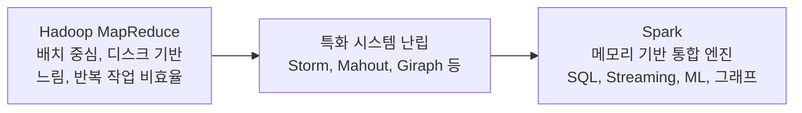

**결론:** 디스크 I/O 병목과 반복 연산 비효율이라는 MapReduce의 한계를, 메모리 기반 인메모리 연산(in-memory computation)과 통합 엔진(unified engine — 여러 종류의 일을 한 엔진에서 처리하는 구조)으로 푼 것이 Spark다.

## 2. Spark의 구성 요소 (스택)

- 13쪽 그림은 계층 구조다.
  - 위층: Spark SQL(structured data), Spark Streaming(real-time), MLlib(machine learning), GraphX(graph processing).
  - 중간층: Spark Core.
  - 아래층: Standalone Scheduler, YARN, Mesos. Standalone Scheduler는 파란색, YARN과 Mesos는 회색 칸이다.
  - Spark SQL 칸과 Spark Core 층에는 빨간 테두리가 쳐져 있다.
  - 그림 속 라벨은 "MLib machine learning"으로 적혀 있다. 강의 그림의 표기이고, 14쪽 표에는 MLlib로 나온다.
- 14쪽 문구: 모든 컴포넌트는 Spark Core 위에서 실행되며 공통된 실행 엔진 및 스케줄러를 공유한다.

| 컴포넌트 | 설명 (14쪽) |
| --- | --- |
| Spark Core | 핵심 실행 플랫폼 |
| Spark SQL | 구조적 데이터 처리 및 SQL 기반 쿼리 실행 |
| Spark Streaming | 실시간 데이터 분석을 위한 스트리밍 처리 (마이크로 배치 방식) |
| MLlib | 머신러닝 알고리즘 라이브러리 (분류, 회귀, 군집 등) |
| GraphX | 그래프 기반 데이터 처리와 분석 지원 (PageRank 등) |

- **PageRank — 다른 쪽에서 많이 연결될수록 중요하다고 점수를 매기는 그래프 알고리즘.** (보충)
- **분류·회귀·군집 — 머신러닝에서 종류 맞히기, 숫자 예측하기, 비슷한 것끼리 묶기.** (보충)
- **Mesos — 클러스터 자원을 나눠 주는 또 다른 관리자.** (보충) 강의는 13쪽 그림에 이름만 보여 준다.
- 클러스터 매니저 종류는 13쪽 그림에 Standalone Scheduler, YARN, Mesos가 나온다. 19쪽 텍스트는 Standalone, Hadoop YARN, Kubernetes를 든다. 두 쪽의 목록이 다르다. 둘 다 강의에 나온 그대로 적는다.

**결론:** 하나의 Spark Core 위에 SQL, 스트리밍, 머신러닝, 그래프를 얹은 모듈형(modular — 부품처럼 필요한 기능만 끼워 쓰는) 단일 엔진 구조다.

## 3. 실행 구조: 누가 일을 나눠 맡나

### 3-1. 큰 그림

- Spark는 Driver, Cluster Manager, Worker Nodes로 구성된 분산 데이터 처리 시스템이다. (17쪽)
  - Driver: 실행 계획 생성 및 작업 분배.
  - Cluster Manager: 클러스터 자원 관리.
  - Worker 1, 2, 3: 작업 수행 및 데이터 처리. 결과는 다시 Driver로 돌아간다(그림의 화살표).
- 애플리케이션 구성 요소는 일곱 가지다. (18쪽)
  - 클러스터 매니저(Cluster Manager), 드라이버(Driver), 실행기(Executor), 스파크 세션(Session), 잡(Job), 스테이지(Stage), 태스크(task).
- 18쪽 그림은 Driver Program 안의 SparkContext가 Cluster Manager와 양방향으로 통신하고, 각 Worker Node의 Executor(Cache, Task 포함)와도 통신하는 구조다. 두 Worker Node 사이도 화살표로 이어진다.

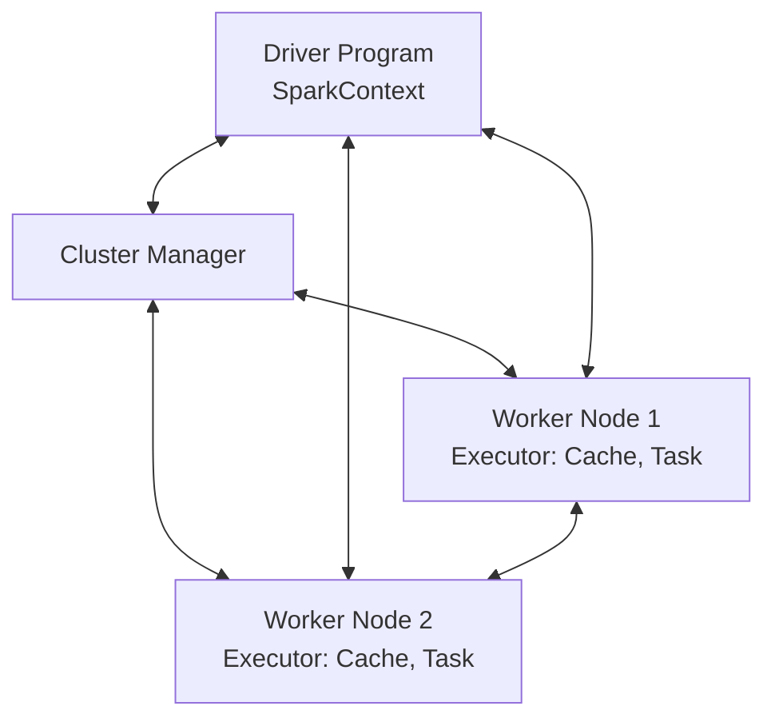

### 3-2. 클러스터 매니저 (19쪽)

- **클러스터 매니저(Cluster Manager) — 컴퓨터 묶음(클러스터)의 CPU와 메모리를 애플리케이션에 나눠 주는 관리자.**
- 애플리케이션의 리소스 관리를 맡는다.
  - 드라이버가 요청한 실행기 프로세스를 시작한다.
  - 실행 중인 프로세스를 중지하거나 재시작한다.
  - 실행자 프로세스가 사용할 수 있는 최대 CPU 코어 개수를 제한하는 등을 맡는다.
  - **프로세스(process) — 컴퓨터에서 실행 중인 프로그램 하나.** (보충)
  - **CPU 코어(core) — CPU 안에서 실제로 계산하는 일꾼 하나.** (보충)
- 종류는 Standalone, Hadoop YARN, Kubernetes다.
  - Standalone — Spark에 들어 있는 기본 클러스터 매니저. (보충)
  - **쿠버네티스(Kubernetes) — 컨테이너를 여러 서버에 배치하고 관리하는 도구.** (보충)

### 3-3. 드라이버 (20쪽)

- **드라이버(Driver) — 스파크 애플리케이션의 실행을 관장하고 모니터링하는 지휘자 프로세스.**
- 하는 일은 네 가지다.
  - 클러스터 매니저에 메모리 및 CPU 리소스를 요청한다.
  - 애플리케이션 로직을 스테이지와 태스크로 분할한다.
  - 여러 실행자에 태스크를 전달한다.
  - 태스크 실행 결과를 수집한다.
- 1개의 스파크 애플리케이션에는 1개의 드라이버만 존재한다.
- 드라이버 프로세스가 어디에 있는지에 따라 두 모드가 있다.
  - 클러스터 모드: 클러스터 매니저가 Driver를 클러스터에서 실행한다.
  - 클라이언트 모드: spark-submit을 실행한 프로세스에서 Driver를 실행한다.

### 3-4. 실행기 (21쪽)

- **실행기(Executor) — 드라이버로부터 전달받은 태스크를 실제로 실행하는 일꾼 프로세스.**
- 드라이버가 요청한 태스크들을 받아 실행하고, 그 결과를 드라이버로 반환한다.
- 각 프로세스는 태스크들을 여러 태스크 슬롯(스레드)에서 병렬로 실행한다.
  - **스레드(thread) — 한 프로세스 안에서 동시에 도는 작업 흐름.**
- JVM 프로세스다.
  - **JVM(Java Virtual Machine) — 자바 프로그램을 돌리는 가상 실행 환경.** (보충) Spark는 Scala로 만들어져 JVM 위에서 돈다는 설명은 강의에 없고, 강의는 "JVM 프로세스"까지만 말한다.
- 21쪽 그림: Driver Process(Spark Session, User Code), Worker 두 대(각각 Executor 두 개), Standalone Manager가 서로 연결된다.

### 3-5. 스파크 세션 (22쪽)

- **스파크 세션(Spark Session) — DataFrame, SQL 등 Spark 기능을 쓰기 위한 진입점(entry point).**
- Spark Core 기능들과 상호 작용할 수 있는 진입점을 제공한다.
- API로 프로그래밍을 할 수 있게 해 주는 객체다.
- spark-shell에서 기본적으로 제공된다.
- 스파크 애플리케이션에서는 사용자가 SparkSession 객체를 생성해 사용해야 한다.
- 22쪽 그림은 Spark Session 아래에 Spark Context와 SQL Context가 있는 구조다.
- **스파크 컨텍스트(Spark Context) — RDD를 다루는 쪽의 진입점.** (보충) SQL Context의 역할은 강의에서 직접 다루지 않음.

### 3-6. 잡, 스테이지, 태스크

- **잡(Job) — 사용자가 실행한 액션(collect(), count() 등)에 의해 생성되는 작업 단위.** (23쪽)
  - 스파크 액션(save(), collect() 등)에 대한 응답으로 생성되는 여러 태스크로 이루어진 병렬 연산이다.
- **스테이지(stage) — 잡을 셔플(데이터 이동) 기준으로 나눈 실행 단위.** (24쪽)
  - 스파크의 각 잡은 스테이지라 불리는 서로 의존성을 가지는 다수의 태스크 모음으로 나뉜다.
  - **의존성(dependency) — 앞 작업이 끝나야 뒤 작업을 할 수 있는 관계.** (보충)
  - **셔플(shuffle) — 파티션 사이에 데이터를 주고받아 다시 섞는 것.**
- **태스크(task) — 스테이지를 구성하는 실제 실행 단위.** (26쪽)
  - 스파크의 각 잡별로 실행기에 보내지는 작업 할당의 가장 기본적인 단위다.
  - 개별 task slot에 할당되고, 데이터의 개별 파티션을 가지고 작업한다.
  - **파티션(partition) — 큰 데이터를 쪼갠 조각 하나.** (보충) 정의는 일반 설명이다.
- 25쪽 그림은 Stage0, Stage1, Stage2를 보여 준다. 파티션끼리 교차 화살표로 섞이는 지점에서 스테이지가 나뉜다.
  - Stage0과 Stage1은 각각 block 4개 → p 열 → p 열로 이어진다. 그다음 교차 화살표를 거쳐 Stage2 점선 안의 p 열(노란색, Stage0 쪽과 Stage1 쪽 하나씩)로 모인다.
  - Stage2는 노란색 p 열 두 개에서 시작해 p 열 → p 열 → r 열로 끝난다. 굵은 파란 화살표는 Stage0과 Stage1 각각의 맨 위 줄에서 시작해 Stage2 맨 위 줄 끝(r)까지 이어진다.
- 23쪽, 24쪽, 26쪽 공통 그림의 층 구성은 다음과 같다.
  - Spark Context/Driver → Action이 JOB 생성 → Wide Transformations 기준으로 STAGE 분할 → Narrow Transformations 단위의 TASK.

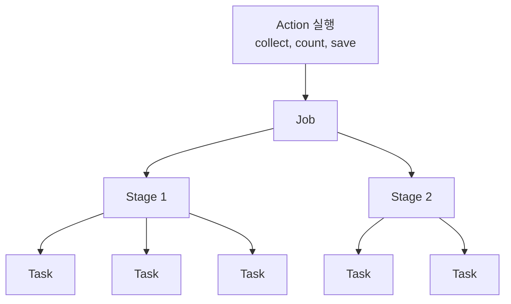

- (보충) 비유: 잡은 주문서 한 장, 스테이지는 주문서 안의 공정 단계, 태스크는 그 공정을 조각별로 나눠 일꾼이 하나씩 맡은 작업이다.

**결론:** 드라이버(driver)가 계획을 세워 잡(job)을 스테이지(stage)와 태스크(task)로 쪼개고, 클러스터 매니저(cluster manager)가 자원을 주면 익스큐터(executor)가 태스크를 병렬 실행하는 마스터-워커(master-worker — 지휘하는 쪽 하나와 일하는 쪽 여럿으로 나뉜 구조) 구조다.

## 4. 연산의 종류: Transformation과 Action

### 4-1. 두 종류 (27쪽)

- 스파크 연산은 크게 트랜스포메이션(Transformation)과 액션(Action)으로 구별한다.
- 그림 문구: Spark Operations = TRANSFORMATIONS + ACTIONS. ACTIONS 옆에는 프린터 아이콘이 있다.

### 4-2. Transformation (28쪽)

- **immutable — 원본을 고치지 않는 성질.** 원본 데이터를 수정하지 않고, 하나의 RDD나 DataFrame을 새로운 RDD나 DataFrame으로 변형한다.
- (input, output) 타입이 (RDD, RDD), (DataFrame, DataFrame)인 연산이다.
- 예: map(), filter(), flatMap(), select(), groupBy(), orderBy() 등.
- Narrow, Wide Transformation이 존재한다.
- 그림 흐름: Create RDD → RDD(겹친 상자) ↔ Transformations, RDD → Actions → Results. 빨간 "Lineage" 화살표가 겹친 RDD를 가리킨다.

### 4-3. Narrow transformation (29쪽)

- **Narrow dependency — 부모 파티션 하나가 자식 파티션 하나에만 대응하는 관계.** (보충) 정의 문장은 일반 설명이고, 아래 항목이 강의 문구다.
  - 부모 파티션 하나를 여러 자식 파티션으로 분산할 필요가 없다.
  - 여러 부모 파티션을 하나로 병합하는 경우도 포함한다.
  - 파티션 간 shuffle 없이 처리한다.
  - 예: filter(), map(), coalesce(shuffle=False).
- 그림 예: map, filter, union, join with inputs co-partitioned.

### 4-4. Wide transformation (30쪽)

- 연산 시 파티션끼리 데이터 교환이 발생한다.
- 예: groupBy(), orderBy(), sortByKey(), reduceByKey().
- 단, join의 경우 두 부모 RDD/DataFrame이 어떻게 파티셔닝 되어 있느냐에 따라 narrow일 수도, wide일 수도 있다.
- 그림 예: groupByKey, join with inputs not co-partitioned.
- 23쪽 그림은 STAGE 층에 "Wide Transformations", TASK 층에 "Narrow Transformations" 라벨을 붙인다. 24쪽은 스테이지를 셔플 기준으로 나눈다고 하므로 wide transformation이 스테이지 경계가 된다. 강의가 이 연결을 한 문장으로 말하지는 않는다. 그림 라벨과 24쪽 설명을 합쳐 읽은 것이다.
- 31쪽은 제목 "Transformation" 아래에 Stage0, Stage1, Stage2 그림을 다시 보여 준다.

| 구분 | Narrow | Wide |
| --- | --- | --- |
| 파티션 간 데이터 이동 | 없음 | 있음 (셔플) |
| 예 | filter(), map(), coalesce(shuffle=False) | groupBy(), orderBy(), sortByKey(), reduceByKey() |
| join | 두 입력이 같은 방식으로 파티셔닝된 경우 | 그렇지 않은 경우 |

### 4-5. Action (32쪽)

- **Action — 결과 계산이나 저장을 실제로 실행하는 연산.**
- count() → 요소 개수(int).
- collect() → Driver의 Python list.
- save 계열 → 외부 저장소에 결과 기록.
- 데이터 조회도 Action이며 외부 상태 변경이 필수는 아니다.
- 32쪽 그림은 28쪽과 같은 흐름도다. Create RDD → RDD(겹친 상자) ↔ Transformations, RDD → Actions → Results 순이다. 32쪽에는 Lineage 표시가 없다.

### 4-6. Lazy evaluation (33쪽)

- **지연 평가(lazy evaluation) — 계산을 미뤄 두었다가 결과가 정말 필요해질 때 한꺼번에 실행하는 방식.**
- 모든 transformation은 즉시 계산되지 않는다.
- 계보(lineage)라 불리는 형태로 기록한다.
- transformation이 실제 계산되는 시점은 action이 실행되는 시점이다.
- action이 실행될 때, 그 전까지 기록된 모든 transformation들의 지연 연산이 수행된다.
- 장점은 두 가지다.
  - 스파크가 연산 쿼리를 분석하고 어디를 최적화할지 파악해 실행 계획 최적화가 가능하다(지연 실행으로 전체 변환 흐름을 고려할 수 있다).
  - 장애에 대한 데이터 내구성을 제공한다. 장애 발생 시 기록된 lineage를 재실행하는 것만으로 원래 상태를 재생성할 수 있다.

**결론:** 트랜스포메이션(transformation)은 지연 평가(lazy evaluation)로 계보(lineage)만 쌓고, 액션(action)이 호출될 때 비로소 잡(job)이 만들어져 실행되며, 이 계보 덕에 장애 복구(fault tolerance — 일부가 고장 나도 다시 만들어 계속 동작하는 성질)가 가능하다.

## 5. 설치와 실행 환경 설정

### 5-1. Spark 설치 (WSL, 35쪽)

- **WSL(Windows Subsystem for Linux) — 윈도우 안에서 리눅스를 돌리는 기능.** (보충) 정의는 일반 설명이다. 강의는 WSL 터미널 기준으로 설치한다.
- 강의 명령어는 다음 세 줄이다.

```bash
wget https://archive.apache.org/dist/spark/spark-3.5.4/spark-3.5.4-bin-hadoop3.tgz
tar -xvzf spark-3.5.4-bin-hadoop3.tgz
sudo mv spark-3.5.4-bin-hadoop3 spark
```

- (보충) 순서대로 내려받기, 압축 해제, 폴더 이름을 spark로 바꾸기다. 강의는 명령어만 적고 뜻은 풀지 않는다.
- 35쪽 캡처에는 내려받는 파일 크기가 400879762바이트(382M)로 나온다. 캡처 날짜는 2025-02-13이다.
- 같은 캡처에서 서버 응답은 HTTP 200 OK, 파일 형식은 application/x-gzip이다. 100% 내려받은 뒤 속도 42.7MB/s로 저장 완료(saved [400879762/400879762])가 나온다. IP 주소 일부는 검은 칸으로 가려져 있다.
- 35쪽 캡처의 wget 주소는 https://dlcdn.apache.org/spark/spark-3.5.4/spark-3.5.4-bin-hadoop3.tgz 다. 본문 텍스트의 archive.apache.org 주소와 다르다. 캡처에는 tar -xvzf 실행 직후 spark-3.5.4-bin-hadoop3/, spark-3.5.4-bin-hadoop3/R/ 같은 압축 해제 목록이 보인다.
- Java 설치는 강의에서는 직접 다루지 않음.

### 5-2. 환경변수 등록 (36쪽)

- **환경변수(environment variable) — 터미널이 프로그램 위치 등을 알도록 미리 적어 두는 설정값.**
- vi ~/.bashrc 로 파일을 열어 다음 두 줄을 작성한다.

```bash
export SPARK_HOME=/home/ssafy/spark
export PATH=$SPARK_HOME/bin:$SPARK_HOME/sbin:$PATH
```

- 저장 후 적용하고 확인한다.

```bash
source ~/.bashrc
echo $SPARK_HOME
```

- 확인 출력은 /home/ssafy/spark 다.
- 36쪽 슬라이드 불릿은 "Spark 환경변수 등록", "vi ~/.bashrc", "source ~/.bashrc", "echo $SPARK_HOME 잘 설정 됐는지 확인" 순이다. 캡처에서 export 두 줄에는 빨간 테두리와 "작성" 표시가 붙어 있고, echo 명령은 ~/spark 폴더에서 실행한다.

### 5-3. PySpark 설치와 실행 (37쪽, 38쪽)

- **PySpark — Python으로 Spark를 쓰게 해 주는 인터페이스.**

```bash
pip install pyspark==3.5.4
pyspark
```

- pyspark를 실행하면 Spark 로고와 version 3.5.4가 나온다. (37쪽)
- 시작 메시지에 다음 세 줄이 나온다. (37쪽)
  - Spark context Web UI available at http://(IP 주소):4040
  - Spark context available as 'sc' (master = local[*], app id = local-...)
  - SparkSession available as 'spark'.
- 37쪽 캡처에는 이 세 줄 앞에 WARN 경고도 나온다. 순서는 다음과 같다. 프롬프트 앞에는 (de) 표시가 있고 Python 버전은 3.10.12다.
  - hostname이 loopback 주소로 풀려 다른 IP를 대신 쓴다는 경고.
  - Set SPARK_LOCAL_IP 안내 경고.
  - Setting default log level to "WARN", To adjust logging level use sc.setLogLevel(newLevel) 안내.
  - native-hadoop library를 못 불러와 builtin-java 클래스를 쓴다는 경고.
- 위 경고 중 SPARK_LOCAL_IP 문구는 "Set SPARK_LOCAL_IP if you need to bind to another address"다. 시작 배너 앞에 "Welcome to"가 나오고, 맨 끝에 "Ctrl click to launch VS Code Native REPL (https://aka.ms/python-native-repl)" 안내와 >>> 프롬프트가 나온다. 슬라이드 불릿은 "pip install pyspark==3.5.4", "pyspark 설치 확인"이다.
- (보충) local[*]는 클러스터 없이 내 컴퓨터의 모든 CPU 코어로 돌리는 로컬 모드를 뜻한다. 강의는 출력만 보여 주고 뜻은 풀지 않는다.
- 38쪽 간단한 예제는 pyspark 셸에서 일반 Python 로컬 연산을 한다.

```python
a = 5
b = 10
print("a+b=", a+b)
print("a*b=", a*b)
```

- 결과는 a+b= 15, a*b= 50 이다.
- 38쪽 제목은 "pyspark 에서 간단한 예제"이고, 문구는 "a값이 5이고, b의 값이 10일 때 각 a+b, a*b의 값을 출력 (Python 로컬 연산)"이다. 38쪽 캡처는 Python 3.12.3이고 Web UI의 IP 주소도 달라 37쪽 캡처와 환경이 다르다.

### 5-4. PySpark 코드는 내부에서 어떻게 도는가 (39쪽)

- 39쪽 흐름은 다음과 같다.
  - Python 코드(PySpark API) → Py4J → JVM: SparkSession / SparkContext(Driver) → Cluster Manager → Executors → 분산 데이터 처리.
- **Py4J — Python 코드가 JVM 쪽 객체를 호출하게 해 주는 다리.** (보충) 강의는 이름만 보여 준다.

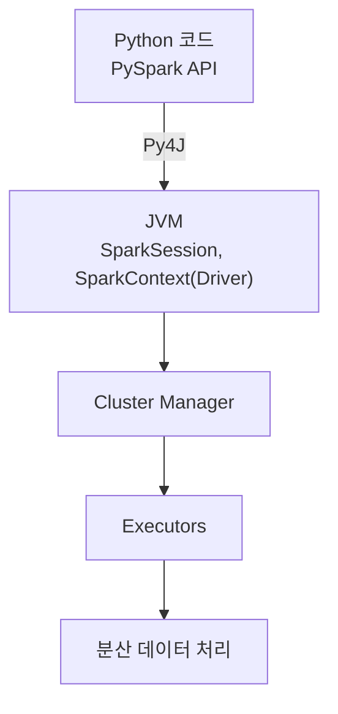

### 5-5. SparkSession 생성 코드 (40쪽)

```python
from pyspark.sql import SparkSession
spark = SparkSession.builder.appName("App").getOrCreate()
print(spark.version)
spark.stop()
```

- 출력은 3.5.4 다.
- (보충) appName("App")은 앱 이름을 정하고, getOrCreate()는 세션을 만들며, spark.stop()은 세션을 끝낸다. 강의는 코드와 출력만 보여 주고 뜻은 풀지 않는다.
- (보충) getOrCreate()는 이미 세션이 있으면 그것을 재사용한다는 설명도 강의에 없다.

### 5-6. sc.textFile()로 파일 읽기 (41쪽~43쪽)

- **sc.textFile() — 텍스트 파일을 읽어 RDD로 바꾸는 기본 함수.** (41쪽)
- 1단계: 터미널에서 테스트 파일을 만든다. 내용은 세 줄이다.
  - Hello Spark
  - Apache Spark is powerful
  - Big Data Processing

```bash
echo -e "Hello Spark \nApache Spark is powerful \nBig Data Processing" > test.txt
```

- 2단계: Spark shell에서 sc.textFile()을 실행하고 줄마다 출력한다.

```python
rdd = sc.textFile("test.txt")
rdd.foreach(print)
```

- 41쪽 캡처에서 경로 앞부분은 가려져 있다. 위 경로는 파일 이름만 옮긴 것이다.
- 3단계: 현재 파티션 개수를 본다. 결과는 2다. (42쪽)

```python
rdd.getNumPartitions()
print("현재 파티션 개수:", rdd.getNumPartitions())
```

- 4단계: repartition(1)로 파티션 수를 1개로 줄인다. (43쪽)
  - 강의 설명: 파티션 수를 1개로 줄여서 병렬성을 제한하고 데이터를 한곳으로 모은다.

```python
rdd_repartitioned = rdd.repartition(1)
print("변경된 파티션 수:", rdd_repartitioned.getNumPartitions())
```

- 결과는 변경된 파티션 수: 1 이다.
- (보충) repartition은 데이터를 다시 섞으므로 셔플이 생긴다. 강의는 이 점을 직접 말하지 않는다.

### 5-7. 예제로 보는 Action과 Transformation (44쪽~47쪽)

- **collect() — RDD의 모든 데이터를 배열 형태로 반환하는 Action.** (44쪽) 32쪽은 "Driver의 Python list"로 돌려준다고 적는다.
  - 데이터를 변환한 뒤 결과를 확인할 때 쓴다.
  - 큰 데이터셋에서는 사용을 지양한다.
  - (보충) 모든 데이터가 드라이버 한 곳으로 모이므로 메모리가 부족할 수 있기 때문이다. 이유는 강의에 없고 "지양"만 있다.

```python
rdd = sc.textFile("file://데이터경로/test.txt")
result = rdd.collect()
print(result)
```

- 44쪽 캡처에서 "데이터 경로"는 사용자 환경의 실제 경로 자리다. 결과는 ['Hello Spark', 'Apache Spark is powerful', 'Big Data Processing'] 이다.
- **count() — RDD의 전체 줄 개수를 세는 기본적인 Action.** (45쪽)
  - 모든 요소의 개수를 반환하며, RDD 연산의 결과를 즉시 평가한다.

```python
line_count = rdd.count()
print("줄 개수:", line_count)
```

- 결과는 줄 개수: 3 이다.
- **filter() — 조건을 만족하는 요소만 포함하는 새 RDD를 만드는 Transformation.** (46쪽)
  - 슬라이드 제목은 "3. 특정 단어가 포함된 줄 필터링(filter 연산)"이고, 특정 키워드를 포함한 줄만 필터링할 수 있다고 적혀 있다. 캡처에서는 "Spark" 글자에 빨간 테두리가 있다.

```python
filtered_rdd = rdd.filter(lambda line: "Spark" in line)
filtered_rdd.foreach(print)
```

- 결과는 Hello Spark, Apache Spark is powerful 두 줄이다.
- (보충) lambda line: "Spark" in line은 이름 없이 한 줄로 쓰는 작은 함수다. line은 RDD의 한 줄(요소)을 받는 변수 이름이다. 강의는 코드만 보여 주고 뜻은 풀지 않는다.
- **map() — RDD의 각 요소를 변환해 새 RDD를 만드는 Transformation.** (47쪽)
  - 슬라이드 제목은 "4. 모든 단어를 소문자로 변환하기(map 연산)"이고, RDD의 모든 요소에 변환 함수를 적용할 수 있다고 적혀 있다.

```python
lower_rdd = rdd.map(lambda line: line.lower())
lower_rdd.foreach(print)
```

- 결과는 hello spark, apache spark is powerful, big data processing 이다.
- (보충) 이 예제들은 4장의 지연 평가와 맞물린다. filter()와 map()은 새 RDD만 만들고, foreach(print), collect(), count() 같은 Action을 호출할 때 실제 계산이 일어난다. 28쪽, 32쪽, 33쪽을 종합한 설명이다. foreach(print)가 Action이라는 말은 강의에 없다.

### 5-8. Docker로 Spark 실행 (48쪽~50쪽)

- **Docker — 프로그램과 실행 환경을 컨테이너라는 상자에 담아 어디서든 똑같이 돌리는 도구.** (보충) 정의는 일반 설명이다.
- **docker-compose — 여러 컨테이너를 yaml 파일 하나로 묶어 한 번에 띄우는 도구.** (보충) 정의는 일반 설명이다.
- **이미지(image) — 컨테이너를 만들 때 쓰는 설치본 틀.** (보충)
- **Dockerfile — 이미지를 어떻게 만들지 적은 설명서 파일.** (보충)
- 강의 순서는 Spark 버전에 맞는 이미지를 가져오고, Dockerfile로 필요한 패키지를 내려받는 것이다. (48쪽)
- Dockerfile.spark 내용은 다음과 같다.

```dockerfile
FROM apache/spark:3.5.4-java17-python3

USER root

RUN ln -sf $(which python3) /usr/bin/python

RUN python3 -m pip install --no-cache-dir --upgrade pip && \
    python3 -m pip install --no-cache-dir pandas==2.2.3

USER spark
```

- 48쪽 캡처에서 위 코드의 주석은 "python3 위치 확인 후 심볼릭 링크", "pandas 설치"다. 주석은 뺐다.
- 49쪽 docker-compose.yaml은 spark-master와 spark-worker 두 서비스를 정의한다.

```yaml
services:
  spark-master:
    build:
      context: .
      dockerfile: Dockerfile.spark
    container_name: spark-master
    environment:
      - SPARK_MODE=master
      - SPARK_MASTER_HOST=spark-master
      - SPARK_RPC_AUTHENTICATION_ENABLED=no
      - SPARK_RPC_ENCRYPTION_ENABLED=no
      - SPARK_LOCAL_STORAGE_ENCRYPTION_ENABLED=no
      - SPARK_SSL_ENABLED=no
    ports:
      - "8083:8080"
      - "7077:7077"
      - "4040:4040"
    networks:
      - de_net
    command: /bin/bash -c "/opt/spark/sbin/start-master.sh && tail -f /dev/null"
    volumes:
      - ./jobs:/opt/spark/jobs
      - ./data:/opt/spark/data
      - ./output:/opt/spark/output
      - ./spark-defaults.conf:/opt/spark/conf/spark-defaults.conf:ro

  spark-worker:
    build:
      context: .
      dockerfile: Dockerfile.spark
    container_name: spark-worker
    environment:
      - SPARK_MODE=worker
      - SPARK_MASTER_URL=spark://spark-master:7077
    depends_on:
      - spark-master
    ports:
      - "8084:8081"
    networks:
      - de_net
    command: /bin/bash -c "sleep 5; /opt/spark/sbin/start-worker.sh $${SPARK_MASTER_URL} && tail -f /dev/null"
    volumes:
      - ./jobs:/opt/spark/jobs
      - ./data:/opt/spark/data
      - ./output:/opt/spark/output
      - ./spark-defaults.conf:/opt/spark/conf/spark-defaults.conf:ro

networks:
  de_net:
    driver: bridge
```

- 두 서비스를 합쳐 한 파일로 옮겼다. 49쪽 캡처는 spark-master가 왼쪽, spark-worker가 오른쪽, networks가 아래 작은 상자로 나뉘어 있다.
- (보충) 읽는 법은 다음과 같다. 코드를 읽은 해설이며 강의가 설명한 문장은 아니다.
  - master는 SPARK_MODE=master로 start-master.sh를 실행한다. worker는 SPARK_MODE=worker로 spark://spark-master:7077에 붙는다.
  - worker는 depends_on으로 master 컨테이너가 먼저 시작되도록 순서를 정하고, 실행 전 sleep 5를 한다.
  - 두 컨테이너는 같은 네트워크 de_net(driver: bridge)에 속한다.
  - jobs, data, output 폴더와 spark-defaults.conf를 호스트와 공유한다. 설정 파일은 :ro, 즉 읽기 전용이다.
- (보충) 7077은 Spark 마스터가 워커의 접속을 받는 포트, 8080은 마스터 웹 화면, 4040은 애플리케이션 웹 화면이다. 강의는 포트 매핑 값만 보여 주고 용도는 설명하지 않는다. 호스트 포트가 8083, 8084인 이유도 강의에서는 직접 다루지 않음.
- (보충) "8083:8080"은 호스트(내 컴퓨터) 8083번 포트를 컨테이너 8080번 포트에 잇는 "호스트:컨테이너" 형식이다. bridge는 같은 호스트 안의 컨테이너끼리 통신하게 해 주는 기본 가상 네트워크다.
- 50쪽 실행 예시는 호스트에서 docker exec로 컨테이너 안에 잡을 제출하는 방식이다.

```bash
docker exec spark-master /opt/spark/bin/spark-submit --master spark://spark-master:7077 /opt/spark/jobs/example.py
```

- 50쪽 캡처에서는 명령이 여러 줄로 줄바꿈돼 있다. 위는 한 줄로 이은 것이다.
- **spark-submit — 만든 Spark 프로그램을 클러스터에 제출해 실행시키는 명령.** (보충) 20쪽에서 클라이언트 모드를 "spark-submit을 실행한 프로세스에서 Driver 실행"이라고 설명했다.
- 제출하는 example.py는 다음과 같다.

```python
from pyspark.sql import SparkSession

spark = SparkSession.builder \
    .appName("Example") \
    .getOrCreate()

data = [
    ("Alice", 20),
    ("Bob", 30),
    ("Cathy", 40)
]
columns = ["name", "age"]

df = spark.createDataFrame(data, columns)

df.show()

spark.stop()
```

- 출력은 name, age 두 열에 Alice 20, Bob 30, Cathy 40 세 행이 있는 표다.
- 강의 원본 코드에는 각 블록 앞에 "SparkSession 생성", "간단한 데이터 생성", "DataFrame 생성", "결과 출력", "Spark 종료" 주석이 있다. 규칙에 따라 뺐다.

**결론:** 로컬에서는 SPARK_HOME과 PATH 환경변수(environment variable)를 잡고 pyspark로 대화형 실행하며, 클러스터 형태는 docker-compose로 master/worker를 띄운 뒤 spark-submit으로 잡(job)을 제출한다.

## 6. 흐름 한눈에 보기

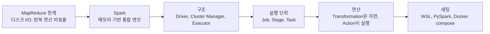

## 7. 시험/면접 대비 핵심 체크리스트

- [ ] Spark 탄생 배경을 말할 수 있는가. Hadoop MapReduce는 느린 속도와 반복 작업 비효율이 구조적 한계다. (7쪽)
- [ ] 느린 이유를 말할 수 있는가. 디스크 기반 처리이고, 디스크는 메모리(RAM)보다 읽기/쓰기가 현저히 느리다. (9쪽)
- [ ] 개발 연표를 아는가. 2009년 개발 시작, 2010년 오픈소스, 2014년 Apache 채택. UC Berkeley AMP Lab 출신이다. (6쪽, 7쪽)
- [ ] 설계 철학 네 축을 아는가. 속도, 사용 편의성, 모듈성, 확장성. (11쪽, 12쪽)
- [ ] 속도 세 가지를 아는가. 인메모리 연산, DAG 기반 스케줄링, Tungsten 코드 생성 최적화. (11쪽)
- [ ] 주요 컴포넌트 다섯 개를 아는가. Spark Core, Spark SQL, Spark Streaming(마이크로 배치), MLlib, GraphX. (14쪽)
- [ ] Spark의 한계 네 가지를 아는가. 엄밀한 실시간 불가(Micro-batch), 작은 파일 비효율, 자체 파일 시스템 부재, 높은 메모리 비용. (16쪽)
- [ ] 실행 구조 세 요소를 아는가. Driver(계획 생성, 작업 분배), Cluster Manager(자원 관리), Worker/Executor(작업 수행). (17쪽)
- [ ] 애플리케이션 구성 요소 일곱 가지를 아는가. 클러스터 매니저, 드라이버, 실행기, 세션, 잡, 스테이지, 태스크. (18쪽)
- [ ] 클러스터 매니저 종류를 아는가. Standalone, Hadoop YARN, Kubernetes(19쪽). 13쪽 그림에는 Mesos도 있다.
- [ ] 드라이버의 역할 네 가지와 "애플리케이션당 1개"를 아는가. (20쪽)
- [ ] 클러스터 모드와 클라이언트 모드의 차이를 아는가. 클러스터 모드는 클러스터에서 Driver 실행, 클라이언트 모드는 spark-submit을 실행한 프로세스에서 Driver 실행. (20쪽)
- [ ] 실행기(Executor)가 태스크를 슬롯(스레드)에서 병렬 실행하는 JVM 프로세스임을 아는가. (21쪽)
- [ ] SparkSession이 Spark 기능의 진입점이고, spark-shell에서는 기본 제공되나 애플리케이션에서는 직접 생성해야 함을 아는가. (22쪽)
- [ ] Job → Stage → Task 계층을 아는가. 잡은 액션이 만들고, 스테이지는 셔플 기준으로 나누며, 태스크는 파티션 하나를 맡는 최소 실행 단위다. (23쪽, 24쪽, 26쪽)
- [ ] Transformation과 Action을 구분하는가. Transformation은 immutable하게 새 RDD/DataFrame을 만들고, Action은 계산이나 저장을 실행한다. (28쪽, 32쪽)
- [ ] Narrow와 Wide의 차이를 예와 함께 말하는가. narrow는 filter(), map(), coalesce(shuffle=False). wide는 groupBy(), orderBy(), sortByKey(), reduceByKey(). join은 파티셔닝에 따라 둘 다 가능. (29쪽, 30쪽)
- [ ] Lazy evaluation과 lineage의 장점 두 가지를 아는가. 실행 계획 최적화와 장애 시 lineage 재실행으로 복구. (33쪽)
- [ ] 설치 명령 세 줄과 환경변수 두 줄을 정확히 쓸 수 있는가. wget, tar -xvzf, sudo mv. SPARK_HOME=/home/ssafy/spark, PATH=$SPARK_HOME/bin:$SPARK_HOME/sbin:$PATH. (35쪽, 36쪽)
- [ ] pip install pyspark==3.5.4 로 PySpark를 설치하고 pyspark로 셸에 들어가며, 시작 시 sc와 spark가 이미 제공됨을 아는가. (37쪽)
- [ ] PySpark 내부 경로를 말할 수 있는가. Python 코드(PySpark API) → Py4J → JVM의 SparkSession/SparkContext(Driver) → Cluster Manager → Executors → 분산 처리. (39쪽)
- [ ] SparkSession 생성 코드를 쓸 수 있는가. SparkSession.builder.appName("App").getOrCreate() 와 spark.stop(). (40쪽)
- [ ] textFile, getNumPartitions, repartition(1), collect, count, filter, map의 역할과 Transformation/Action 분류를 아는가. (41쪽~47쪽)
- [ ] collect()를 큰 데이터셋에서 지양하라는 점을 아는가. (44쪽)
- [ ] docker-compose의 master/worker 구조를 읽을 수 있는가. spark://spark-master:7077, depends_on, de_net(bridge), volumes(jobs/data/output). 잡은 docker exec spark-master /opt/spark/bin/spark-submit --master spark://spark-master:7077 /opt/spark/jobs/example.py 로 제출한다. (49쪽, 50쪽)

---

# Spark RDD 요약 (2/3) - 왜 필요하고, 무엇이며, 어떻게 쓰는가

> 용어 풀이는 이해를 돕는 일반 설명이다. 강의가 직접 정의한 것이 아닐 수 있다. 강의 근거가 아닌 서술은 (보충)으로 따로 표시했다. 강의 근거는 (N쪽)으로 표기했다. 강의에 없는 내용은 "강의에서는 직접 다루지 않음"이라고 적었다.

## 0. 강의 개요

- 강의 제목은 "데이터엔지니어링 활용1 - Spark RDD"다(1쪽).
- 챕터 포인트는 세 가지다(3쪽).
  - RDD의 개념
  - RDD 생성 및 변환
  - 연산 결과와 파티션 이동 예측
- (보충) Spark(스파크) — 여러 서버에 일을 나눠 대용량 데이터를 처리하는 분산 처리 엔진. RDD는 그 안에서 데이터를 다루는 기본 단위다.
- (보충) 큰 그림은 이렇다. 변환(Transformation)은 "이렇게 바꾸겠다"는 계획만 쌓고, 액션(Action)은 "결과를 달라"고 요청해 실제 계산을 시작시킨다.
- 강의 흐름은 아래와 같다.
  - RDD 개념(4~11쪽)
  - RDD 생성(12~16쪽)
  - 변환(Transformation) 연산(17~88쪽)
  - 액션(Action) 연산(89~102쪽)
  - 예측한 실행 확인(103쪽)

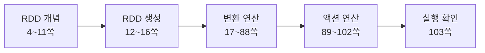

## 1. RDD는 왜 필요한가

### 1-1. 강의가 직접 말하는 배경

- 강의에서는 MapReduce의 한계, 직접 분산 처리의 어려움을 직접 다루지 않음. "RDD가 왜 등장했나"라는 역사적 설명이 강의에 없다.
- 강의가 말하는 RDD의 존재 이유는 정의 한 줄이다. RDD는 "대용량 데이터를 분산 처리하고 분석하기 위한 Spark의 기본 데이터 처리 단위"다(5쪽).
- 강의가 RDD의 성질로 내세운 것은 아래와 같다. (보충) 각각이 앞 절 같은 불편을 덜어 주는 쪽의 성질로 읽을 수 있다. 강의는 이 연결을 직접 쓰지 않았다.
  - 분산(Distributed): 큰 데이터를 여러 파티션(partition, 데이터 조각)으로 쪼개 나눠 다룬다(5, 6쪽).
  - 탄력성(Resilient): 노드(서버)가 장애로 중단되어도 데이터를 복구할 수 있다(7쪽).
  - 불변성(Immutable): 한 번 만든 RDD는 바꾸지 못하고, 변환하면 새 RDD가 생긴다(7쪽).
  - 지연 평가(Lazy Evaluation): 변환은 계산하지 않고 lineage(리니지, 변환 이력)에 기록만 한다(10쪽).
- 강의가 반복해서 다루는 주제는 셔플(shuffle)이다. 같은 키가 여러 파티션에 흩어져 있으면 서버 사이에서 데이터를 주고받으며 모아야 한다(58, 88쪽).

### 1-2. RDD 없이 직접 분산 처리하면 (보충)

- 강의에서는 직접 다루지 않음. 아래는 이해를 돕는 일반 설명이다.
- (보충) 데이터 나누기를 직접 해야 한다. 파일을 서버 여러 대에 어떻게 쪼갤지 개발자가 정한다.
- (보충) 서버 간 통신을 직접 짜야 한다. 같은 키의 값을 한 서버로 모으려면 네트워크 전송 코드가 필요하다.
- (보충) 장애 복구를 직접 짜야 한다. 서버 한 대가 죽으면 어떤 조각을 다시 계산할지 추적해야 한다.
- (보충) 계산 순서를 직접 관리해야 한다. 어디까지 끝났고 무엇이 남았는지 개발자가 기록한다.
- (보충) RDD는 이 네 가지를 프레임워크가 맡게 한다. 개발자는 map, filter 같은 함수만 적는다.

### 1-3. MapReduce와 비교 (보충)

- 강의에서는 직접 다루지 않음.
- (보충) MapReduce(맵리듀스) — 큰 데이터를 Map 단계와 Reduce 단계로 나눠 처리하는 구글발 분산 처리 모델. 단계 사이 중간 결과를 디스크에 쓰는 구조로 알려져 있다.
- (보충) Spark는 RDD로 중간 결과를 메모리에서 이어 쓴다고 알려져 있다. 강의는 이 비교를 하지 않았다.

**결론:** 강의가 직접 말한 것은 RDD가 분산 처리용 기본 데이터 처리 단위라는 점이다. (보충) 업계 용어로 풀면 분산 병렬 처리(distributed parallel processing)와 장애 허용(fault tolerance)을 한 추상화(abstraction)로 묶어 개발자가 분산 데이터를 컬렉션처럼 다루게 하는 단위다. 등장 배경은 강의에 없다.

## 2. RDD 핵심 개념 (4~11쪽)

### 2-1. RDD란 (5쪽)

- RDD는 Resilient Distributed Dataset의 약자다.
  - Resilient(탄력적인) — 일부가 고장 나도 되살릴 수 있는 성질.
  - Distributed(분산된) — 여러 서버에 나뉘어 놓인 성질.
  - Dataset(데이터셋) — 데이터 묶음.
- 용어 구조는 이렇다.
  - Object(item, record) — RDD를 이루는 낱개 데이터 하나.
  - Partition(파티션) — RDD를 쪼갠 조각. 분산된 데이터 파티션이다.
  - partitioning, sharding — 원본 RDD를 파티션으로 나누는 일.
- 그림은 An RDD(데이터셋의 원본) 4칸이 화살표를 따라 파티션 4개로 나뉘는 모습이다. 낱개 데이터는 An object(=item, record)로, 조각은 Partition(분산된 데이터 파티션)으로 적혀 있다.

### 2-2. 데이터의 추상화 (6쪽)

- 강의 그림은 데이터 5개를 파티션 3개에 나눠 담는다. 첫 번째 Data는 첫 파티션, 두 번째와 세 번째는 가운데 파티션, 네 번째와 다섯 번째는 세 번째 파티션으로 간다. 파티션 하나에 데이터가 하나일 수도, 둘일 수도 있다.
- 추상화(abstraction) — 복잡한 내부를 감추고 단순한 모양만 보이게 하는 것.
- (보충) 개발자는 RDD 하나만 보고, 파티션 배치는 Spark가 맡는다고 이해할 수 있다. 강의는 이 문장을 직접 쓰지 않았다.

### 2-3. 탄력성과 불변성 (7쪽)

- RDD는 한 번 생성되면 변경할 수 없다.
- 어떤 노드(서버)가 장애로 중단되더라도 데이터 복구가 가능하다.
- 그림은 RDD에 변환(map, filter 등)을 적용하면 기존 RDD가 아닌 New RDD가 만들어지는 모습이다.
- 불변성(immutability) — 만든 뒤 값을 바꾸지 않는 성질. 바꾸고 싶으면 새로 만든다.
- 강의는 복구가 어떤 원리로 되는지 이 쪽에서 설명하지 않는다. (보충) 10쪽의 lineage 기록이 단서로 읽힌다.

### 2-4. 타입 안정성 (8쪽)

- 하나의 타입의 객체를 가질 수 있다.
- 데이터 타입을 컴파일 시점에 검사한다.
- 성능 최적화가 된다.
- 코드의 가독성과 유지보수성이 향상된다.
- PySpark를 쓸 때는 Python이 동적 타입 언어이기 때문에 타입 안정성이 적용되지 않는다.
- (보충) 타입 안정성(type safety) — 값의 종류(타입)가 맞지 않는 사용을 막아 주는 성질.
- (보충) 동적 타입(dynamic typing) — 프로그램을 돌릴 때 비로소 값의 타입이 정해지는 방식.
- 컴파일 시점 검사(compile-time check) — 프로그램을 실행하기 전에 타입 오류를 찾아내는 것.

### 2-5. 정형 vs 비정형 데이터 (9쪽)

- 비정형 데이터(unstructured) — 고정된 포맷이 없는 텍스트 데이터.
  - sc.textFile()로 RDD에 올린 뒤 map, filter, flatMap 등으로 가공한다.
- 정형 데이터(structured) — 컬럼이 있는 테이블 형태 데이터.
  - DataFrame 또는 RDD.map()으로 가공한다.
- (보충) DataFrame(데이터프레임) — 컬럼 이름이 붙은 표 형태의 데이터 구조. 강의는 이 쪽에서 따로 설명하지 않는다.

### 2-6. 지연 평가 (10쪽)

- 변환은 즉시 계산하지 않고 lineage에 기록한다.
- Action(액션, 결과를 실제로 달라고 요청하는 연산)이 필요한 파티션의 계산을 실행한다.
- 같은 Stage의 좁은 변환을 파티션별로 이어서 처리한다. (보충) 좁은 변환 — 다른 파티션 데이터가 필요 없어 셔플 없이 끝나는 변환. 4장에서 정리한다.
- 그림 흐름은 Storage에서 읽은 RDD1, transformation으로 RDD2, 다시 transformation으로 RDD3, action으로 result다. Storage에서 RDD1로 가는 화살표에는 "Rdd created by reading data from stable storage"(안정적인 저장소에서 데이터를 읽어 만든 RDD)라고 적혀 있다.
- 지연 평가(lazy evaluation) — 지금 계산하지 않고, 결과가 꼭 필요할 때 한꺼번에 계산하는 방식.
- 리니지(lineage) — 이 RDD가 어떤 RDD에서 어떤 변환으로 만들어졌는지 적어 둔 족보.
- 스테이지(Stage) — 셔플 없이 이어서 처리할 수 있는 연산 묶음.
- 강의는 DAG(방향성 비순환 그래프)라는 용어를 직접 쓰지 않음. (보충) 그림의 화살표 연결(Storage에서 RDD1, RDD2, RDD3, result)이 그 개념에 해당하는 모양이다.
- (보충) DAG(Directed Acyclic Graph) — 방향이 있고 순환이 없는 그래프. lineage를 그래프로 그린 모양이다.
- (보충) 복구 원리는 이렇게 이해할 수 있다. 파티션이 사라지면 lineage를 따라 원본부터 그 파티션만 다시 계산한다. 강의는 이 문장을 직접 쓰지 않았다.

### 2-7. 주요 구성 요소 정리 코드 (11쪽)

강의 코드를 주석 없이 옮겼다.

```python
from pyspark import SparkContext

sc = SparkContext("local", "LazyEvalExample")

rdd = sc.parallelize(["apple", "banana", "spark", "data"])

upper_rdd = rdd.map(lambda x: x.upper())

filtered_rdd = upper_rdd.filter(lambda x: "SPARK" in x)

result = filtered_rdd.collect()
```

- 코드 설명은 아래와 같다.
  - (보충) SparkContext("local", "LazyEvalExample")는 로컬 모드(내 컴퓨터 한 대에서 실행)로 이름이 LazyEvalExample인 컨텍스트를 만든다.
  - sc.parallelize(...)는 메모리의 리스트를 RDD로 만든다. 슬라이드는 이 줄을 "텍스트 데이터 로딩 → Transformation"이라고 적었다. (보충) 엄밀히 parallelize는 RDD 생성(3장)이고 변환 연산 표에는 없다.
  - rdd.map(lambda x: x.upper())는 문자열을 대문자로 바꾸는 변환이다. (보충) lambda(람다) — 이름 없이 한 줄로 쓰는 Python 함수. 슬라이드는 "대문자로 바꾸기 → Transformation"이라고 적었다.
  - upper_rdd.filter(lambda x: "SPARK" in x)는 SPARK가 들어간 문자열만 남기는 변환이다. 슬라이드는 "SPARK가 포함된 문자열만 필터링 → Transformation"이라고 적었다.
  - 슬라이드는 filter까지를 "지금까지는 아무것도 실행되지 않음"이라고 적었다.
  - filtered_rdd.collect()는 Action이고, 이때 계산이 실제로 돈다. 슬라이드는 "결과 확인 (Action)"이라고 적었다.
- 강의 실행 결과 출력은 없음.
- (보충) 입력과 연산으로 따져 보면 result는 ['SPARK']다.
- 컨텍스트(SparkContext) — Spark 클러스터와 연결하는 시작점 객체. 코드에서 sc로 쓴다.

**결론:** RDD의 핵심은 불변성(immutability), 분산 파티셔닝(partitioning), 지연 평가(lazy evaluation) 세 가지다. 장애 허용(fault tolerance, 일부가 죽어도 복구)은 (보충) lineage 기반 재계산으로 풀린다고 이해할 수 있다. 강의는 이 연결을 직접 쓰지 않았다.

## 3. RDD 생성 (12~16쪽)

### 3-1. 연산 결과를 읽는 4가지 질문과 확인 원칙 (13쪽)

변환마다 아래 질문으로 결과와 이동을 예측하라는 것이 강의의 틀이다. 슬라이드는 질문 4개와 확인 원칙 2개, 모두 6줄이다.

- 연산 결과: 각 요소의 값과 개수는 어떻게 바뀔까?
- 파티션: 이 계산에 다른 파티션의 데이터가 필요할까?
- 데이터 이동: shuffle이 있다면 무엇을 모아야 할까?
- 실행 시점: Action 전후에 실제로 무엇이 실행될까?
- 결과와 이동을 먼저 예측하고 코드와 Spark UI로 확인한다.
- 셔플 표시는 해당 연산 자체 기준이다. 앞선 변환과 Driver 전송은 별도로 확인한다.
- 셔플(shuffle) — 같은 키 값을 모으려고 파티션 사이에서 데이터를 서버 간에 주고받는 일.
- 드라이버(Driver) — 사용자 프로그램을 돌리고 최종 결과를 받아 가는 중심 프로세스.
- Spark UI — 실행 중인 작업의 Stage, Task 같은 정보를 보여 주는 웹 화면.

### 3-2. 두 가지 생성 방법 (14쪽)

- 메모리 데이터를 RDD로 변환하는 방법
  - Python의 리스트(List)나 Scala의 컬렉션(Collection)을 RDD로 바꾼다.
  - 주로 테스트나 작은 데이터셋을 다룰 때 쓴다.
- 외부 파일(텍스트, CSV, JSON 등)에서 RDD를 만드는 방법
  - 실무에서는 보통 파일이나 데이터베이스에서 데이터를 불러와야 한다.
  - `sc.textFile("파일 경로")`를 쓴다.
  - `spark.read.format("jdbc").option(...).load().rdd`로 DataFrame을 RDD로 변환할 수 있다.
  - (보충) jdbc — 자바 계열 프로그램이 데이터베이스에 접속하는 표준 규격.

### 3-3. parallelize() (15쪽)

- 기존 메모리 데이터를 Spark의 RDD로 변환하는 역할이다.
- 메모리에 있는 데이터를 Spark 클러스터(cluster, 함께 일하는 서버 묶음)로 보낼 때 쓴다.
- 데이터가 클 경우 비효율적일 수 있어 소규모 데이터 분석에 주로 쓴다.

Python 예제는 아래와 같다.

```python
wordsRDD = sc.parallelize(["fish", "cats", "dogs"])
```

Scala 예제는 아래와 같다.

```scala
val wordsRDD = sc.parallelize(List("fish", "cats", "dogs"))
```

Java 예제는 아래와 같다.

```java
JavaRDD<String> wordsRDD = sc.parallelize(Arrays.asList("fish", "cats", "dogs"))
```

### 3-4. sc.textFile() (16쪽)

- 외부 파일에서 데이터를 직접 읽어와 RDD로 변환하는 역할이다.
- 읽는 대상은 일반 텍스트 파일(CSV, 로그 파일 등), S3 같은 저장소, HBase와 Cassandra 같은 NoSQL 데이터베이스 등이다. 슬라이드는 앞의 둘을 "저장소에서 데이터 로드", 뒤의 둘을 "NoSQL 데이터베이스에서 읽기"로 묶었다.
- (보충) S3 — 아마존의 파일 저장 서비스. HBase, Cassandra — 대용량 NoSQL 데이터베이스(표와 SQL 방식을 따르지 않는 DB). 강의는 풀이하지 않았다.
- 아래 예제의 슬라이드 설명은 "로컬 텍스트 파일 읽기(Read a local text file)"다.

Python 예제는 아래와 같다.

```python
linesRDD = sc.textFile("/path/to/README.md")
```

Scala 예제는 아래와 같다.

```scala
val linesRDD = sc.textFile("/path/to/README.md")
```

Java 예제는 아래와 같다.

```java
JavaRDD<String> linesRDD = sc.textFile("/path/to/README.md")
```

**결론:** RDD는 인메모리 컬렉션은 parallelize(), 외부 저장소는 textFile() 같은 데이터 소스 API로 만든다.

## 4. Transformation: 변환 연산 (17~88쪽)

- Transformation(변환) — 기존 RDD에서 새 RDD를 만드는 연산. 지연 평가라 호출만으로는 계산이 돌지 않는다(10쪽).
- 강의는 각 변환의 설명 슬라이드에 "셔플 없음" 또는 "셔플 발생"을 적었다(repartition은 77쪽 코드 주석). 아래 표는 그 표시를 모은 것이다.

| 연산 | 하는 일 | 셔플 | 근거 |
| --- | --- | --- | --- |
| map | 각 요소에 함수 적용 | 없음 | 22, 23쪽 |
| flatMap | 함수 적용 후 평탄화 | 없음 | 29, 30쪽 |
| filter | 조건 만족 요소만 유지 | 없음 | 36쪽 |
| mapPartitions | 파티션별로 함수 적용 | 없음 | 40쪽 |
| mapPartitionsWithIndex | 파티션 인덱스와 함께 처리 | 없음 | 42쪽 |
| keyBy | 요소에 키만 부여 | 없음 | 47쪽 |
| groupBy | 함수 결과를 키로 그룹화 | 발생(예제) | 53쪽 |
| groupByKey | 키별 값 모으기 | 발생(예제) | 57쪽 |
| reduceByKey | 부분 집계 후 키별 재분배 | 발생(예제) | 60쪽 |
| join | 같은 키끼리 짝짓기 | 발생(예제) | 68쪽 |
| union | 두 RDD 이어 붙임 | 없음 | 70쪽 |
| distinct | 중복 제거 | 발생(예제) | 74쪽 |
| sample | 통계적 표본 추출 | 없음 | 76쪽 |
| repartition | 파티션 수 변경, 재분배 | 발생 | 77쪽 |
| coalesce | 파티션 수 줄임 | 없음(shuffle=False) | 81쪽 |
| partitionBy | 지정한 partitioner로 재분배 | 발생(예제) | 87쪽 |

- 슬라이드는 groupBy, groupByKey, reduceByKey, join, distinct, partitionBy에 "셔플 발생 (예제)"라고 적었다. 같은 partitioner면 생략 가능하다는 단서가 groupByKey, reduceByKey, join, partitionBy에 붙는다(57, 60, 68, 87쪽).
- partitioner(파티셔너) — 키를 보고 어느 파티션으로 보낼지 정하는 규칙.

### 4-1. map (17~23쪽)

- 입력 RDD x의 항목에 사용자 정의 함수를 하나씩 적용해 RDD y를 만든다(18~21쪽).
- 파티션 내부에서 처리하고 셔플이 없다(22쪽).
- 문법은 `map(f, preservesPartitioning = False)`다. RDD의 각 요소에 함수 f를 적용해 새 RDD를 반환한다(23쪽).
- preservesPartitioning은 mapPartitions, mapPartitionsWithIndex, flatMap에도 같은 모양으로 나온다. (보충) 결과 RDD가 기존 파티션 배치를 그대로 유지하는지 알려 주는 옵션이다. 강의는 풀이하지 않았다.
- 항목 개수는 그대로다. 항목 3개가 들어가면 3개가 나온다.
- 18~20쪽 그림은 x의 항목 3개에 함수가 하나씩 적용되어 y의 초록 항목이 하나씩 늘어나는 모습이다. 21쪽은 전(x)과 후(y) 라벨만 붙은 비교 그림이다. 23쪽에는 "셔플 없음, 각 파티션에서 요소 변환"이라고 적혀 있다.
- 17쪽 그림은 "(partitions not shown)"이라고 적었다. 각 아이템이 어떤 파티션에 속하는지는 그림에 표시하지 않았다는 뜻이다. filter, flatMap, groupBy, groupByKey 그림에도 같은 문구가 있다.

```python
x = sc.parallelize(["b", "a", "c"])
y = x.map(lambda z: (z, 1))
print(x.collect())
print(y.collect())
```

- 출력은 아래와 같다.

```text
x: ['b', 'a', 'c']
y: [('b', 1), ('a', 1), ('c', 1)]
```

### 4-2. flatMap (24~30쪽)

- 모든 요소에 먼저 함수를 적용한 뒤, 그 결과를 평탄화(flatten)해 새 RDD를 반환한다(29쪽).
- 평탄화(flatten) — 리스트 속 리스트를 한 겹으로 펴서 낱개 항목으로 만드는 것.
- 파티션 안에서 변환과 평탄화를 하고 셔플이 없다(30쪽).
- 문법은 `flatMap(f, preservesPartitioning = False)`다.
- map은 항목 수가 그대로고, flatMap은 항목 수가 늘 수 있다. 슬라이드 그림에서 요소 하나가 3칸으로 펼쳐지며, 결과 쪽 항목이 3개, 6개, 9개로 늘어난다(25~28쪽). 28쪽은 "flatmap() 적용 후"라는 제목에 before(x)와 after(y) 라벨이 붙은 비교 그림이다.
- 그림은 요소 하나를 3칸으로 그려 결과가 9개다. 코드는 요소마다 4개(1*x, 2*x, 3*x, 100)를 만들어 결과가 12개다. 강의 원본 자체의 불일치다. 요약의 오독이 아니다(29, 30쪽 PDF로 확인). 코드 출력(12개, 평균 28.0)이 코드와 맞는다.

```python
x = sc.parallelize([1, 2, 3])
y = x.flatMap(lambda x: (1*x, 2*x, 3*x, 100))
print(x.collect())
print(y.collect())
print(y.mean())
```

- 출력은 아래와 같다.

```text
x : [1, 2, 3]
y : [1, 2, 3, 100, 2, 4, 6, 100, 3, 6, 9, 100]
y.mean() : 28.0
```

### 4-3. filter (31~36쪽)

- 사용자 함수를 적용해, 함수의 반환값이 true인 항목만 유지한다(32~35쪽).
- 그림은 항목 3개를 차례로 검사한다. 첫 항목은 True라 emit(결과로 내보냄)되고(32쪽), 둘째는 False라 빠지고(33쪽), 셋째는 True라 emit된다(34쪽). 35쪽은 before(x)와 after(y) 비교다.
- 조건을 만족하는 요소를 유지하고, 셔플이 없고, 빈 파티션이 생길 수 있다(36쪽).
- 파티션 내부에서 조건을 검사한다.
- 문법은 `filter(f)`다.

```python
x = sc.parallelize([1, 2, 3])
y = x.filter(lambda x: x%2 == 1)
print(x.collect())
print(y.collect())
```

- 출력은 아래와 같다. 슬라이드 코드의 주석(`#keep odd value`)은 홀수만 남긴다는 뜻이다.

```text
x: [1, 2, 3]
y: [1, 3]
```

### 4-4. 파티션 안에서 이어지는 연산 (37~38쪽)

- 입력 RDD는 2개 파티션이다. P0은 [1, 2, 3], P1은 [4, 5, 6]이다. `map(x * 2)` 뒤에 `filter(x > 6)`를 붙인다.
- 질문은 세 가지다(37쪽). 각 출력 파티션에는 어떤 값이 남을까, P0와 P1 사이에 값을 주고받아야 할까, 결과가 없는 파티션은 사라질까.
- 답은 아래와 같다(38쪽).

```text
P0: []
P1: [8, 10, 12]
```

- 출력도 2개 파티션이다. P0가 비어도 파티션은 유지된다.
- 두 연산은 각 파티션 안에서 연결되며 shuffle 없이 계산된다.
- Action을 실행하면 이 구간은 파티션별 Task로 처리된다.
- 태스크(Task) — 파티션 하나를 처리하는 작업 단위.
- (보충) 계산 과정(P0: 2, 4, 6 중 6 초과 없음)은 슬라이드 값에서 직접 따진 것이다.

### 4-5. mapPartitions (39~40쪽)

- RDD의 각 파티션에 함수 f를 적용해 새 RDD를 반환한다. 셔플이 없고 파티션별 iterator로 처리한다.
- 문법은 `mapPartitions(f, preservesPartitioning=False)`다.
- 39쪽 그림에는 파티션을 가리키는 A, B 라벨이 붙어 있다.
- iterator(이터레이터) — 값을 하나씩 꺼내 주는 반복 객체.
- (보충) map은 요소마다 함수가 불리고, mapPartitions는 파티션마다 함수가 한 번 불린다. 강의는 이 비교를 직접 쓰지 않았다.

```python
x = sc.parallelize([1, 2, 3], 2)

def f(iterator):
    yield sum(iterator)
    yield 42

y = x.mapPartitions(f)
print(x.glom().collect())
print(y.glom().collect())
```

- glom()은 파티션별 요소를 리스트로 묶어 보여 준다(슬라이드 주석 설명).
- (보충) yield — 값을 하나씩 내보내는 Python 문법. 함수가 `yield`를 두 번 쓰면 파티션마다 값 두 개가 나온다.
- 출력은 아래와 같다.

```text
x: [[1], [2, 3]]
y: [[1, 42], [5, 42]]
```

- 파티션마다 합계와 42가 한 번씩 나온다. 첫 파티션 [1]은 합 1, 둘째 [2, 3]은 합 5다.

### 4-6. mapPartitionsWithIndex (41~42쪽)

- 원래 파티션의 인덱스를 추적하면서, RDD의 각 파티션에 함수를 적용해 새 RDD를 반환한다. 셔플이 없다.
- 문법은 `mapPartitionsWithIndex(f, preservesPartitioning=False)`다.
- 함수 f는 (partitionIndex, iterator) 두 인자를 받는다.
- 41쪽 그림은 입력 파티션 쪽에 "Spark input partition index"라는 표시를 붙였다. (보충) 파티션 번호를 Spark가 넣어 준다는 뜻으로 읽힌다.
- 슬라이드 설명은 "인덱스와 파티션 내부 처리"다(42쪽).

```python
x = sc.parallelize([1, 2, 3], 2)

def f(partitionIndex, iterator):
    yield (partitionIndex, sum(iterator))

y = x.mapPartitionsWithIndex(f)
print(x.glom().collect())
print(y.glom().collect())
```

- 출력은 아래와 같다.

```text
x: [[1], [2, 3]]
y: [[(0, 1)], [(1, 5)]]
```

### 4-7. keyBy (43~47쪽)

- 원래 RDD의 각 항목에 대해 쌍(pair)을 만들어 Pair RDD를 만든다. 쌍의 key는 사용자 정의 함수가 값으로부터 계산한다(47쪽).
- 요소에 키만 부여하고 셔플이 없다.
- 그림(43~46쪽)은 John에 'J', Fred에 'F', Anna에 'A', James에 'J' 순서로 키가 붙는 모습이다. 키는 emits 라벨로 표시된다.
- 문법은 `keyBy(f)`다.
- Pair RDD(페어 RDD) — (키, 값) 쌍으로 이뤄진 RDD. groupByKey, reduceByKey, join이 이 형태를 받는다.

```python
x = sc.parallelize(['John', 'Fred', 'Anna', 'James'])
y = x.keyBy(lambda w: w[0])
print(y.collect())
```

- 출력은 아래와 같다.

```text
x: ['John', 'Fred', 'Anna', 'James']
y: [('J', 'John'), ('F', 'Fred'), ('A', 'Anna'), ('J', 'James')]
```

- 값은 원본 문자열 그대로이고, 키는 첫 글자다. 두 항목('John', 'James')이 같은 키 'J'를 가진다.

### 4-8. groupBy (48~53쪽)

- 원래 RDD의 데이터를 그룹화하기 위해, 사용자 정의 함수의 출력값을 key로 한다. 이 key에 해당하는 모든 항목을 value로 가지는 쌍(pair)을 만든다(53쪽).
- 셔플이 발생한다(예제). 생성한 키 기준으로 재분배한다.
- 문법은 `groupBy(f, numPartitions=None)`다.
- 48쪽은 "4 items in RDD"(James, Anna, Fred, John)다. 그림은 John('J'), Fred('F'), Anna('A'), James('J') 순서로 키를 만들어 초록 쌍에 모으는 과정이다. 마지막에 J 키에는 ["John", "James"]가 쌓인다(49~52쪽).

```python
x = sc.parallelize(['John', 'Fred', 'Anna', 'James'])
y = x.groupBy(lambda w: w[0])
print([(t[0], [i for i in t[1]]) for t in y.collect()])
```

- 슬라이드 주석(`# A function to generate keys`)은 groupBy에 넘긴 함수가 키를 만든다는 뜻이다.
- 출력은 아래와 같다.

```text
x: ['John', 'Fred', 'Anna', 'James']
y: [('A', ['Anna']), ('J', ['John', 'James']), ('F', ['Fred'])]
```

- 슬라이드는 같은 동작을 아래 두 줄로도 보여 준다(53쪽).

```python
x = x.map(lambda w: (w[0], w))
y = x.groupByKey()
```

### 4-9. groupByKey (54~57쪽)

- 원래 RDD에서 각 key에 해당하는 value들을 그룹화한다. 그룹화된 value들을 모아 원래의 key와 함께 새로운 쌍(pair)을 만든다(57쪽).
- 셔플이 발생한다(예제). 키별 값들을 모아 전달한다. 같은 partitioner면 생략 가능하다.
- 문법은 `groupByKey(numPartitions=None)`다.
- 입력은 Pair RDD다. 그림은 5개 항목(B 5, B 4, A 3, A 2, A 1)이 키별로 모이는 모습이다(54~56쪽).

```python
x = sc.parallelize([('B', 5), ('B', 4), ('A', 3), ('A', 2), ('A', 1)])
y = x.groupByKey()
print(x.collect())
print([(t[0], [i for i in t[1]]) for t in y.collect()])
```

- 출력은 아래와 같다.

```text
x: [('B', 5), ('B', 4), ('A', 3), ('A', 2), ('A', 1)]
y: [('B', [5, 4]), ('A', [3, 2, 1])]
```

- 그림(55, 56쪽)에는 A의 값이 [2,3,1] 순서로, B의 값이 [5,4]로 그려져 있다. 코드 출력은 [3,2,1]이다. (보충) 값 순서는 파티션에서 도착하는 순서에 따라 달라질 수 있다.

### 4-10. 같은 키를 모으려면 (58쪽)

- 입력은 P0: [(a, 1), (b, 1)], P1: [(a, 1), (a, 1)]이다.
- 강의가 던진 질문은 아래와 같다.
  - a의 모든 값이 이미 한 파티션에 모여 있을까?
  - 키별 합계를 구하려면 어느 값이 이동해야 할까?
  - 각 파티션에서 먼저 합치면 전달할 값은 어떻게 달라질까?
  - groupByKey와 reduceByKey의 실행 흐름을 비교해 보자.
- 강의는 이어서 61쪽에 비교 설명을 두고, 62, 63쪽 그림으로 이동량을 보여 준다.

### 4-11. Word Counting 예시: groupByKey (59쪽)

- map 뒤의 groupByKey에서 키별 재분배가 일어난다. 그 뒤의 map은 셔플이 없다.

```python
words = sc.parallelize(['one', 'two', 'two', 'three', 'three', 'three'])
wordPairsRdd = words.map(lambda w: (w, 1))
wordCounts = wordPairsRdd.groupByKey().map(lambda pair: (pair[0], sum(pair[1])))

print(words.collect())
print(wordPairsRdd.collect())
print(wordCounts.collect())
```

- 출력은 아래와 같다.

```text
words: ['one', 'two', 'two', 'three', 'three', 'three']
wordPairsRDD: [('one', 1), ('two', 1), ('two', 1), ('three', 1), ('three', 1), ('three', 1)]
wordCounts: [('one', 1), ('two', 2), ('three', 3)]
```

### 4-12. Word Counting 예시: reduceByKey (60쪽)

- reduceByKey는 부분 집계 후 키별 재분배한다. 같은 partitioner면 생략 가능하다.
- 슬라이드 메모에 "= Grouping + Aggregation"이라고 적혀 있다. 키별로 묶고 집계를 한 번에 한다는 뜻이다.

```python
words = sc.parallelize(['one', 'two', 'two', 'three', 'three', 'three'])
wordPairsRdd = words.map(lambda w: (w, 1))
wordCounts = wordPairsRdd.reduceByKey(lambda cnt1, cnt2: cnt1 + cnt2)

print(words.collect())
print(wordPairsRdd.collect())
print(wordCounts.collect())
```

- 출력은 groupByKey 예시와 같다.

```text
words: ['one', 'two', 'two', 'three', 'three', 'three']
wordPairsRDD: [('one', 1), ('two', 1), ('two', 1), ('three', 1), ('three', 1), ('three', 1)]
wordCounts: [('one', 1), ('two', 2), ('three', 3)]
```

### 4-13. reduceByKey vs groupByKey (61~63쪽)

- 같은 키가 여러 파티션에 있으면 두 방식 모두 재분배가 필요하다(61쪽).
- groupByKey는 각 키의 모든 값을 모아 후속 연산을 수행한다.
- reduceByKey는 파티션 안에서 먼저 집계한 뒤 부분 결과를 전달한다.
- 그림에서 원본 값 11개와 부분 합계 6개의 이동을 비교한다(61쪽).
- 그림(62, 63쪽)의 입력은 파티션 3개다. 도착 파티션에는 a, b 이름표가 붙어 있다.
  - 파티션 1: (a,1), (b,1)
  - 파티션 2: (a,1), (a,1), (b,1), (b,1)
  - 파티션 3: (a,1), (a,1), (a,1), (b,1), (b,1)

reduceByKey 흐름(62쪽)은 아래와 같다.

- 각 파티션이 먼저 안에서 합친다.
  - 파티션 1: (a,1), (b,1)
  - 파티션 2: (a,2), (b,2)
  - 파티션 3: (a,3), (b,2)
- 합친 부분 결과 6개만 키별 파티션으로 이동한다.
  - a 쪽: (a,1), (a,2), (a,3)을 합쳐 (a,6)
  - b 쪽: (b,1), (b,2), (b,2)를 합쳐 (b,5)

groupByKey 흐름(63쪽)은 아래와 같다.

- 합치지 않고 원본 (키, 1) 11개를 전부 키별 파티션으로 이동한다.
  - a 쪽: (a,1) 6개를 받아 (a,6)
  - b 쪽: (b,1) 5개를 받아 (b,5)

아래 그림은 62, 63쪽 내용을 옮겨 그린 것이다.

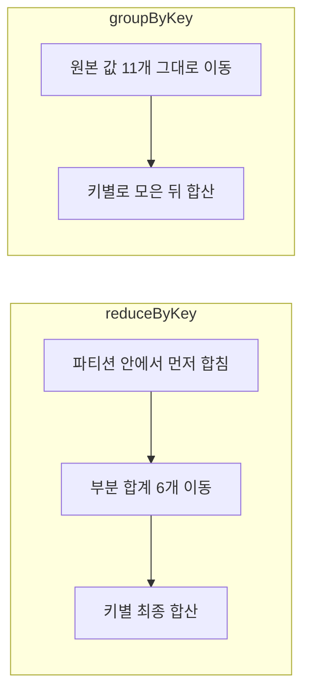

- 결과는 같고 이동하는 데이터 양이 다르다. 11개 대 6개다.
- 강의는 reduceByKey가 낫다고 직접 결론내리지 않았다. 이동량 비교만 제시했다. 선택은 학습자가 한다.

**결론:** 키 단위 집계에서는 셔플 대상 데이터량이 갈린다(강의 그림 기준 6개 대 11개). reduceByKey는 (보충, 업계 용어) 맵 사이드 컴바이닝(map-side combining, 보내기 전 로컬 선집계)에 해당하는 방식으로 이동량을 줄이고, groupByKey는 원본 값 전체를 옮긴다.

### 4-14. join (64~68쪽)

- 원래 RDD들에서 같은 키를 가진 모든 요소 쌍(pair)을 포함하는 새 RDD를 반환한다(68쪽).
- 셔플이 발생한다(예제). 조인 키를 기준으로 재분배한다. 같은 partitioner면 생략 가능하다.
- 문법은 `join(otherRDD, numPartitions=None)`다.
- 그림 해설은 이렇다. x는 (B,2), (A,1), y는 (B,5), (A,4), (A,3)이다. x의 A는 y의 A 두 개와 각각 짝지어진다. B끼리는 (2,5)가 된다. 결과 z는 (1,3), (1,4), (2,5) 순서로 하나씩 쌓인다(65~67쪽).

```python
x = sc.parallelize([("a", 1), ("b", 2)])
y = sc.parallelize([("a", 3), ("a", 4), ("b", 5)])
z = x.join(y)
print(z.collect())
```

- 출력은 아래와 같다.

```text
x: [("a", 1), ("b", 2)]
y: [("a", 3), ("a", 4), ("b", 5)]
z: [("a", (1, 3)), ("a", (1, 4)), ("b", (2, 5))]
```

- 예제의 키 a, b는 두 RDD에 모두 있다. 한쪽에만 있는 키가 있을 때 어떻게 되는지는 강의에서는 직접 다루지 않음.
- (보충) 일반적으로 이 join은 양쪽에 모두 있는 키만 결과에 남기는 안쪽 조인(inner join)으로 알려져 있다.

### 4-15. union (69~70쪽)

- 두 개의 원래 RDD에서 모든 항목을 포함하는 새 RDD를 반환한다. 중복된 항목은 제거하지 않는다.
- 셔플이 없다. 부모 파티션들을 이어 붙인다.
- 문법은 `union(otherRDD)`다.

```python
x = sc.parallelize([1, 2, 3], 2)
y = sc.parallelize([3, 4], 1)
z = x.union(y)
print(z.glom().collect())
```

- 출력은 아래와 같다.

```text
x: [1, 2, 3]
y: [3, 4]
z: [[1], [2, 3], [3, 4]]
```

- 파티션 2개와 1개가 이어 붙어 3개가 된다. 3은 두 번 남는다.
- 그림(69쪽)은 x(항목 3, 2, 1)가 파티션 A, B로, y(항목 4, 3)가 파티션 C로 표시되고, z가 A, B, C 세 파티션에 항목 5개(4, 3, 3, 2, 1)를 가지는 모습이다.

### 4-16. distinct (71~74쪽)

- 원래 RDD에서 중복을 제거한 고유한 항목들만 포함하는 새 RDD를 반환한다(74쪽).
- 셔플이 발생한다(예제). 같은 값을 모아 중복을 제거한다.
- 문법은 `distinct(numPartitions=None)`다.
- 그림(71~73쪽)은 x의 항목 4, 3, 3, 2, 1 중 중복된 3 하나가 흐려지고(72쪽), y가 4, 3, 2, 1이 되는 모습이다.

```python
x = sc.parallelize([1, 2, 3, 3, 4])
y = x.distinct()
print(y.collect())
```

- 출력은 아래와 같다.

```text
x: [1, 2, 3, 3, 4]
y: [1, 2, 3, 4]
```

### 4-17. sample (75~76쪽)

- 큰 데이터에서 일부 샘플만으로 통계적으로 의미 있는 근사치를 얻는다는 취지다(75쪽). 머신 수가 많아질수록 처리 효율이 높아진다고도 적혀 있다.
- 원래 RDD에서 통계적 샘플을 추출해 구성한 새 RDD를 반환한다(76쪽).
- 셔플이 없다. 파티션별로 표본을 추출한다. 입력은 파티션 2개로 고정한 예제다.
- 문법은 `sample(withReplacement, fraction, seed=None)`다.
- withReplacement(복원 추출 여부), fraction(뽑을 비율), seed(난수 시드)의 뜻은 슬라이드가 따로 풀지 않았다.
- (보충) withReplacement가 True면 같은 요소를 여러 번 뽑을 수 있고, seed를 고정하면 같은 결과를 재현할 수 있다.

```python
x = sc.parallelize([1, 2, 3, 4, 5], 2)
y = x.sample(False, 0.4, 42)
print(x.collect())
print(y.collect())
```

- 출력은 아래와 같다.

```text
x: [1, 2, 3, 4, 5]
y: [1, 2]
```

- (보충) 뽑히는 요소는 확률적이다. 정확히 40%(2개)가 나온다고 보장하는 설명은 강의에 없다.
- 75쪽 그림은 x(1~5)에서 y로 1과 3이 뽑힌 모습이다. 76쪽 코드 출력 [1, 2]와 뽑힌 값이 다르다. 강의 원본 자체의 불일치다. 요약의 오독이 아니다(75, 76쪽 PDF로 확인).

### 4-18. 파티셔닝 재분배: repartition vs coalesce (77~81쪽)

- repartition: 셔플 발생. 파티션 수 변경 및 재분배. 늘리기 or 균등 재분배(슬라이드 터미널 주석).
- coalesce: 셔플 없음. 파티션 수 줄이기.
- 강의는 이 둘을 DataFrame 변수 df로 보여 준다.

```python
df2 = df.repartition(10)
df2.rdd.getNumPartitions()

df3 = df.coalesce(2)
df3.rdd.getNumPartitions()
```

- 터미널 결과(77쪽)는 아래와 같다.

```text
>>> df.rdd.getNumPartitions()
8
>>> df2 = df.repartition(10)
>>> df2.rdd.getNumPartitions()
10
>>> df3 = df.coalesce(2)
>>> df3.rdd.getNumPartitions()
2
```

- 원래 파티션은 8개였다. repartition(10)으로 10개가 되었고, coalesce(2)로 2개가 되었다.

coalesce RDD 예제(78~81쪽)는 아래와 같다.

- 파티션 수를 줄여서 구성한 새 RDD를 반환한다.
- 파티션 병합이고 shuffle=False가 기본이다. shuffle=True는 셔플이 발생한다.
- 문법은 `coalesce(numPartitions, shuffle=False)`다.

```python
x = sc.parallelize([1, 2, 3, 4, 5], 3)
y = x.coalesce(2)
print(x.glom().collect())
print(y.glom().collect())
```

- 출력은 아래와 같다.

```text
x: [[1], [2, 3], [4, 5]]
y: [[1], [2, 3, 4, 5]]
```

- 파티션 3개가 2개로 줄었다. 셔플 없이 파티션끼리 병합한다.
- 그림(78~80쪽)은 파티션 A, B, C 중 A와 B가 합쳐져 AB가 되고 C는 그대로인 모양이다. 코드 출력은 첫 파티션 [1]이 그대로이고 뒤의 두 파티션 [2, 3]과 [4, 5]가 합쳐진 모양이다. 합쳐지는 대상이 다르다. 강의 원본 자체의 불일치다. 요약의 오독이 아니다(78~81쪽 PDF로 확인). 어느 쪽이 실제 동작인지는 강의가 설명하지 않는다.
- repartition 문법 자체와 늘릴 때 coalesce가 안 되는 이유는 강의에서는 직접 다루지 않음.

### 4-19. partitionBy (82~87쪽)

- 사용자 정의 함수가 반환하는 파티션에 따라 원래 항목들을 배치해, 지정한 개수의 파티션을 갖는 새 RDD를 반환한다(87쪽).
- 셔플이 발생한다(예제). 지정한 partitioner로 재분배한다. 같은 partitioner면 생략 가능하다.
- 문법은 `partitionBy(numPartitions, partitioner=portable_hash)`다. 기본 partitioner는 portable_hash다.
- (보충) portable_hash — 키를 숫자로 바꾸는 해시(hash) 계산으로 파티션을 고르는 기본 규칙. 강의는 풀이하지 않았다.
- 그림은 키 J, A, F를 가진 항목들이 함수 결과(0 또는 1)에 따라 두 파티션 중 하나로 옮겨지는 모습이다(83~86쪽). 옮겨지는 순서는 James(1), Fred(0), Anna(0), John(1)이다. 마지막 장면(86쪽)에서 한쪽 파티션에는 John, James가, 다른 쪽에는 Anna, Fred가 모인다.

```python
x = sc.parallelize([('J', 'James'), ('F', 'Fred'), ('A', 'Anna'), ('J', 'John')], 3)
y = x.partitionBy(2, lambda key: 0 if key[0] < 'H' else 1)
print(x.glom().collect())
print(y.glom().collect())
```

- 출력은 아래와 같다.

```text
x: [[('J', 'James')], [('F', 'Fred')], [('A', 'Anna'), ('J', 'John')]]
y: [[('F', 'Fred'), ('A', 'Anna')], [('J', 'James'), ('J', 'John')]]
```

- 함수는 키가 'H'보다 앞(알파벳순)이면 0번, 아니면 1번 파티션에 보낸다. F와 A는 0번에, J는 1번에 모였다.
- 입력 파티션 3개가 출력 파티션 2개로 바뀌었다.

### 4-20. 파티션 이동을 판단하는 기준 (88쪽)

- map, flatMap, filter는 각 파티션 내부에서 처리한다.
- 키 집계는 같은 키가 흩어져 있으면 모으는 과정이 필요하다.
- repartition은 shuffle로 데이터를 다시 배치한다.
- coalesce(shuffle=False)는 shuffle 없이 파티션 수를 줄인다.
- 기존 파티셔닝에 따라 필요한 이동은 달라질 수 있다.
- 같은 키가 함께 있는지, partitioner를 유지하는지 확인한다.

(보충) 업계에서는 셔플이 없는 변환을 좁은 변환(narrow transformation), 셔플이 있는 변환을 넓은 변환(wide transformation)이라 부른다. 강의는 이 용어를 쓰지 않았고 "셔플 없음/발생"으로만 표시했다. 다만 10쪽에서 "같은 Stage의 좁은 변환"이라고 narrow의 뜻을 한 번 언급했다.

(보충) 아래 그림은 이해를 돕기 위해 직접 그렸다. 강의 그림이 아니다.

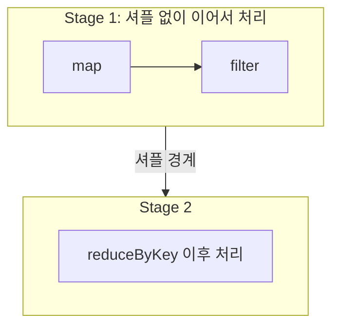

**결론:** 변환의 성능은 셔플(shuffle, 파티션 간 네트워크 이동) 여부가 가른다. map, filter 같은 좁은 변환(narrow transformation)은 Stage 안에서 이어 처리되고, 키 집계와 재분배는 넓은 변환(wide transformation)이라 Stage 경계를 만든다.

## 5. Action: 액션 연산 (89~102쪽)

- Action(액션) — 변환된 RDD 데이터를 메모리로 가져오거나, 저장하거나, 집계하는 연산(89쪽). 이 호출이 있어야 지연되던 계산이 실제로 돈다(10쪽).
- 강의가 보여 준 표는 아래와 같다(89쪽). 슬라이드는 rdd의 값을 따로 적지 않았다. 결과 열(collect 결과 [1, 2, 3, 4])로 보아 rdd는 [1, 2, 3, 4]로 읽힌다.

| 연산 | 설명 | 예제 | 결과 |
| --- | --- | --- | --- |
| collect() | 모든 데이터를 리스트로 반환 | rdd.collect() | [1, 2, 3, 4] |
| count() | 전체 요소 개수 반환 | rdd.count() | 4 |
| reduce() | 전체 요소를 하나로 결합 | rdd.reduce(lambda a, b: a + b) | 10 |
| sum() | 요소의 합 반환 | rdd.sum() | 10 |
| mean() | 평균 값 반환 | rdd.mean() | 2.5 |

- 위 표의 count()는 별도 상세 슬라이드가 없다. 동작은 표 한 줄이 전부다. 89쪽 설명에 "저장하거나"가 있지만 저장 연산을 다룬 슬라이드도 없다.

### 5-1. collect (90~91쪽)

- RDD의 모든 항목을 하나의 리스트로 드라이버 프로그램으로 반환한다(91쪽).
- 셔플이 없다. 결과는 Driver로 전송된다.
- 90쪽 그림은 파티션 A, B에 나뉜 항목 3개가 대괄호 리스트 하나로 모이는 모습이다.
- 문법은 `collect()`다.

```python
x = sc.parallelize([1, 2, 3], 2)
y = x.collect()

print(x.glom().collect())
print(y)
```

- 출력은 아래와 같다.

```text
x: [[1], [2, 3]]
y: [1, 2, 3]
```

- (보충) 모든 데이터가 드라이버 메모리로 오므로 큰 RDD에 collect()를 쓰면 메모리가 부족할 수 있다. 강의는 이 위험을 직접 적지 않았다. 강의의 실습 예제가 모두 소량이다.

### 5-2. countByKey (92~93쪽)

- RDD에 있는 각 키의 등장 횟수를 세어 키와 그 개수로 이루어진 맵(map)을 반환한다(93쪽).
- 셔플이 없다. 파티션별 개수를 Driver에서 집계한다.
- 문법은 `countByKey()`다.

```python
x = sc.parallelize([('J', 'James'), ('F', 'Fred'), ('A', 'Anna'), ('J', 'John')])
y = x.countByKey()
print(y)
```

- 출력은 아래와 같다.

```text
x: [('J', 'James'), ('F', 'Fred'), ('A', 'Anna'), ('J', 'John')]
y: {'J': 2, 'F': 1, 'A': 1}
```

- 그림에서도 결과는 {'A': 1, 'J': 2, 'F': 1}처럼 딕셔너리 모양이다(92쪽).

### 5-3. reduce (94~98쪽)

- 전체 RDD를 대상으로 축소(reduce) 연산을 수행한다(94쪽).
- RDD의 모든 요소를 사용자 정의 함수를 이용해 요소와 중간 결과를 쌍(pairwise)으로 연속적으로 집계해, 최종 결과를 드라이버 프로그램으로 반환한다(98쪽).
- 셔플이 없다. 파티션별 집계 후 Driver에서 결합한다.
- 문법은 `reduce(f)`다.
- 그림 흐름은 [1, 2, 3, 4]에서 lambda a, b: a+b를 쓴다(94~97쪽).
  - 1과 2를 더해 3(94쪽)
  - 3과 3을 더해 6 (이때 3은 직전 결과 3과 요소 3)(95쪽)
  - 6과 4를 더해 10(96쪽)
  - 97쪽은 같은 흐름을 1, 2 → 3, 3 → 6, 4 → 10으로 이어지는 나무 모양 도표로 다시 보여 준다.

```python
x = sc.parallelize([1, 2, 3, 4])
y = x.reduce(lambda a, b: a + b)

print(x.collect())
print(y)
```

- 출력은 아래와 같다.

```text
x: [1, 2, 3, 4]
y: 10
```

- (보충) reduceByKey는 변환이고 키별 RDD를 반환한다. reduce는 액션이고 단일 값을 Driver로 반환한다. 강의는 이 비교를 직접 쓰지 않았다. 단일 값을 Driver로 반환한다는 점은 98쪽에 있다.

### 5-4. sum (99~100쪽)

- RDD에 있는 모든 항목의 합(sum)을 반환한다. 셔플이 없고 파티션별 합을 Driver에서 결합한다.
- 문법은 `sum()`이다.

```python
x = sc.parallelize([2, 4, 1])
y = x.sum()

print(x.collect())
print(y)
```

- 출력은 아래와 같다.

```text
x: [2, 4, 1]
y: 7
```

### 5-5. mean (101~102쪽)

- RDD에 있는 모든 항목의 평균(mean)을 반환한다. 셔플이 없고 파티션별 통계를 Driver에서 결합한다.
- 문법은 `mean()`이다.

```python
x = sc.parallelize([2, 4, 1])
y = x.mean()

print(x.collect())
print(y)
```

- 출력은 아래와 같다.

```text
x: [2, 4, 1]
y: 2.333333
```

- 위 5-4, 5-5 예제 입력은 [2, 4, 1]이다. 89쪽 표(평균 2.5)는 입력이 [1, 2, 3, 4]로 읽히는 다른 예제다. 값이 달라 보이니 헷갈리지 않게 구분해야 한다.

**결론:** 액션(action)은 지연 평가(lazy evaluation)를 깨고 계산을 실제로 실행시키는 트리거(trigger, 방아쇠)다. (보충) 업계에서는 이 실행 단위를 잡(job)이라 부른다. 결과는 collect, reduce, sum 계열처럼 드라이버(Driver)로 모인다.

## 6. 예측한 실행을 확인하기 (103쪽)

- 강의가 정리한 검증 절차는 아래와 같다.
  - 흐름: 입력 → filter → (단어, 1) → reduceByKey → collect.
  - 먼저 파티션별 결과와 shuffle 경계를 표시한다.
  - 변환 정의와 Action 호출을 구분하여 실행한다.
  - 작은 데이터는 glom().collect()로 파티션별 결과를 확인한다.
  - Spark UI에서 Stage 경계, Task 수, Shuffle Read/Write를 비교한다.
  - shuffle의 유무와 이동량을 나누어 실행 흐름을 확인한다.
- 이 흐름은 13쪽의 4가지 질문과 확인 원칙과 이어진다. 먼저 손으로 예측하고, 코드와 Spark UI로 확인한다.
- Shuffle Read/Write — Stage 사이에서 읽고 쓴 데이터량.
- (보충) 이 값이 클수록 셔플 비용이 크다고 볼 수 있다. 강의는 이 문장을 직접 쓰지 않았다.
- 103쪽 흐름에 대응하는 완성 코드는 강의에서는 직접 다루지 않음.

(보충) 위 흐름은 아래처럼 쓸 수 있다. 강의 코드가 아니라 흐름을 코드로 옮긴 예시다.

```python
lines = sc.parallelize(["spark rdd", "spark map", "rdd"])
filtered = lines.filter(lambda line: len(line) > 0)
pairs = filtered.flatMap(lambda line: line.split(" ")).map(lambda w: (w, 1))
counts = pairs.reduceByKey(lambda a, b: a + b)
result = counts.collect()
```

**결론:** 학습의 목표는 지연 평가(lazy evaluation) 때문에 보이지 않는 실행 계획을 결과와 셔플 경계로 예측하고, Spark UI로 검증하는 습관이다.

## 7. 캐싱/persist (강의에서는 직접 다루지 않음)

- 강의에서는 직접 다루지 않음. cache(), persist(), 저장 레벨, 체크포인트 슬라이드는 1~104쪽 어디에도 없다. 104쪽은 마무리 슬라이드("내일 방송에서 만나요!")다.
- (보충) 지연 평가 때문에 같은 RDD에 액션을 여러 번 부르면 lineage를 따라 매번 다시 계산한다. cache()와 persist()는 계산한 결과를 메모리 등에 남겨 재사용하게 한다고 알려져 있다.
- 강의가 보여 주는 가장 가까운 내용은 10쪽의 "변환은 lineage에 기록"과 "Action이 필요한 파티션의 계산을 실행"이다.

## 8. 시험/면접 대비 핵심 체크리스트

- [ ] RDD는 Resilient Distributed Dataset의 약자다. 대용량 데이터를 분산 처리하는 Spark의 기본 데이터 처리 단위다(5쪽).
- [ ] 탄력성(Resilient)은 노드 장애에도 데이터를 복구할 수 있다는 뜻이다(7쪽).
- [ ] 불변성(Immutable)은 한 번 만든 RDD를 바꿀 수 없고, 변환하면 새 RDD가 생긴다는 뜻이다(7쪽).
- [ ] RDD는 파티션(partition)으로 쪼개져 분산된다(5, 6쪽).
- [ ] PySpark에서는 Python이 동적 타입 언어라 타입 안정성이 적용되지 않는다(8쪽).
- [ ] 비정형 데이터는 sc.textFile() 후 map, filter, flatMap으로, 정형 데이터는 DataFrame 또는 RDD.map()으로 가공한다(9쪽).
- [ ] 변환은 즉시 계산하지 않고 lineage에 기록한다. Action이 필요한 파티션의 계산을 실행한다(10쪽).
- [ ] 같은 Stage의 좁은 변환은 파티션별로 이어서 처리한다(10쪽).
- [ ] RDD 생성은 parallelize(메모리 데이터, 소규모 분석용)와 textFile(외부 파일)이 있다(14~16쪽).
- [ ] sc.textFile()은 CSV, 로그, S3, HBase, Cassandra 등에서 읽을 수 있다(16쪽).
- [ ] map은 요소 수를 유지하고, flatMap은 결과를 평탄화해 요소 수가 늘 수 있다. 둘 다 셔플이 없다(22, 29, 30쪽).
- [ ] flatMap 예제 y.mean() 결과는 28.0이다(30쪽).
- [ ] filter는 true인 요소만 남기고 빈 파티션이 생길 수 있다(36쪽).
- [ ] map(x*2) 후 filter(x>6) 예제에서 P0는 [], P1은 [8, 10, 12]이다. 빈 P0도 파티션은 유지된다(38쪽).
- [ ] mapPartitions는 파티션별 iterator로 처리한다. 예제 y는 [[1, 42], [5, 42]]다(40쪽).
- [ ] mapPartitionsWithIndex는 (partitionIndex, iterator)를 받는다. 예제 y는 [[(0, 1)], [(1, 5)]]다(42쪽).
- [ ] keyBy(f)는 키만 붙여 Pair RDD를 만든다. 셔플이 없다(47쪽).
- [ ] groupBy는 함수 결과를 키로 삼고 groupByKey는 이미 있는 키로 모은다. 둘 다 셔플이 발생한다(53, 57쪽).
- [ ] groupByKey 예제 y는 [('B', [5, 4]), ('A', [3, 2, 1])]다(57쪽).
- [ ] 단어 수 세기 결과는 [('one', 1), ('two', 2), ('three', 3)]다(59, 60쪽).
- [ ] reduceByKey는 파티션 안에서 먼저 집계하고(부분 합계), groupByKey는 원본 값 전체를 옮긴다. 강의 그림은 11개 대 6개다(61~63쪽).
- [ ] join 예제 결과는 [("a",(1,3)), ("a",(1,4)), ("b",(2,5))]다(68쪽).
- [ ] union은 셔플이 없고 중복을 제거하지 않는다. 예제 z는 [[1], [2, 3], [3, 4]]다(70쪽).
- [ ] distinct는 같은 값을 모아 중복을 제거하므로 셔플이 발생한다. 예제 y는 [1, 2, 3, 4]다(74쪽).
- [ ] sample(withReplacement, fraction, seed=None)은 셔플이 없다. 예제는 sample(False, 0.4, 42)이고 y는 [1, 2]다(76쪽).
- [ ] repartition은 셔플이 발생하고, coalesce(numPartitions, shuffle=False)는 셔플 없이 파티션 수를 줄인다(77, 81쪽).
- [ ] 터미널 예제에서 8개 파티션이 repartition(10)으로 10개, coalesce(2)로 2개가 되었다(77쪽).
- [ ] partitionBy(numPartitions, partitioner=portable_hash)는 지정한 partitioner로 재분배한다. 셔플이 발생한다(87쪽).
- [ ] 같은 partitioner면 groupByKey, reduceByKey, join, partitionBy의 셔플을 생략할 수 있다(57, 60, 68, 87쪽).
- [ ] 파티션 이동 판단 기준은 이렇다. 파티션 내부 처리(map, flatMap, filter)인지, 키 집계로 모아야 하는지, 같은 키가 함께 있는지, partitioner를 유지하는지를 본다(88쪽).
- [ ] 액션 표(89쪽)는 collect, count, reduce, sum, mean이다. 표 예제 결과는 [1,2,3,4], 4, 10, 10, 2.5다. 상세 슬라이드는 collect, countByKey, reduce, sum, mean에 있다(90~102쪽).
- [ ] collect는 모든 항목을 리스트로 Driver에 반환한다(91쪽).
- [ ] countByKey 예제 결과는 {'J': 2, 'F': 1, 'A': 1}이다(93쪽).
- [ ] reduce(lambda a, b: a+b)의 [1, 2, 3, 4] 결과는 10이다(98쪽).
- [ ] sum([2, 4, 1])은 7, mean([2, 4, 1])은 2.333333이다(100, 102쪽).
- [ ] 실행 확인은 파티션별 결과와 셔플 경계를 먼저 예측하고 glom().collect()와 Spark UI(Stage, Task 수, Shuffle Read/Write)로 비교한다(103쪽).
- [ ] 캐싱/persist, MapReduce 한계, DAG 용어는 이 강의에서 직접 다루지 않는다.
- [ ] 강의 원본에서 그림과 코드 출력이 어긋나는 곳은 세 군데다. flatMap(그림 9개, 출력 12개, 29, 30쪽), sample(그림 1과 3, 출력 [1, 2], 75, 76쪽), coalesce(그림 A와 B 병합, 출력은 뒤 두 파티션 병합, 78~81쪽).

---

# Spark DataFrame과 Spark SQL 요약 (3/3) - 왜 생겼고, 무엇이며, 어떻게 쓰는가

> 용어 풀이는 이해를 돕는 일반 설명이다. 강의가 직접 정의한 것이 아닐 수 있다. 강의 근거가 아닌 서술은 (보충)으로 따로 표시했다. 강의에 없는 내용은 "강의에서는 직접 다루지 않음"이라고 적었다.

3쪽 "챕터의 포인트"는 두 가지다. "DataFrame과 Spark SQL", "DSL과 SQL을 활용한 데이터 처리"다. 36쪽은 뒤쪽 주제의 구분 슬라이드이고, 69쪽은 끝 인사 슬라이드("내일 방송에서 만나요!")다.

## 1. DataFrame이 왜 필요한가 (RDD의 한계)

### 1-1. RDD란 (복습)

- **RDD(Resilient Distributed Dataset) — 데이터를 여러 서버에 나눠 병렬로 처리하게 해 주는 Spark의 기본 데이터 단위.** 빠르고 안정적으로 동작하는 병렬 처리 프로그램을 쓸 수 있다(5쪽).
- 하지만 RDD는 데이터 값 자체는 표현해도, 데이터에 대한 메타데이터인 **스키마(schema) — 컬럼 이름과 타입을 적어 둔 데이터의 설계도**를 명시적으로 표현할 방법이 없다(5쪽).

### 1-2. RDD API의 문제점 (6쪽)

- RDD에 넣는 Python 함수 안의 표현식은 **Catalyst(카탈리스트) — Spark SQL의 쿼리 최적화 엔진**이 분석하기 어렵다.
- 컬럼 구조를 활용한 최적화가 제한된다. 조건을 앞으로 옮기는 것(조건 이동)과 필요한 컬럼만 고르는 것(컬럼 선택) 최적화가 제한된다.
- RDD에도 파티셔닝(partitioning, 데이터를 조각내 나누는 것), 부분 집계, 직렬화(serialization, 객체를 바이트로 바꾸는 것)와 압축 설정은 적용된다.
- DataFrame은 스키마와 표현식을 엔진에 전달한다. 그래서 추가 최적화가 가능하다.

### 1-3. 강의가 보여 주는 해결 방향

- DataFrame은 **Spark SQL이 제공하는 구조화된 데이터 모델로서 RDD의 한계를 보완**한다(7쪽).
- 사용 난이도 면에서 RDD는 낮은 수준(저수준) API이고, DataFrame은 높은 수준(고수준) API이며 SQL도 쓸 수 있다(13쪽).
- 강의 근거를 정리하면 세 가지다. 스키마 부재, 최적화의 어려움, 저수준 API다.

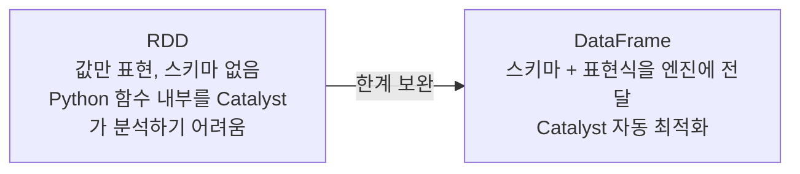

**결론:** RDD의 스키마 부재(schema-less)와 최적화 어려움 문제를, 스키마를 가진 DataFrame과 Catalyst 옵티마이저(optimizer)로 푼 것이 Spark SQL이다.

## 2. DataFrame이란 (7~12쪽)

### 2-1. 정의

- **DataFrame — 스키마를 가진 분산 데이터 컬렉션.** 데이터를 행(row)과 열(column)로 이루어진 표로 관리한다(7쪽).
- 각 열은 명확한 데이터 타입과 메타데이터(스키마)를 가진다(7쪽).
- 구조, 포맷 등 몇몇 연산에서 Pandas의 DataFrame에 영향을 많이 받았다(8쪽).
- 이름 있는 컬럼과 스키마를 가진 **분산 인메모리 테이블**처럼 동작한다(8쪽).
- 같은 데이터를 RDD로 보면 파티션(partition#1~#3)별로 행이 흩어져 있다. DataFrame으로 보면 name, city, age, smoker, height, birthdate 컬럼을 가진 표 하나로 보인다(8쪽).
- 8쪽 그림의 값은 다음과 같다. partition#1은 `John Seattle 60 True 1.70 1960-01-01`, partition#2는 `Tony Cupertino 30 False 1.80 1990-01-01`, partition#3은 `Mike New York 40 True 1.65 1980-01-01`이다. 파티션마다 한 행씩 들어 있다.

### 2-2. DataFrame = RDD + schema + DSL (11쪽)

- **DSL(Domain-Specific Language) — 특정 목적을 위해 만든 전용 문법.** 여기서는 `filter`, `select` 같은 DataFrame 메서드 호출 방식을 뜻한다.
- 스키마 예: `label: Double`, `text: String`, `words: Seq[String]`, `features: Vector`, `prediction: Double`. 이름 붙은 컬럼과 타입이 짝으로 정의된다.
- 11쪽 왼쪽은 Named columns with types, 오른쪽은 Domain-Specific Language(DSL)다.
- 11쪽 예시 표(label, text, words, features)는 4행이다. `0, This is ..., ["This","is",...], [0.5,1.2,...]`, `0, When we ..., ["When",...], [1.9,-0.8,...]`, `1, Knuth was ..., ["Knuth",...], [0.0,8.7,...]`, `0, Or you ..., ["Or","you",...], [0.1,-0.6,...]`이다. label이 1인 행은 하나다.
- DSL 예(슬라이드 코드 위에 "Select science articles"라는 주석이 붙어 있다):

```python
sciDocs = data.filter(col("label") == 1)
```

### 2-3. DSL과 SQL을 모두 지원 (12쪽)

같은 필터링을 두 방식으로 할 수 있다.

```python
sciDocs = data.filter(col("label") == 1)
sciDocs.show()
```

```python
data_scaled = spark.sql("SELECT * FROM data WHERE label = 1")
data_scaled.show()
```

- 슬라이드는 왼쪽 위 파란 상자를 "DSL 수행 결과", 오른쪽 아래 초록 상자를 "SQL 수행 결과"로 나눠 보여 준다. 11쪽의 label은 0, 1이었는데 12쪽 출력에서는 1.0으로 나온다. 11쪽 표의 Knuth가 12쪽 출력에서는 Kruth로 적혀 있다. 11쪽 표에서 label이 1인 행은 Knuth 하나뿐인데, 12쪽 출력은 `This is ...`를 포함한 두 행이다. 두 슬라이드의 예제 데이터가 서로 다르다. 12쪽 콘솔 화면에는 "필터링", "결과 출력" 주석이 있다.
- 두 방식의 실행 결과는 같다. label이 1.0인 두 행이 나온다. 하나는 text가 `This is ...`, words가 `[This, is]`, features가 `[0.5, 1.2]`다. 다른 하나는 text가 `Kruth was ...`, words가 `[Kruth, was]`, features가 `[0.8, 0.7]`다.

### 2-4. 데이터 타입 (9쪽)

- 기본 타입: Byte, Short, Integer, Long, Float, Double, String, Boolean, Decimal.
- 정형화 타입: Binary, Timestamp, Date, Array, Map, Struct, StructField.
- 실제 데이터를 위한 스키마를 정의할 때 이런 타입들이 어떻게 연계되는지 아는 것이 중요하다.

```python
from pyspark.sql.types import StructType, StructField, StringType, ArrayType, IntegerType

schema = StructType([
    StructField("name", StringType(), True),
    StructField("scores", ArrayType(IntegerType()), True)
])
```

### 2-5. 스키마(Schema) (10쪽)

- Spark의 스키마는 DataFrame을 위해 **컬럼 이름과 연관된 데이터 타입을 정의한 것**이다.
- 외부 데이터 소스에서 구조화된 데이터를 읽어 들일 때 쓴다.
- 읽을 때 스키마를 가져오는 방식과 달리, 미리 스키마를 정의하면 장점이 있다.
  - Spark가 데이터 타입을 추측해야 하는 책임을 덜어 준다.
  - Spark가 스키마를 확정하려고 파일의 많은 부분을 읽는 별도의 Job을 만드는 것을 막는다.
  - 데이터가 스키마와 맞지 않으면 조기에 문제를 발견할 수 있다.

**결론:** DataFrame은 스키마 기반 구조화 데이터(structured data)를 DSL과 SQL 두 방식으로 다루는 분산 테이블 추상화다.

## 3. RDD와 DataFrame의 차이, 언제 무엇을 쓰나 (13~15쪽)

### 3-1. 비교 (13쪽)

| 구분 | RDD | DataFrame |
| --- | --- | --- |
| 데이터 표현 방식 | 값만 표현 가능, 스키마 표현 불가능 | 명확한 스키마(컬럼, 데이터 타입)를 가진 구조적 데이터 |
| 최적화 및 성능 | 최적화가 어려움, 직접적 연산 필요 | Catalyst Optimizer를 통한 자동 최적화 및 빠른 처리 가능 |
| 사용 편의성 | 낮음(저수준 API) | 높음(고수준 API, SQL 활용 가능) |

- 강의 요약: DataFrame을 쓰면 더 효율적이고 편리하게 처리할 수 있다. 데이터의 메타 정보를 활용해 더 빠르고 최적화된 분석을 할 수 있다.

### 3-2. RDD를 쓰는 경우 (14쪽)

1. 저수준의 Transformation과 Action을 직접 제어해야 할 때.
2. 스트림 데이터(미디어나 텍스트 스트림)가 구조화되지 않은 경우.
3. 특정 도메인 표현을 위해 함수형 프로그래밍이 필요할 때.
4. 스키마 변환이 필요 없을 때. 예: 열 기반 저장소를 사용하지 않는 경우.
5. DataFrame이나 Dataset에서 처리할 수 없는 성능 최적화가 필요할 때.

### 3-3. DataFrame을 쓰는 경우 (15쪽)

1. 고수준의 추상화와 도메인 기반 API가 필요할 때.
2. 고수준의 표현(filter, select, agg, avg, sum, SQL, columnar access) 등 복잡한 연산이 필요하거나, 반구조적 데이터에 대한 lambda 식이 필요할 때.
3. 명시적인 스키마와 표현식 분석으로 컬럼과 타입을 확인하고,(슬라이드 문장이 여기서 끝나지 않고 4번으로 이어진다.)
4. Catalyst 최적화 및 Tungsten의 효율적인 코드 제너레이션이 필요할 때.
5. Spark API의 일관성과 간결함을 원할 때.

- Tungsten은 이 쪽(15쪽)에서 이름만 나온다. 강의에서는 직접 다루지 않음.
- (보충) Tungsten은 Spark의 실행 엔진 쪽 최적화(메모리 관리와 코드 생성)를 부르는 이름으로 알려져 있다.

**결론:** 강의는 저수준 제어(low-level control)가 필요한 경우(14쪽)에 RDD를, 스키마·SQL·Catalyst 최적화가 필요한 경우(15쪽)에 DataFrame을 쓰는 것으로 나눈다.

## 4. Spark SQL이란 (16~23쪽)

### 4-1. 정의 (16쪽)

- Spark SQL은 구조화된 데이터를 SQL처럼 처리할 수 있게 해 주는 Spark 모듈이다.
- 내부적으로는 DataFrame/Dataset API와 동일한 엔진(Catalyst)을 사용한다.
- DataFrame과 Dataset을 SQL처럼 다룰 수 있게 해 주는 **분산 SQL 쿼리 엔진**이다.
- RDD보다 높은 수준의 추상화와 자동 최적화를 제공한다.
- 강의의 한 줄 요약: DataFrame이 중심이고, Spark SQL은 그것을 SQL 방식으로 접근하게 해 주는 방법 중 하나다.

### 4-2. Spark SQL의 역할 (17쪽)

- SQL 같은 질의를 수행한다.
- Spark 컴포넌트들을 통합한다. Java, Scala, Python, R 등 여러 언어로 정형화 데이터 작업을 단순화하도록 DataFrame, Dataset을 추상화한다.
- JSON, CSV, txt, avro, parquet, orc 같은 정형화된 파일 포맷에서 스키마와 정형화 데이터를 읽고 쓴다. 데이터를 임시 테이블로 변환한다.
- 빠른 데이터 탐색을 위해 대화형 Spark SQL 셸을 제공한다.
- 표준 데이터베이스 JDBC/ODBC 커넥터를 통해 외부 도구들과 연결하는 중간 역할을 한다.
- 최종 실행을 위해 최적화된 질의 계획과 JVM을 위한 최적화된 코드를 생성한다.
- (보충) JDBC/ODBC(Java/Open Database Connectivity) — 프로그램이 데이터베이스와 대화하는 표준 연결 규격이다. JVM(Java Virtual Machine) — Spark가 실제로 돌아가는 자바 실행 환경이다.

### 4-3. 전체 구조 (18~19쪽)

18쪽은 Spark 로고에 + 기호로 표(UserID, Name, Age, Location, Pet)를 더한 그림이다. (보충) Spark SQL이 표 형태 데이터를 다룬다는 뜻으로 읽힌다. 강의 글은 없다.

- 표의 5행은 `28492942 John Galt 32 New York Sea Horse`, `95829324 Winston Smith 41 Oceania Ant`, `92871761 Tom Sawyer 17 Mississippi Raccoon`, `37584932 Carlos Hinojosa 33 Orlando Cat`, `73648274 Luis Rodriguez 34 Orlando Dogs`다.

19쪽 다이어그램은 다음과 같다.

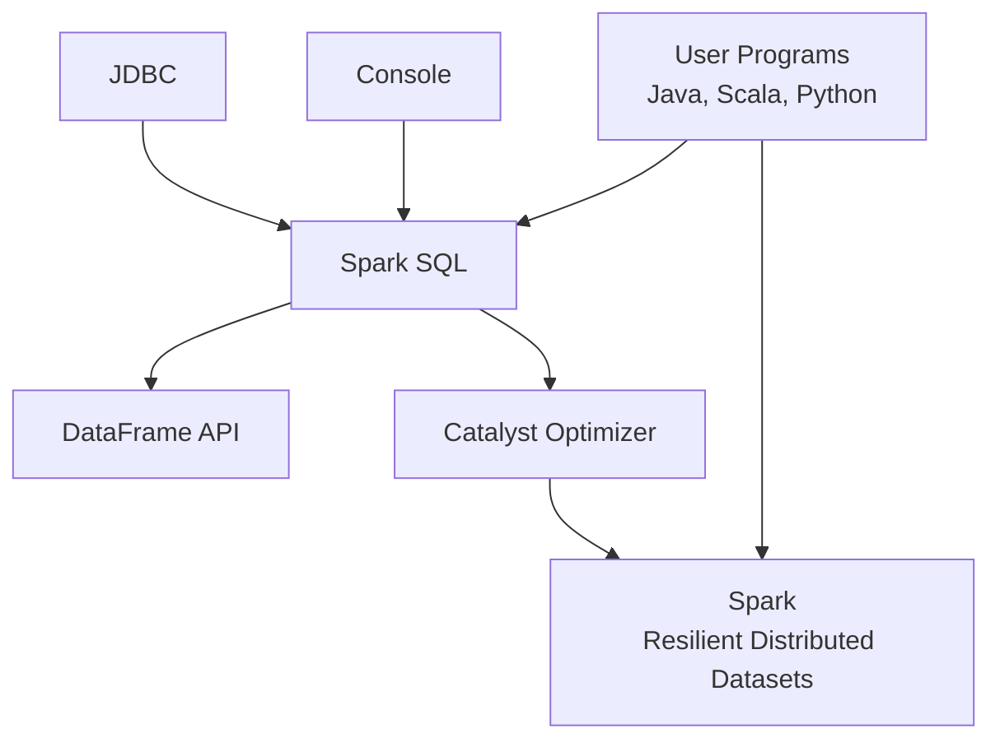

- JDBC, Console, 사용자 프로그램이 Spark SQL을 거친다. Spark SQL은 DataFrame API와 Catalyst Optimizer를 품고 있다. 그 아래에 Spark의 RDD가 있다.
- 사용자 프로그램은 Spark SQL을 거치지 않고 Spark(RDD)에 직접 접근하는 경로도 있다.

### 4-4. 내부 동작: Catalyst Optimizer (20~22쪽)

- Spark SQL은 SQL 쿼리를 실행하는 역할이다. 거기에 사용자가 입력한 쿼리나 DataFrame의 명령을 가장 빠르고 효율적인 방식으로 처리한다.
- 내부에서 데이터를 효율적으로 처리하는 핵심 엔진이 Catalyst Optimizer다(20쪽).
- SQL, DataFrames, Datasets가 모두 Catalyst Optimizer로 들어가 Physical Plan(물리적 실행 계획)이 나온다(21쪽). 그림에서 Physical Plan은 작은 상자 여러 개가 화살표로 이어져 맨 아래 데이터베이스 모양 아이콘으로 끝나는 흐름이다.

최적화 과정은 4단계다(22쪽).

1. SQL Parser & DataFrame API 해석 단계.
2. Logical Plan(논리적 계획) 생성.
3. Optimized Logical Plan(최적화된 논리 계획) 생성.
4. Physical Plan(물리적 실행 계획) 생성.

그림(22쪽)에는 더 자세한 이름이 있다.

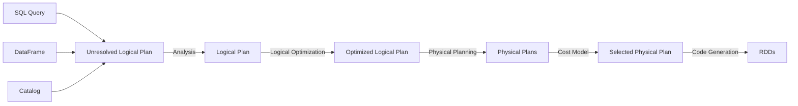

- Catalyst Optimizer가 내부적으로 복잡한 최적화 과정을 자동으로 처리한다.
- 쿼리 계획(query plan) 같은 용어의 일반적 풀이는 (보충)이다. 논리 계획은 "무엇을 할지"를, 물리 계획은 "어떻게 실행할지"를 적은 것으로 이해하면 된다.

### 4-5. Spark SQL과 DataFrame API의 관계 (23쪽)

- 서로 완전히 독립된 별개의 것이 아니다.
- 동일한 최적화 엔진(Catalyst Optimizer)을 공유하고, 내부적으로 통합된 구조를 가진다.
- 결과적으로 Spark에서는 DataFrame API로 작성한 데이터 처리 명령을 내부적으로 Spark SQL의 엔진으로 최적화해 실행한다.

**결론:** Spark SQL은 DataFrame API와 같은 Catalyst 옵티마이저를 공유하는 분산 SQL 쿼리 엔진이며, 쿼리를 논리 계획과 물리 계획(logical/physical plan)으로 최적화한 뒤 RDD 코드로 내려보낸다.

## 5. Dataset API (24쪽)

- Spark 2.0에서 개발자들이 한 종류의 API만 알면 되도록 DataFrame과 Dataset API를 하나로 합쳤다.
- Dataset은 정적 타입(typed) API와 동적 타입(untyped) API의 두 특성을 모두 가진다.
- Java, Scala(타입 안전을 보장하는 언어)에서만 사용할 수 있다.
- Python, R(타입 안전을 보장하지 않는 언어)에서는 사용할 수 없고 DataFrame API만 쓸 수 있다.
- 그림(Unified Apache Spark 2.0 API): 겹쳐 있던 DataFrame과 Dataset 상자가 하나의 Dataset(2016)으로 합쳐진다. Untyped API는 `DataFrame = Dataset[Row]`(Alias, 별칭)이고, Typed API는 `Dataset[T]`다. 그림 출처는 databricks로 적혀 있다.
- (보충) 이 강의의 슬라이드 코드는 모두 Python이다. 그래서 실습은 DataFrame 중심이라고 볼 수 있다.

- (보충) 타입 안전(type safety) — 숫자 자리에 문자를 넣는 식의 실수를 실행 전에 잡아 주는 성질이다. 정적 타입(typed)은 그 검사를 미리 하고, 동적 타입(untyped)은 실행할 때 확인한다.

**결론:** Spark 2.0 이후 DataFrame은 `Dataset[Row]`의 별칭(alias)이고, Dataset은 강의 기준으로 Java, Scala에서만 쓴다. Python은 DataFrame만 쓴다.

## 6. 뷰 등록과 SQL 실행, 구조 변환 (25~26쪽)

### 6-1. View 등록 및 SQL 실행 (25쪽)

- **뷰(view) — DataFrame에 이름을 붙여 SQL의 테이블처럼 부를 수 있게 한 것.**

```python
df.createTempView("viewName")
df.createGlobalTempView("viewName")
df.createOrReplaceTempView("viewName")
```

```python
spark.sql("SELECT * FROM viewName").show()
spark.sql("SELECT * FROM global_temp.viewName").show()
```

- 슬라이드 코드에는 "DataFrame을 뷰로 등록하기", "뷰에 SQL 쿼리 실행하기"라는 주석이 붙어 있다.
- 슬라이드의 첫 SQL 줄은 `spark.sql("SELECT * FROM viewName ").show()`로 따옴표 앞에 공백이 하나 있다. 위 코드는 공백 없이 적었다. 실행 결과에는 영향이 없다.
- 결과는 두 쿼리 모두 같다. column1이 A, B이고 column2가 100, 200인 두 행이다.
- 글로벌 뷰는 `global_temp.뷰이름` 형태로 조회한다는 점이 코드에서 보인다.
- (보충) `createTempView`는 해당 SparkSession 안에서만, `createGlobalTempView`는 같은 Spark 애플리케이션의 여러 세션에서 쓸 수 있다. `createOrReplaceTempView`는 같은 이름이 있으면 덮어쓴다. 강의는 차이를 따로 설명하지 않는다.

### 6-2. DataFrame 구조 변환 (26쪽)

```python
rdd1 = df.rdd
```

```python
df.toJSON().first()
```

```python
pandas_df = df.toPandas()
print(pandas_df)
```

- `df.rdd`는 DataFrame을 분산 처리용 RDD로 바꾼다.
- `df.toJSON().first()`의 결과는 `'{"column1":"A","column2":100}'`다. JSON 문자열로 바꾼 뒤 첫 항목을 확인한 것이다.
- `df.toPandas()`는 Pandas DataFrame으로 바꾼다. 로컬 메모리 안의 작업이다. 출력은 0번 행 A 100, 1번 행 B 200이다.
- (보충) 로컬 메모리로 가져오므로 데이터가 크면 메모리가 모자랄 수 있다. 강의는 이 주의점을 직접 말하지 않는다.

**결론:** 한 DataFrame을 SQL용 뷰(view), RDD, JSON, Pandas로 상호 변환(conversion)하며 쓸 수 있다.

## 7. DataFrame 생성과 입출력 API (27~33쪽)

### 7-1. 개요 (27쪽)

- Spark는 다양한 형태의 데이터를 DataFrame으로 다룰 수 있다.
- CSV, JSON, ORC, Parquet 같은 파일 포맷을 읽어 DataFrame을 만들 수 있다.
- DataFrame을 직접 만들거나 외부 데이터를 불러올 때 **SparkSession**이 필요하다.
- SparkSession은 Spark에서 DataFrame 작업을 시작하기 위한 기본 진입점(entry point)이다.
- 대표적으로 `createDataFrame()`, `read`, `readStream`으로 DataFrame을 만든다.
- 그림은 Driver Program(SparkContext), Cluster Manager, Worker Node(Executor, Cache, Task) 구조다. 강의 글은 이 그림을 따로 설명하지 않는다.
- (보충) Driver — 작업을 지휘하는 프로그램, Cluster Manager — 서버 자원을 나눠 주는 관리자, Executor — 실제 계산을 하는 일꾼이다. SparkSession은 그 위에서 DataFrame 작업을 여는 입구다.
- 그림 아래 작은 글씨로 출처 주소가 적혀 있다. `https://www.databricks.com/blog/2016/08/15/how-to-use-sparksession-in-apache-spark-2-0.html`이다.

### 7-2. createDataFrame() (28쪽)

- Python 객체를 Spark DataFrame으로 변환하는 메서드다. 코드 내부의 데이터를 기반으로 DataFrame을 만든다.

```python
from pyspark.sql import SparkSession

spark = SparkSession \
    .builder \
    .appName("create_order_dataframe_example") \
    .getOrCreate()

schema = """
    order_id STRING,
    customer_id STRING,
    order_date STRING,
    order_amount DOUBLE,
    payment_method STRING,
    category STRING
"""

data = [
    ("O00001", "C0001", "2026-01-05", 32000.0, "CARD", "book"),
    ("O00002", "C0002", "2026-01-06", 18000.0, "CASH", "food"),
    ("O00003", "C0001", "2026-01-07", 54000.0, "CARD", "electronics")
]

order_df = spark.createDataFrame(
    data=data,
    schema=schema
)

order_df.show()
order_df.printSchema()
```

- 스키마를 `StructType` 대신 DDL 문자열(`order_id STRING, ...`)로 줄 수도 있다는 점이 이 코드에서 보인다.
- 실행 결과: 3행이 표로 출력된다. `printSchema()`는 root 아래에 각 컬럼을 `order_id: string (nullable = true)` 형태로 보여 준다. order_amount만 `double`이다. 슬라이드 이미지는 payment_method 줄까지만 보이고 category 줄은 잘려 있다.
- order_id는 슬라이드 코드와 출력 표 모두 알파벳 O로 시작하는 `O00001`, `O00002`, `O00003`이다. 고해상도로 보면 첫 글자는 획이 없는 둥근 O이고, 뒤의 0은 `C0001`의 0처럼 가운데 획이 있는 숫자 0이다. 29쪽 출력의 `O00010`까지 같은 형태다. (이전 판의 "숫자 0" 판독을 바로잡았다.)

### 7-3. read (29쪽)

- 외부에 저장된 데이터를 Spark DataFrame으로 불러올 때 쓴다. 파일 경로나 저장소 위치를 지정해 데이터를 로드한다.
- CSV, JSON, Parquet, JDBC 등 다양한 입력 소스를 지원한다.

```python
from pyspark.sql import SparkSession

spark = SparkSession \
    .builder \
    .appName("read_load_example") \
    .getOrCreate()

order_schema = """
    order_id STRING,
    customer_id STRING,
    order_date STRING,
    order_amount DOUBLE,
    payment_method STRING,
    category STRING
"""

order_df = spark.read \
    .format("csv") \
    .option("header", True) \
    .option("delimiter", ",") \
    .schema(order_schema) \
    .load("data/input/order_history.csv")

order_df.show(10)
```

- 결과는 10행이 표로 출력된다. 예를 들어 첫 행은 order_id O00001, customer_id C0029, order_date 2026-01-07, order_amount 145000.0, payment_method CASH, category fashion이다. order_id는 O00001부터 O00010까지다. payment_method에는 CASH, CARD, TRANSFER가, category에는 fashion, living, electronics, food, digital, beauty, book이 나온다.
- 10행 전체는 다음과 같다(order_id, customer_id, order_date, order_amount, payment_method, category 순).
  - `O00001 C0029 2026-01-07 145000.0 CASH fashion`
  - `O00002 C0036 2026-01-27 284000.0 CARD living`
  - `O00003 C0009 2026-01-08 52000.0 CASH fashion`
  - `O00004 C0130 2026-01-07 292000.0 CASH living`
  - `O00005 C0057 2026-04-25 147000.0 CARD electronics`
  - `O00006 C0109 2026-03-29 147000.0 CASH fashion`
  - `O00007 C0087 2026-01-27 52000.0 TRANSFER food`
  - `O00008 C0092 2026-03-30 140000.0 CARD digital`
  - `O00009 C0138 2026-02-01 198000.0 CARD beauty`
  - `O00010 C0093 2026-05-28 103000.0 CARD book`

### 7-4. read와 readStream (30쪽)

- 이 쪽은 DataFrame을 생성하는 대표적인 입력 API를 다룬다.
- `read`는 저장된 데이터를 한 번에 읽는 **배치(batch) 입력** 방식이다.
- `readStream`은 계속 들어오는 데이터를 지속적으로 읽는 **스트리밍(streaming) 입력** 방식이다.
- 두 방식 모두 기본 설정 흐름은 비슷하다. 데이터 소스에 따라 필요한 옵션과 실행 방식은 달라질 수 있다.

| 함수 | 역할 | 예시 |
| --- | --- | --- |
| format() | 읽어올 데이터의 형식 또는 소스 지정 | parquet, csv, json, orc, jdbc, text, table, kafka 등 |
| option() | 데이터 소스별 세부 읽기 옵션 지정 | ("delimiter", ","), ("header", True) 등 |
| schema() | 컬럼명과 데이터 타입을 직접 정의 | "order_id STRING, order_amount DOUBLE" 등 |
| load() | 설정한 정보를 바탕으로 실제 데이터 로드 | "data/input/order_history.csv" 등 |

### 7-5. write (31쪽)

- 배치 결과 저장에는 `write`를 쓴다. 스트리밍 결과 저장에는 `writeStream`을 쓴다.

```python
from pyspark.sql import SparkSession
from pyspark.sql.functions import col

spark = SparkSession \
    .builder \
    .appName("order_history_write_example") \
    .getOrCreate()

order_schema = """
    order_id STRING,
    customer_id STRING,
    order_date STRING,
    order_amount DOUBLE,
    payment_method STRING,
    category STRING
"""

order_df = spark.read \
    .option("header", True) \
    .schema(order_schema) \
    .csv("data/input/order_history.csv")

card_order_df = order_df.filter(col("payment_method") == "CARD")

card_order_df.write \
    .mode("overwrite") \
    .format("csv") \
    .save("data/output")
```

- 이 예제는 `read`로 읽은 뒤 `filter`로 결제수단이 CARD인 행만 남기고 CSV로 저장한다.

### 7-6. readStream과 writeStream (32쪽)

```python
from pyspark.sql import SparkSession

spark = SparkSession \
    .builder \
    .appName("read_stream_example") \
    .getOrCreate()

order_schema = """
    order_id STRING,
    customer_id STRING,
    order_date STRING,
    order_amount DOUBLE,
    payment_method STRING,
    category STRING
"""

stream_order_df = (spark.readStream
    .format("csv")
    .option("header", True)
    .schema(order_schema)
    .load("data/stream")
)
```

```python
query = (
    stream_order_df.writeStream
    .format("console")
    .outputMode("append")
    .option("truncate", False)
    .start()
)

query.awaitTermination()
```

- 슬라이드 코드 안 주석: `data/stream` 디렉터리에 새 CSV 파일이 추가되면 스트리밍 입력 대상으로 처리할 수 있다.
- 32쪽 제목은 writeStream이고, 윗부분 설명은 31쪽과 같다. 배치 결과 저장에는 write, 스트리밍 결과 저장에는 writeStream을 쓴다.
- `outputMode("append")`는 새로 생긴 결과만 이어서 내보낸다. `format("console")`은 콘솔에 출력한다. `start()`는 스트림 실행을 시작하고, `awaitTermination()`은 스트림이 끝날 때까지 기다린다. 이 네 가지의 풀이는 (보충)이다. 강의는 코드만 보여 준다.

### 7-7. 입력과 출력의 호출 위치 (33쪽)

- DataFrame 생성은 SparkSession에서 시작한다. DataFrame 저장은 생성된 DataFrame 객체에서 직접 한다. 즉 입력 단계와 출력 단계의 호출 위치가 다르다.
- 데이터를 만들거나 읽을 때는 SparkSession을, 저장하거나 전송할 때는 `DataFrame.write`를 쓴다.

| 함수 | 역할 | 예시 |
| --- | --- | --- |
| format() | 저장할 데이터 형식 또는 저장 대상 지정 | parquet(default), csv, json, orc, jdbc, text, kafka 등 |
| mode() | 기존 데이터가 있을 때의 처리 방식 지정 | overwrite는 기존 데이터 덮어쓰기, append는 기존 데이터 뒤에 추가, ignore는 이미 있으면 저장 생략, error는 이미 있으면 오류 발생 |
| option() | 저장 대상에 필요한 세부 옵션 지정 | .option("header", True) |
| bucketBy() | 해시 기준으로 데이터를 버킷 단위로 나누어 저장 | .bucketBy(10, "customer_id") |
| partitionBy() | 특정 컬럼 값을 기준으로 디렉터리를 나누어 저장 | .partitionBy("order_date") |
| sortBy() | 저장 전 지정 컬럼 기준으로 정렬 | .sortBy("order_amount") |
| save() | 설정된 조건에 따라 실제 저장 실행 | .save("data/output/orders_by_date") |

- (보충) 해시(hash) — 값을 계산식에 넣어 번호로 바꾸는 것이다. 버킷(bucket) — 같은 번호끼리 모은 묶음이다. `bucketBy(10, "customer_id")`는 고객 ID를 10개 묶음으로 나누는 뜻으로 읽힌다.

**결론:** 입력은 SparkSession의 `read`/`readStream`, 출력은 DataFrame의 `write`/`writeStream`이며, 배치(batch)와 스트리밍(streaming)이 짝으로 대응한다.

## 8. 컬럼 변환과 다중 집계, 날짜와 조건부 컬럼 (34~35쪽)

### 8-1. 컬럼 변환과 다중 집계 (34쪽)

- 컬럼 변환과 추가에는 `withColumn()`을 쓴다.
- 그룹별 다중 집계에는 `groupBy().agg()`를 쓴다.

예제 데이터는 다음과 같다.

```python
data = [
    ("Alice", "28", 60000000, "Data Science", "05-01-2026"),
    ("Bob", "32", 72000000, "Data Science", "06-01-2026"),
    ("Cathy", "30", 48000000, "Engineering", "07-01-2026"),
]
columns = ["Name", "Age", "Salary", "Department", "OrderDate"]

df = spark.createDataFrame(data, columns)
```

컬럼 타입 변환이다. `col()`은 컬럼을 가리키고, `cast("int")`는 문자열 나이를 정수로 바꾼다. `withColumn()`은 원본을 수정하지 않고 컬럼을 추가하거나 바꾼 새 DataFrame을 반환한다.

```python
age_df = df.withColumn("Age", col("Age").cast("int"))
age_df.printSchema()
age_df.show()
```

계산한 값으로 새 컬럼을 추가한다. 연봉을 12로 나눠 월급을 계산한다. 기존 Salary 컬럼은 그대로 유지된다.

```python
monthly_df = age_df.withColumn("Monthly_Salary", col("Salary") / 12)
monthly_df.show()
```

그룹별 다중 집계다. `groupBy()`로 부서별로 묶고, `agg()` 안에서 여러 집계를 한 번에 정의한다. `count("*")`는 그룹의 전체 행 수이고, `alias()`는 결과 컬럼의 이름이다.

```python
summary_df = age_df.groupBy("Department").agg(
    avg("Age").alias("Avg_Age"),
    sum("Salary").alias("Total_Salary"),
    count("*").alias("Employee_Count"),
)
summary_df.show()
```

- 슬라이드 코드는 각 단계 앞에 `print`로 구분 제목을 찍는다. 예: `print("=== Age: 문자열 → 정수 ===")`, `print("=== 연봉으로 Monthly_Salary 계산 ===")`, `print("=== 부서별 평균 나이 · 연봉 합계 · 직원 수 ===")`. 위 코드 블록에서는 생략했다.
- 이 슬라이드는 실행 결과를 보여 주지 않는다.
- 34쪽 코드에는 import 줄이 없다. (보충) 코드에는 `avg`, `sum`, `count`, `col` 등이 쓰인다. 보통 `from pyspark.sql.functions import col, avg, sum, count`로 가져온다.

### 8-2. 날짜와 조건부 컬럼 (35쪽)

- 문자열의 날짜 변환에는 `to_date()`를 쓴다.
- 조건에 따른 값 변경에는 `when().otherwise()`를 쓴다.

입력 형식 `dd-MM-yyyy`는 일-월-연도다. `MM`(월)과 `mm`(분)을 구분해야 한다. 단순한 표시 형식 변경이 아니라 StringType을 DateType으로 바꾸는 변환이다.

```python
date_df = age_df.withColumn(
    "Order_Date_Format",
    to_date(col("OrderDate"), "dd-MM-yyyy"),
)
date_df.printSchema()
date_df.show()
```

`when()`은 조건에 맞는 값을, `otherwise()`는 조건에 맞지 않는 값을 정한다. Data Science만 AI Research로 바꾸고, 다른 부서명은 기존 값을 유지한다.

```python
renamed_df = age_df.withColumn(
    "Department",
    when(col("Department") == "Data Science", "AI Research")
    .otherwise(col("Department")),
)
renamed_df.show()
```

- 이 슬라이드도 실행 결과는 없고, import 줄도 없다(`to_date`, `when`, `col`). 코드에는 `print("=== OrderDate: 문자열 → 날짜 ===")`, `print("=== Data Science 부서명을 AI Research로 변경 ===")` 같은 구분 제목 줄이 있다.

**결론:** 컬럼 추가와 타입 변환은 `withColumn`, 그룹 집계는 `groupBy().agg()`, 조건 분기는 `when().otherwise()`로 한다. 강의는 `withColumn`이 "원본을 수정하지 않고 새 DataFrame을 반환"한다고 말한다(34쪽).

(보충) 이런 성질을 불변성(immutability) — 만든 데이터를 고치지 않고 새로 만드는 성질 — 이라 부른다. `groupBy().agg()`와 `when().otherwise()`에도 같은 성질이 적용된다는 말은 강의에 없다.

## 9. DSL과 SQL을 활용한 데이터 처리 (36~68쪽)

이 장은 같은 작업을 DSL 방식과 SQL 방식으로 나란히 보여 준다. SQL 방식은 먼저 `createOrReplaceTempView`로 뷰를 등록해야 한다.

### 9-1. SQL 쿼리 기본 문법 (37쪽)

- 데이터 조회: SELECT, WHERE
- 정렬: ORDER BY
- 중복 제거: DISTINCT
- 데이터 집계: GROUP BY, HAVING, 집계 함수(COUNT, AVG, SUM)
- 데이터 결합: JOIN

### 9-2. DataFrame 만들기 (38~39쪽)

DSL 코드다.

```python
spark = SparkSession.builder.appName("ExampleApp").getOrCreate()

schema = StructType([
    StructField("name", StringType(), True),
    StructField("age", IntegerType(), True)
])

parts = spark.sparkContext.parallelize([("Mine", "28"), ("Filip", "29"), ("Jonathan", "30")])
people = parts.map(lambda p: Row(name=p[0], age=int(p[1].strip())))
df = spark.createDataFrame(people, schema)

df.show()
```

- 결과는 name과 age 두 컬럼에 Mine 28, Filip 29, Jonathan 30이다.
- 흐름은 RDD(`parallelize`, `map`)를 만들고, `Row` 객체로 바꾼 뒤, 스키마와 함께 `createDataFrame`에 넣는 것이다. RDD에서 DataFrame으로 가는 길이다.
- 38쪽 슬라이드에는 import 줄이 하나도 없다. `SparkSession`, `StructType`, `StructField`, `StringType`, `IntegerType`, `Row` 모두 가져오는 줄이 없다. (보충) 보통 `from pyspark.sql import SparkSession, Row`와 `from pyspark.sql.types import ...`로 가져온다.

SQL 코드다. DataFrame을 SQL에서 쓸 수 있도록 TempView로 등록하고 같은 조회를 한다.

```python
df.createOrReplaceTempView("people")

result = spark.sql("""
    SELECT name, age
    FROM people
""")

result.show()
```

- 결과는 DSL과 같은 세 행이다.

### 9-3. 파일에서 DataFrame 만들기 (40~42쪽)

DSL 코드다.

```python
people_df = (
    spark.read.option("header", "false")
    .option("inferSchema", "true")
    .csv("people.txt")
    .toDF("name", "age")
)
people_df.show()
```

- 결과는 John 25, Sarah 30, Mike 28이다.
- `inferSchema`는 **스키마 추론(schema inference) — 값을 보고 Spark가 타입을 알아서 추측하는 것**이다. 2-5절에서 본 것처럼 강의는 미리 스키마를 정의하는 쪽의 장점을 강조한다.
- `header`를 `false`로 두면 첫 줄을 컬럼명으로 쓰지 않는다. 그래서 `toDF("name", "age")`로 컬럼명을 붙인다. 이 풀이는 (보충)이다.

SQL 코드다.

```python
people_df = (
    spark.read.option("header", "false")
    .option("inferSchema", "true")
    .csv("people.txt")
    .toDF("name", "age")
)
people_df.createOrReplaceTempView("people")
spark.sql("SELECT name, age FROM people").show()
```

- 결과는 DSL과 같다.

여러 데이터 소스를 읽는 코드다(42쪽).

```python
df = spark.read.json("filename.json")
df = spark.read.load("filename.json", format="json")
df = spark.read.parquet("filename.parquet")
df = spark.read.text("filename.txt")
```

- JSON은 `read.json()` 또는 `read.load(..., format="json")` 두 방식이 있다. Parquet은 `read.parquet()`, 텍스트는 `read.text()`다.
- Parquet이 무엇인지는 강의에서는 직접 다루지 않음. (보충) 열 단위로 저장하는 파일 포맷으로 알려져 있다.

### 9-4. 데이터 확인(Inspect Data)과 중복 제거 (43~45쪽)

```python
df.dtypes
df.show()
df.head()
df.first()
```

- `df.dtypes`는 열 이름과 데이터 타입을 준다. `df.show()`는 내용을 표시한다. `df.head()`와 `df.first()`는 첫 번째 행을 반환한다.

```python
df.take(n)
df.schema
df.describe().show()
df.columns
```

- `df.take(n)`은 처음 n개의 행을 반환한다. `df.schema`는 스키마를 반환한다. `df.describe().show()`는 요약 통계를 계산한다. `df.columns`는 열 이름을 반환한다.

```python
df.count()
df.distinct().count()
df.printSchema()
df.explain()
```

- `df.count()`는 행 개수를, `df.distinct().count()`는 고유 행 개수를 계산한다. `df.printSchema()`는 스키마를 출력한다. `df.explain()`은 논리 및 물리적 실행 계획을 출력한다.
- (보충) `df.explain()`은 4-4절의 Catalyst 계획을 직접 눈으로 보는 방법으로 볼 수 있다. 강의는 "논리 및 물리적 실행 계획 출력"이라고만 적었다.

중복 행 제거(Duplicate Values)다.

```python
df = df.dropDuplicates()
```

### 9-5. 조회 SELECT (46~48쪽)

예제 DataFrame은 column1이 A, B이고 column2가 100, 200이다.

DSL 방식과 SQL 방식이다.

```python
df = spark.createDataFrame(data)
df.select("column1", "column2").show()
```

```python
df.createOrReplaceTempView("my_table")

spark.sql("""
    SELECT column1, column2
    FROM my_table
""").show()
```

- 결과는 둘 다 `A 100`, `B 200`이다.

표현식과 필터를 쓰는 DSL 코드다.

```python
df.select(
    col("column1"),
    (col("column2") + 1).alias("column2_plus1")
).show()

df.filter(col("column1") > "A").show()
```

- 첫 결과: column1과 column2_plus1이 `A 101`, `B 201`이다.
- 둘째 결과: column1이 "A"보다 큰 값만 남는다. `B 200` 한 행이다.

같은 일을 하는 SQL 코드다.

```python
spark.sql("""
    SELECT column1, column2 + 1 AS column2_plus1
    FROM my_table
""").show()

spark.sql("""
    SELECT *
    FROM my_table
    WHERE column1 > 'A'
""").show()
```

- 결과는 DSL과 같다.

### 9-6. when과 isin, CASE WHEN과 IN (49~50쪽)

DSL 코드다. column2가 100보다 크면 1, 아니면 0으로 표시해 새 컬럼 `flag`를 만든다. column1이 'A' 또는 'B'인 행만 필터링한다.

```python
from pyspark.sql.functions import when

df.select(
    "column1",
    when(df.column2 > 100, 1)
    .otherwise(0)
    .alias("flag")
).show()

df.filter(
    df.column1.isin("A", "B")
).show()
```

- 첫 결과는 `A 0`, `B 1`이다(A의 column2는 100이라 100보다 크지 않다).
- 둘째 결과는 `A 100`, `B 200`이다.

SQL 코드다.

```python
spark.sql("""
    SELECT column1,
        CASE WHEN column2 > 100 THEN 1 ELSE 0 END AS flag
    FROM my_table
""").show()

spark.sql("""
    SELECT *
    FROM my_table
    WHERE column1 IN ('A', 'B')
""").show()
```

- 결과는 DSL과 같다.
- 대응 관계: `when().otherwise()`는 `CASE WHEN ... THEN ... ELSE ... END`, `isin()`은 `IN (...)`이다.

### 9-7. 문자열 조건: startswith, endswith, like (51~52쪽)

DSL 코드다.

```python
df.select(
    col("column1"), col("column1").startswith("A").alias("starts_with_A")
).show()

df.select(
    col("column2"),
    col("column2").cast("string").endswith("00").alias("ends_with_00")
).show()

df.select(
    col("column1"), col("column1").like("A").alias("is_A")
).show()
```

- 결과: starts_with_A는 A가 true, B가 false다. ends_with_00은 100과 200 모두 true다. is_A는 A가 true, B가 false다.
- DSL 코드는 `col("column1").startswith("A")`, `col("column2").cast("string").endswith("00")`, `col("column1").like("A")`다. 슬라이드 주석은 순서대로 "특정 문자열로 시작하는지", "특정 문자열로 끝나는지", "'A'와 정확히 일치하는 경우"다.

SQL 코드다(52쪽).

```python
spark.sql("""SELECT column1, column1 LIKE 'A%' AS starts_with_A
    FROM my_table """).show()

spark.sql("""SELECT column2,
        CAST(column2 AS STRING) LIKE '%00' AS ends_with_00
    FROM my_table""").show()

spark.sql("""SELECT column1, column1 = 'A' AS is_A
    FROM my_table""").show()
```

- 결과는 DSL과 같다.
- 52쪽 아래 설명: 모든 조건은 문자열 비교로 True/False 결과를 반환한다. 숫자 컬럼에는 문자열 변환이 필요할 수 있다.
- DSL의 `like("A")`는 정확히 일치하는지 확인한다. SQL에서는 같은 일을 `= 'A'`로 쓴다. 시작과 끝 일치는 `LIKE 'A%'`, `LIKE '%00'`처럼 `%`를 쓴다. (보충) `%`는 "아무 문자열"을 뜻하는 와일드카드다.

### 9-8. 문자열 추출과 범위: substr, between (53~54쪽)

예제 데이터는 column1이 ABCDEFG, HIJKLMN이고 column2가 100, 200이다.

DSL 코드다.

```python
df.select(df.column1.substr(2, 3).alias("name")).show()

df.select(
    col("column1"), col("column2"),
    col("column2").between(50, 150).alias("is_between_50_150")
).show()
```

- 첫 결과: 2번째 문자부터 3개를 뽑아 `BCD`, `IJK`가 된다.
- 둘째 결과: column2가 50~150 사이면 true다. 100은 true, 200은 false다.

SQL 코드다.

```python
spark.sql("""SELECT SUBSTRING(column1, 2, 3) AS name FROM my_table""").show()

spark.sql("""
    SELECT column1, column2,
        column2 BETWEEN 50 AND 150 AS is_between_50_150
    FROM my_table
""").show()
```

- 결과는 DSL과 같다. `BCD`, `IJK`와 true, false다.

### 9-9. 컬럼 이름 변경과 삭제 (55~56쪽)

DSL 코드다. 슬라이드에는 줄 끝 `\` 위치에 원화 기호처럼 보이는 문자가 있다. 줄 잇기 기호다.

```python
df.withColumnRenamed("column1", "alphabet") \
  .withColumnRenamed("column2", "number") \
  .show()

df.drop("column1").show()
```

- 첫 결과: 컬럼명이 alphabet, number로 바뀐다. 값은 `ABCDEFG 100`, `HIJKLMN 200`이다.
- 둘째 결과: column1이 사라지고 column2만 남는다(100, 200).

SQL 코드다.

```python
spark.sql("""
    SELECT column1 AS alphabet, column2 AS number
    FROM my_table
""").show()

spark.sql("SELECT column2 FROM my_table").show()
```

- SQL 코드는 `SELECT column2 FROM my_table`로 필요한 컬럼만 남겨 column1을 지우는 효과를 낸다. 슬라이드 주석은 이를 "column1 컬럼 삭제"라고 적었다.
- (보충) SQL에는 컬럼을 지우는 문장이 따로 없어서 필요한 컬럼만 SELECT하는 방식으로 삭제를 대신한다.

### 9-10. 그룹별 집계 groupBy, count (57~58쪽)

예제 데이터는 column1이 A, B, A, A, A이고 column2가 100, 200, 300, 400, 500이다.

```python
df.groupBy("column1").count().show()
```

```python
spark.sql("""
    SELECT column1, COUNT(*) as count
    FROM my_table
    GROUP BY column1
""").show()
```

- 결과는 둘 다 `A 4`, `B 1`이다.

### 9-11. 조건 필터링 filter (59~60쪽)

column2가 200보다 큰 항목만 남긴다.

```python
df.filter(df["column2"] > 200).show()
```

```python
spark.sql("""
    SELECT *
    FROM my_table
    WHERE column2 > 200
""").show()
```

- 결과는 둘 다 `A 300`, `A 400`, `A 500`이다.
- DSL의 `filter`가 SQL의 `WHERE`에 대응한다.

### 9-12. 정렬 sort와 orderBy (61~62쪽)

DSL 코드다.

```python
df.sort(df["column1"].desc()).show()

df.orderBy(["column1", "column2"], ascending=[True, False]).show()
```

- 단일 컬럼 내림차순 결과는 B가 먼저 나온다. `B 200`, `A 300`, `A 400`, `A 100`, `A 500` 순이다. (보충) 같은 값(A) 안의 순서는 정해져 있지 않다. 강의는 이 점을 말하지 않는다.
- 다중 컬럼 결과는 column1 오름차순, column2 내림차순이다. `A 500`, `A 400`, `A 300`, `A 100`, `B 200` 순이다.

SQL 코드다.

```python
spark.sql("""
    SELECT *
    FROM my_table
    ORDER BY column1 DESC
""").show()

spark.sql("""
    SELECT *
    FROM my_table
    ORDER BY column1 ASC, column2 DESC
""").show()
```

- SQL 결과는 DSL과 같다. 단일 컬럼 내림차순은 `B 200`, `A 300`, `A 400`, `A 100`, `A 500`, 다중 컬럼은 `A 500`, `A 400`, `A 300`, `A 100`, `B 200` 순이다.

### 9-13. 결측값 처리와 값 치환 (63~64쪽)

- **결측값(missing value, NULL) — 값이 비어 있는 칸.**
- 예제 데이터(5행)는 column1이 A, B, NULL, A, NULL이고 column2가 100, NULL, 300, NULL, NULL이다. 슬라이드의 결과로부터 읽은 값이다.

DSL 코드다.

```python
df.na.fill({"column1": "Unknown", "column2": 0}).show()

df.na.drop().show()

df.na.replace({"A": "Alpha", "B": "Beta"}).show()
```

- `na.fill`: column1의 NULL은 "Unknown", column2의 NULL은 0으로 채운다. 결과는 `A 100`, `B 0`, `Unknown 300`, `A 0`, `Unknown 0`이다.
- `na.drop`: 두 컬럼 중 하나라도 NULL이 있으면 행을 제거한다. 결과는 `A 100` 한 행이다.
- `na.replace`: 문자열 값을 "A"에서 "Alpha"로, "B"에서 "Beta"로 바꾼다. NULL은 그대로 남는다.

SQL 코드다.

```python
spark.sql("""SELECT
  COALESCE(column1, 'Unknown') AS column1,
  COALESCE(column2, 0) AS column2
FROM my_table""").show()

spark.sql("""SELECT * FROM my_table
WHERE column1 IS NOT NULL AND column2 IS NOT NULL""").show()

spark.sql("""SELECT CASE
    WHEN column1 = 'A' THEN 'Alpha'
    WHEN column1 = 'B' THEN 'Beta'
    ELSE column1
  END AS column1, column2
FROM my_table
""").show()
```

- 대응 관계: `na.fill`은 `COALESCE`, `na.drop`은 `WHERE ... IS NOT NULL`, `na.replace`는 `CASE WHEN`이다.
- `COALESCE`의 풀이는 (보충)이다. 앞에서부터 처음 만나는 NULL이 아닌 값을 돌려주는 함수다.

### 9-14. 조인 JOIN (65~68쪽)

- **조인(join) — 두 표를 공통 키(key) 값으로 이어 붙이는 연산.**
- 예시 테이블: `users(user_id, name)`, `orders(order_id, user_id, amount)`.
- users는 `1 Alice`, `2 Bob`, `3 Chris`, `4 Diana`다.
- orders는 `101 1 120`, `102 1 70`, `103 2 200`, `104 NULL 50`, `105 99 30`이다(order_id, user_id, amount 순).

SQL 코드다(65~66쪽).

```python
spark.sql("""
SELECT u.user_id, u.name, o.order_id, o.amount
FROM users u
INNER JOIN orders o
ON u.user_id = o.user_id
""").show()
```

```python
spark.sql("""
SELECT u.user_id, u.name, o.order_id, o.amount
FROM users u
LEFT JOIN orders o
ON u.user_id = o.user_id
""").show()
```

```python
spark.sql("""
SELECT u.user_id, u.name, o.order_id, o.amount
FROM users u
RIGHT JOIN orders o
ON u.user_id = o.user_id
""").show()
```

```python
spark.sql("""
SELECT u.user_id, u.name, o.order_id, o.amount
FROM users u
FULL OUTER JOIN orders o
ON u.user_id = o.user_id
""").show()
```

DSL 코드다(67~68쪽).

```python
inner_df = df_users.join(df_orders,
    df_users.user_id == df_orders.user_id,
    "inner")
inner_df.select(df_users.user_id,
    df_users.name,
    df_orders.order_id,
    df_orders.amount).show()
```

```python
left_df = df_users.join(df_orders,
    df_users.user_id == df_orders.user_id, "left")
left_df.select(df_users.user_id, df_users.name,
    df_orders.order_id, df_orders.amount).show()
```

```python
right_df = df_users.join(df_orders,
    df_users.user_id == df_orders.user_id, "right")
right_df.select(df_users.user_id, df_users.name,
    df_orders.order_id, df_orders.amount).show()
```

```python
full_df = df_users.join(df_orders,
    df_users.user_id == df_orders.user_id,
    "full_outer")
full_df.select(df_users.user_id,
    df_users.name,
    df_orders.order_id,
    df_orders.amount).show()
```

결과는 SQL과 DSL이 같다. 컬럼은 user_id, name, order_id, amount 순이다.

| 조인 | 의미 (강의) | 결과 행 |
| --- | --- | --- |
| INNER JOIN | 공통 키만 조회 | `1 Alice 101 120`, `1 Alice 102 70`, `2 Bob 103 200` |
| LEFT JOIN | users 기준, 매칭 없으면 NULL | INNER의 3행에 `3 Chris NULL NULL`, `4 Diana NULL NULL` 추가 |
| RIGHT JOIN | orders 기준 | INNER의 3행에 `NULL NULL 104 50`, `NULL NULL 105 30` 추가 |
| FULL OUTER JOIN | 양쪽 모두 포함 | LEFT와 RIGHT의 행을 합친 7행 |

- orders의 104번(user_id가 NULL)과 105번(user_id가 99로 users에 없음)은 짝이 없다. 그래서 RIGHT와 FULL OUTER에서 users 쪽 컬럼이 NULL로 나온다.
- 조인 종류를 DSL에서는 `join()`의 세 번째 인자 문자열("inner", "left", "right", "full_outer")로 고른다.
- 슬라이드 결과에서 FULL OUTER의 행 순서는 `NULL NULL 104 50`, `1 Alice 102 70`, `1 Alice 101 120`, `2 Bob 103 200`, `3 Chris NULL NULL`, `4 Diana NULL NULL`, `NULL NULL 105 30` 순이다. INNER/LEFT/RIGHT의 순서와 다르다. 조인 결과의 행 순서는 보장되지 않는다는 점은 (보충)이다.

**결론:** 이 강의 예제에서는 DSL 메서드와 SQL 절이 짝으로 대응하고(예: `filter`와 `WHERE`, `groupBy`와 `GROUP BY`, `join`과 `JOIN`) 결과도 같다. 강의는 DataFrame API 명령이 Spark SQL 엔진(Catalyst)으로 최적화된다고 말한다(23쪽).

## 10. UDF

- **UDF(User Defined Function, 사용자 정의 함수) — 내장 함수로 부족할 때 사용자가 직접 만들어 쓰는 함수.**
- 강의에서는 직접 다루지 않음. 이 PDF 69쪽 전체에 UDF 슬라이드가 없다.
- `lambda`는 15쪽(DataFrame을 쓰는 경우 2번, "반구조적 데이터에 대한 lambda 식")과 38쪽(`parts.map(lambda p: Row(...))`)에 나온다. 하지만 UDF로 등록하는 예는 없다.
- 이 강의에서 값 변환에 쓴 것은 내장 함수(`cast`, `to_date`, `when`, `substr`, `between`, `na.fill` 등)와 SQL 내장 함수(`COALESCE`, `SUBSTRING`, `CASE WHEN`)다.
- (보충) 6쪽에서 "RDD의 Python 함수 내부 표현식은 Catalyst가 분석하기 어렵다"고 한 것과 같은 이유로, 일반적으로 UDF도 옵티마이저가 내부를 볼 수 없다고 알려져 있다. 강의가 UDF에 대해 한 말은 아니다.

## 11. 시험/면접 대비 핵심 체크리스트

- [ ] RDD는 값만 표현하고 스키마를 명시적으로 표현할 방법이 없다고 설명할 수 있다(5쪽).
- [ ] RDD의 Python 함수 내부 표현식은 Catalyst가 분석하기 어렵고, 컬럼 구조 기반 최적화(조건 이동, 컬럼 선택)가 제한된다고 말할 수 있다(6쪽).
- [ ] DataFrame = RDD + schema + DSL이라는 공식을 설명할 수 있다(11쪽).
- [ ] DataFrame은 이름 있는 컬럼과 스키마를 가진 분산 인메모리 테이블처럼 동작하고 Pandas의 영향을 받았다(8쪽).
- [ ] RDD와 DataFrame의 비교표 3항목(데이터 표현, 최적화/성능, 사용 편의성)을 말할 수 있다(13쪽).
- [ ] RDD를 쓰는 5가지 경우와 DataFrame을 쓰는 5가지 경우를 구분한다(14~15쪽).
- [ ] 미리 스키마를 정의하면 얻는 장점 3가지를 안다: 타입 추측 부담 제거, 스키마 확정용 별도 Job 방지, 조기 문제 발견(10쪽).
- [ ] 기본 타입(Byte~Decimal)과 정형화 타입(Binary, Timestamp, Date, Array, Map, Struct, StructField)을 나열할 수 있다(9쪽).
- [ ] Spark SQL은 DataFrame/Dataset과 같은 Catalyst 엔진을 쓰는 분산 SQL 쿼리 엔진이라고 말할 수 있다(16쪽).
- [ ] "DataFrame이 중심이고 Spark SQL은 SQL 방식으로 접근하게 해 주는 방법 중 하나"라는 문장을 설명할 수 있다(16쪽).
- [ ] Catalyst의 4단계(SQL Parser와 DataFrame API 해석, Logical Plan, Optimized Logical Plan, Physical Plan)를 순서대로 말할 수 있다(22쪽).
- [ ] 그림 속 용어(Analysis, Catalog, Logical Optimization, Physical Planning, Cost Model, Code Generation, RDDs)를 안다(22쪽).
- [ ] Tungsten이 강의에서 "효율적인 코드 제너레이션"으로만 언급된다는 점을 안다(15쪽).
- [ ] Dataset은 Spark 2.0에서 DataFrame과 합쳐졌고, DataFrame은 `Dataset[Row]`, Typed는 `Dataset[T]`이며, Python/R에서는 DataFrame만 쓴다(24쪽).
- [ ] 뷰 등록 3가지 `createTempView`, `createGlobalTempView`, `createOrReplaceTempView`와 글로벌 뷰 조회 형식 `global_temp.viewName`을 쓸 수 있다(25쪽).
- [ ] 변환 메서드 `df.rdd`, `df.toJSON().first()`, `df.toPandas()`를 안다(26쪽).
- [ ] SparkSession은 DataFrame 작업의 진입점이고, `createDataFrame()`, `read`, `readStream`으로 DataFrame을 만든다(27쪽).
- [ ] `read`는 배치 입력, `readStream`은 스트리밍 입력이다(30쪽).
- [ ] 읽기 체인 `format()`, `option()`, `schema()`, `load()`의 역할을 말할 수 있다(30쪽).
- [ ] 쓰기 체인 `format()`, `mode()`, `option()`, `bucketBy()`, `partitionBy()`, `sortBy()`, `save()`의 역할을 말할 수 있다(33쪽).
- [ ] `mode()`의 4가지 값 overwrite, append, ignore, error를 구분한다(33쪽).
- [ ] 입력은 SparkSession, 출력은 `DataFrame.write`에서 호출한다는 차이를 설명할 수 있다(33쪽).
- [ ] `writeStream`의 `outputMode("append")`, `start()`, `awaitTermination()` 흐름을 안다(32쪽).
- [ ] 컬럼 추가/변환은 `withColumn`, 다중 집계는 `groupBy().agg()`, 날짜 변환은 `to_date`, 조건 분기는 `when().otherwise()`다(34~35쪽).
- [ ] DSL과 SQL 대응을 말할 수 있다: `select`와 `SELECT`, `filter`와 `WHERE`, `when().otherwise()`와 `CASE WHEN`, `isin`과 `IN`, `startswith`/`endswith`/`like`와 `LIKE`, `substr`과 `SUBSTRING`, `between`과 `BETWEEN`, `withColumnRenamed`와 `AS`, `groupBy().count()`와 `GROUP BY`, `sort`/`orderBy`와 `ORDER BY`, `na.fill`과 `COALESCE`, `join`과 `JOIN`(46~68쪽).
- [ ] 데이터 확인 메서드 `dtypes`, `show`, `head`, `first`, `take`, `schema`, `describe`, `columns`, `count`, `distinct`, `printSchema`, `explain`, `dropDuplicates`의 용도를 안다(43~45쪽).
- [ ] `explain()`이 논리/물리 실행 계획을 출력한다는 점을 안다(45쪽).
- [ ] 4가지 조인(inner, left, right, full_outer)의 결과 차이를 예시 테이블로 설명할 수 있다(65~68쪽).
- [ ] UDF는 이 강의에서 다루지 않았음을 알고 있다.
